# Mermaid Patterns

These are copy-ready starting points for the `architecture-diagrams` skill. Replace the generic names with the exact `C-` names from the component catalogue, and delete the nodes that don't apply. The syntax is deliberately conservative (`flowchart`, `subgraph`, `sequenceDiagram`, `stateDiagram-v2`), so it renders in most Mermaid versions.

**Syntax rules used throughout**

- `%% Title:` is the first line inside each block, and a `*Caption: …*` sentence follows each block.
- Node IDs are plain alphanumerics (`C05`). Labels are quoted: `C05["C-05 Policy Engine"]`.
- Never put parentheses, brackets, or braces inside an unquoted label. Never use `end` as a node ID.
- Edge labels are quoted: `-->|"HTTPS · workload identity · Confidential"|`.
- Trust zones are `subgraph TBn["TB-n Zone name"]`.
- Shapes: `["…"]` service · `[("…")]` data store · `{"…"}` decision or policy gate · `(["…"])` external actor or system · `[["…"]]` model endpoint · `{{"…"}}` queue, topic, or event bus.

---

## 0. Legend

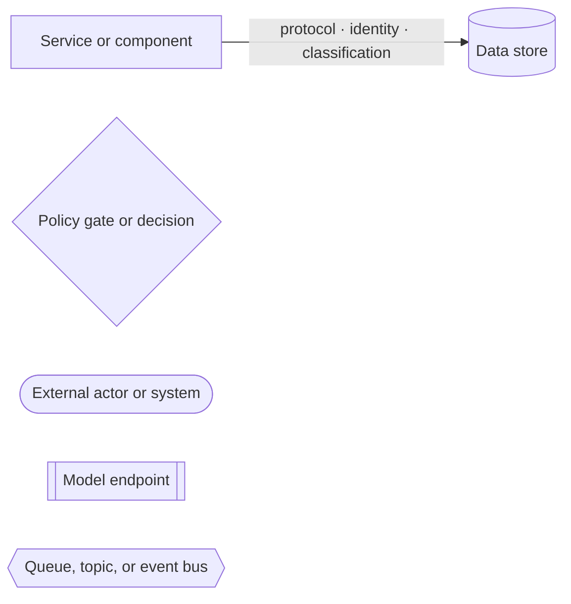
*Caption: Shapes and edge-label format used in every diagram in this document.*

## 1. System context

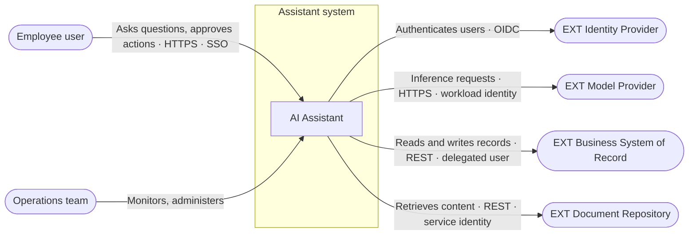
*Caption: The assistant serves employees and depends on four external systems, two of which receive confidential data.*

## 2. Container / application components

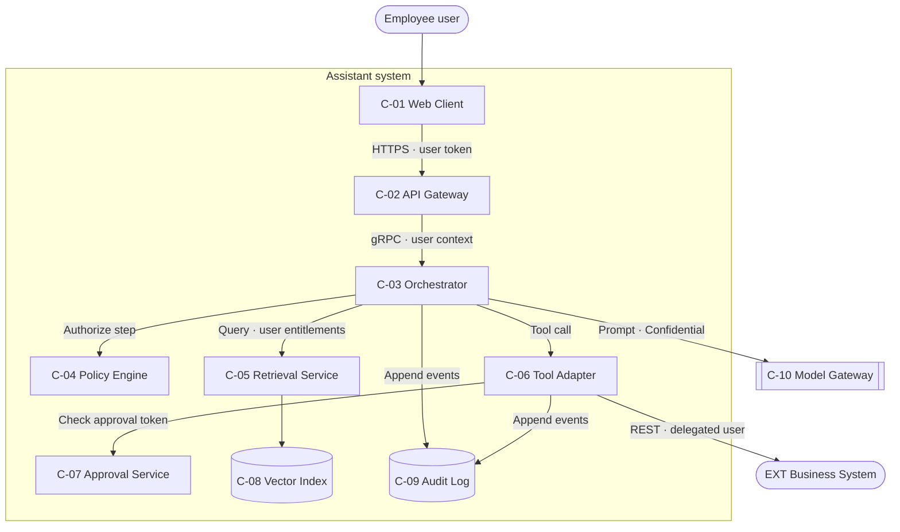
*Caption: The orchestrator coordinates retrieval, model calls, and tools, while policy and approval checks sit outside the model path.*

## 3. Component (inside one container)

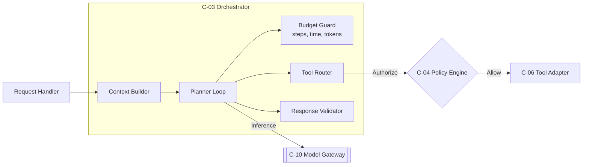
*Caption: Inside the orchestrator, every tool call is authorized by the external policy engine and every loop iteration is metered by the budget guard.*

## 4. Deployment

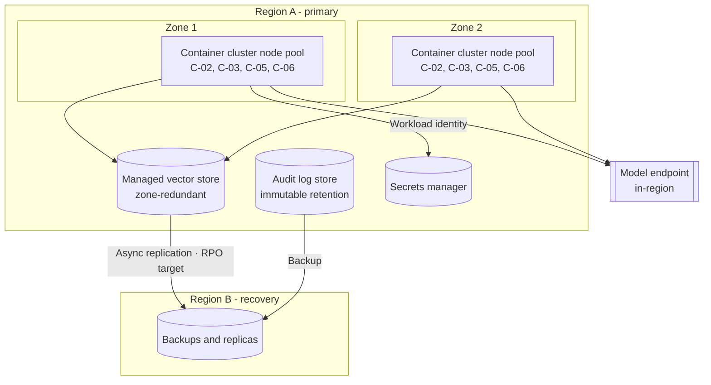
*Caption: Stateless services run across two zones in the primary region, and stateful stores replicate to a recovery region to meet the RPO target.*

## 5. Sequence: side-effecting request with approval

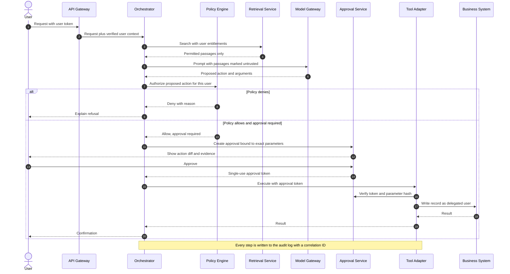
*Caption: The model proposes the action, but deterministic policy and a parameter-bound approval decide whether it executes.*

## 6. Data flow with classification

```mermaid
%% Title: Data flow — Ingestion and retrieval
flowchart LR
  SRC(["EXT Document Repository"])
  ING["C-11 Ingestion Pipeline"]
  RED["C-12 Classification and Redaction"]
  EMB[["C-13 Embedding Model"]]
  IDX[("C-08 Vector Index")]
  RET["C-05 Retrieval Service"]
  ORC["C-03 Orchestrator"]
  SRC -->|"Documents plus ACLs · Confidential"| ING
  ING --> RED
  RED -->|"Redacted text · Internal"| EMB
  EMB -->|"Vectors plus ACL metadata"| IDX
  ORC -->|"Query plus user entitlements"| RET
  RET -->|"Filtered query"| IDX
  IDX -->|"Permitted chunks · Internal"| RET
  RET --> ORC
```
*Caption: Classification and redaction run before embedding, and entitlements are enforced at query time, not only at ingestion.*

## 7. Trust boundary / security

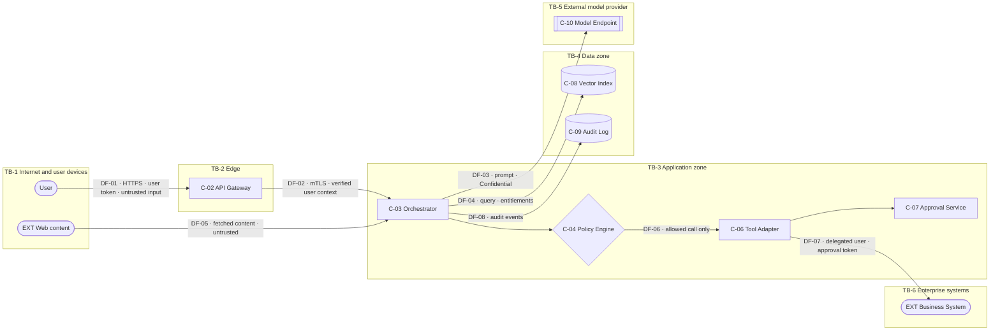
*Caption: Untrusted input enters at DF-01 and DF-05, and side effects reach enterprise systems only through the policy-gated tool adapter at DF-07.*

## 8a. Agent execution and control flow

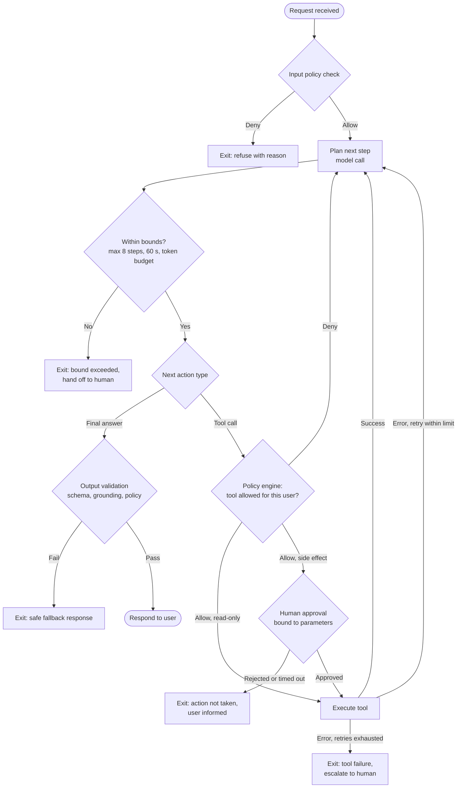
*Caption: Every iteration passes the bound check, every tool call passes the policy engine, side effects need parameter-bound approval, and each failure has an explicit exit.*

## 8b. Agent and approval state machine

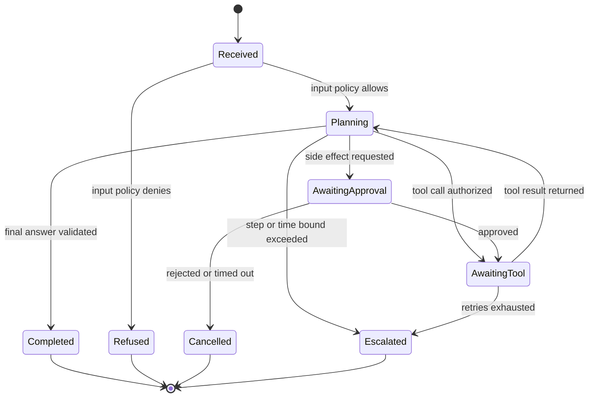
*Caption: The run reaches a terminal state on every path, and only the approved path leads to a side-effecting tool call.*

## 9. Integration / event flow

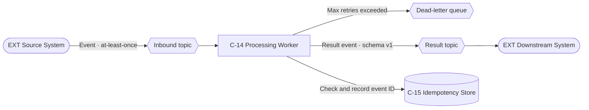
*Caption: At-least-once delivery is made safe by an idempotency store, and poison messages go to a dead-letter queue instead of retrying forever.*

## 10. Environment / network topology

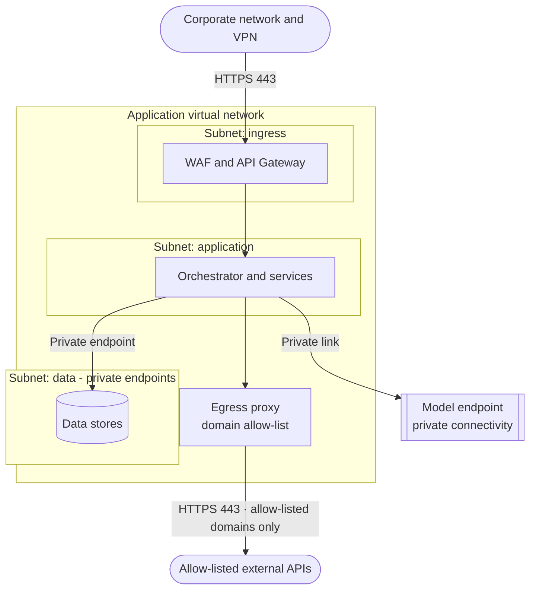
*Caption: All outbound internet traffic leaves through an allow-listing egress proxy, and data stores are reachable only through private endpoints.*

## 11a. CI/CD workflow

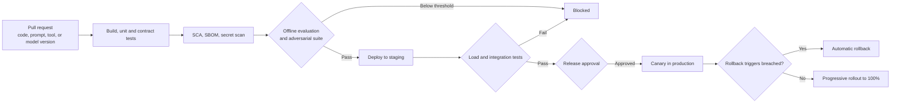
*Caption: Prompt and model changes go through the same evaluation, security, and canary gates as code changes.*

## 11b. Operational workflow: incident and rollback

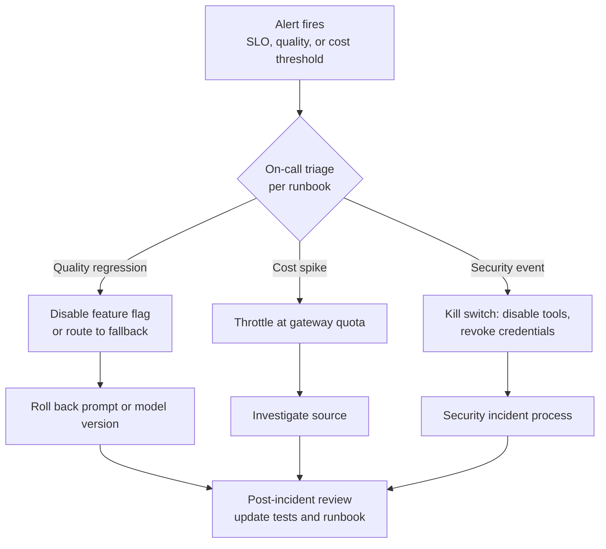
*Caption: Each alert class maps to a pre-defined containment action, and every incident ends by updating the tests and runbooks.*
