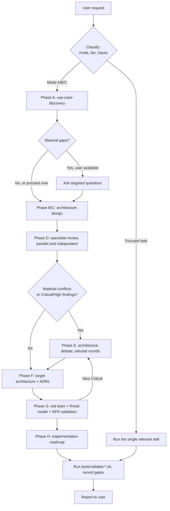

# Operating Model

This document explains how the coordinator (the main Claude Code session) runs an engagement: classify the request, choose skills and specialists, mediate review and debate, decide, and validate.

## 1. Roles

| Role | Who | Responsibilities |
|---|---|---|
| **Board chair / coordinator** | Main Claude Code session | Classifies the engagement, briefs specialists, mediates rebuttals, synthesizes, owns the final recommendation, writes the deliverables |
| **Specialists** | 9 subagents in `.claude/agents/` | Independent domain assessment. Read-only toward sources. Return structured reports. |
| **Human decision owners** | Named in the intake | Approve mandatory-constraint changes, accept residual risk, approve production |

## 2. Engagement flow

## 3. Specialist selection matrix

Invoke a specialist when the row's trigger applies. Don't invoke all nine by default.

| Specialist | Invoke when | Typically skip when |
|---|---|---|
| `enterprise-architect` | Cross-domain impact, reuse vs. build, strategic or portfolio fit, ownership questions, T3+ | A single-team tool with no enterprise dependencies |
| `solution-architect` | Any end-to-end design, interfaces, or feasibility question (almost always in Mode A/C) | A purely focused security or NFR question |
| `agentic-systems-architect` | Solution ladder rung ≥ 4 is under consideration, or the design contains agents or tools | No AI component remains after Phase B |
| `ai-platform-architect` | Model access/serving, gateways, registries, evaluation pipelines, LLMOps, shared AI platform questions | A single managed-API call with no platform concerns |
| `data-knowledge-memory-architect` | RAG, search, memory, context, data pipelines, data governance, PII | No new data stores or retrieval |
| `security-identity-architect` | Always at T2+. Any tool execution, delegated access, sensitive data, or external exposure | T1 read-only on public data. The coordinator still applies `standards/security-and-identity.md` §5 (T1 row) and the §7 G4 quick checklist |
| `integration-infrastructure-architect` | Deployment topology, network, hybrid/on-prem, IaC, enterprise integration, platform constraints | A pure design-pattern question |
| `reliability-llmops-architect` | Latency/availability/throughput targets, side-effecting actions, production readiness, cost ceilings | Early T1 prototyping |
| `red-team-architect` | Always at T3/T4. At T2 for material decisions. Whenever the user asks for an independent challenge. | T1, unless requested |

**Typical benches**

| Situation | Bench |
|---|---|
| T1 focused review | solution + one relevant domain specialist, coordinator self-check |
| T2 new design | solution, agentic (if AI), security, reliability; red team on contested decisions |
| T3 design/review | T2 bench + data, integration-infra, red team |
| T4 or enterprise platform | All nine |
| Technology decision | Relevant domain specialist(s) + `technology-evaluation` skill; red team if T3+ |

## 4. Briefing a specialist

Every brief (the Agent tool prompt) must be self-contained, because the specialist starts with no context. Include:

1. **Engagement:** use-case id, mode, tier, the question this specialist must answer.
2. **Inputs:** paths to the intake, requirements, design, and source artifacts to read. Use paths; don't paste content.
3. **Constraints:** a list of CON/PRH IDs and their text, so they can't be missed.
4. **Scope:** what is in and out of scope for this specialist, so mandates don't overlap.
5. **Independence:** in round 1, don't include other specialists' conclusions.
6. **Output:** "Return your report in the format defined in your agent instructions. Don't write files."
7. **Research:** whether to verify time-sensitive claims with WebSearch/WebFetch, and the date to cite.

Launch independent specialists **in parallel** (multiple Agent calls in one message).

## 5. Persisting specialist output

The coordinator saves each returned report verbatim to `use-cases/<id>/03-review-board/round-<n>/<agent-name>.md`, with a header showing the brief summary and date. Specialists don't write files. This keeps every reviewer read-only and the record auditable.

## 6. Conflict resolution and debate (coordinator-mediated)

1. **Collect.** Build a conflict register: claims where specialists disagree, findings rated High or Critical, and assumptions that more than one specialist depends on.
2. **Classify each conflict.** Factual (resolve with evidence or research), trade-off (resolve against prioritized requirements), or value/strategy (escalate to a human decision owner).
3. **Rebuttal round.** Send each involved specialist a new brief containing the opposing position, its evidence, and the question: "Concede, refine, or rebut with evidence." One round is the default; two is the maximum, unless new evidence appears.
4. **Decide.** The chair decides on evidence and requirement priority, not vote count. Record each decision in `03-review-board/debate-record.md` as accepted, rejected (with reason), or escalated. Material outcomes become ADRs.
5. **Red-team second pass (T3/T4).** Give the red team the synthesized target and the debate record, and ask whether the remediations are sufficient.

Stop debating when an objection is resolved, when the evidence is asymmetric and documented, or when it is escalated to a human. Don't loop for the sake of appearing rigorous.

## 7. Validation: what counts as evidence

| Check | What it proves | What it doesn't prove |
|---|---|---|
| `tools/validate-framework.sh` | Framework files, agent and skill frontmatter, internal links are structurally valid | That the instructions are good |
| `tools/validate-deliverables.sh <uc>` | Required files and sections exist for the tier; IDs are cross-referenced | That the design is correct |
| `tools/validate-diagrams.sh <path>` | Mermaid blocks are well-formed (or parse, if `mmdc` is installed) | That diagrams match reality or meet the NFRs |
| Specialist review and red team | Expert judgment against the requirements | Production behavior |
| Tests or evaluations actually run | Behavior under the tested conditions | Untested conditions |

Report every check you claim as performed with its actual observed result.

## 8. Re-opening decisions

To re-evaluate an ADR (for example, "Re-evaluate ADR-004"):
1. Run `adr-management` in revisit mode.
2. Confirm which trigger fired.
3. Run `technology-evaluation` with fresh research.
4. Run a targeted specialist or red-team review if T3+.
5. Write a new ADR that supersedes the old one. Mark the old ADR `Superseded by ADR-NNN`, and keep it.
6. Update the traceability and affected diagrams, then re-run validation.

## 9. Cost and turnaround

- Prefer the smallest sufficient bench, and parallel briefs over sequential ones.
- Reuse specialist output across phases instead of re-invoking for the same question.
- Use research only for claims that affect a decision.
