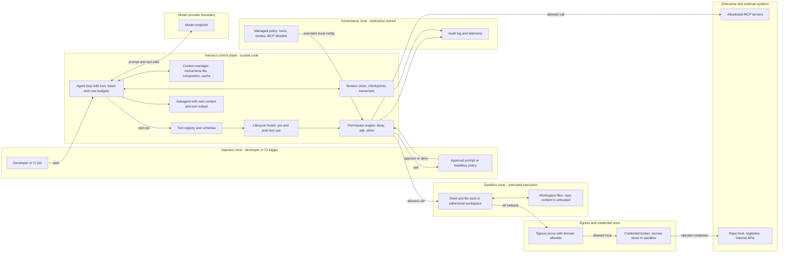

# Pattern: Agent Harness with Sandboxed Tool Execution

- **Last verified:** 2026-10-27 · **Confidence:** High for the pattern (technology-agnostic `[JUDGMENT]`); Medium for the dated product evidence, which changes quickly
- **Rung:** 6 (runtime for a single bounded agent); a cross-cutting concern when an enterprise rolls out a coding agent

This pattern describes the *inside* of an agent runtime: the harness around the model loop. `single-bounded-tool-agent.md` and `human-approved-action-agent.md` describe what an agent may do; this pattern describes how a production runtime enforces it when the tools are real (shell, files, code, data, systems) and have open-ended effects, so the boundary must come from the execution environment, not the tool schema.

## Appropriate use cases

- Coding agents that read, edit, build and test code in a repository, interactively or in CI, and data or operations agents that run scripts, queries or CLIs against real environments.
- An enterprise rollout of a vendor coding agent, where the harness already exists and the design work is governance and boundary placement.

## Preconditions and constraints

- The agentic justification (`standards/agentic-ai-design-principles.md` §1) is recorded. A "fix the failing tests" task qualifies; a fixed lint-and-format step does not (use rung 2 with rung 4 steps).
- An owner exists for harness policy (managed settings, allowed tools, MCP allowlist), separate from the developers who use it (AG-16).
- An isolation substrate (OS sandbox, container, microVM, or ephemeral cloud workspace) and an egress proxy you control exist, and credentials can be held outside the sandbox and injected by a broker.
- Version control exists for everything the agent can write (harness checkpoints are not a substitute), and model-provider data-handling terms (retention, training use, residency) are agreed for the code and data it will read.

## Architecture diagram

Every model-proposed tool call passes deterministic hooks and a permission engine governed by managed policy; execution happens in an isolated workspace whose only route out is an allowlisting proxy that injects credentials the model never sees.

## Core components

| Component | Responsibility |
|---|---|
| Agent loop | Model call → tool calls → results → repeat; stops on a final answer, turn cap, token or cost budget, wall-clock deadline, or user interrupt, and reports which (AG-02, AG-06) |
| Tool registry | Typed tool schemas, read/write classification, parallel-safe flag; separates read tools from shell and write tools (AG-03, AG-07) |
| Permission engine | Evaluates rules outside the model: deny beats ask beats allow; permission modes set the baseline (read-only/plan, accept edits, fully pre-approved for isolated runs); unresolved "ask" goes to a human prompt or, headless, to deny (AG-05, AG-08) |
| Lifecycle hooks | Deterministic interception at session start, prompt submit, pre tool use (block, rewrite, or escalate), post tool use (audit, lint, scan), compaction and stop; hooks cannot widen what managed deny rules forbid |
| Sandbox | OS- or VM-enforced filesystem and network isolation around shell and code execution; writable only to the workspace; ephemeral per task in CI or cloud |
| Egress proxy and credential broker | Single route out; domain allowlist; credential injection so tokens never enter the sandbox or the model context; traffic logging |
| Context manager | Loads the project instructions file and policy text; compacts or summarizes history near the window limit; keeps a stable prefix for prompt caching; bounds tool output size |
| Subagents | Isolated sub-contexts with their own prompt and tool subset; return a summary, not a transcript; depth-limited |
| MCP client | Connects only to allowlisted, version-pinned servers; server tool descriptions are untrusted input |
| Session store and checkpoints | Transcript, state for resume/fork, file snapshots for rewind; complements, never replaces, version control |
| Managed policy and audit | Enterprise-delivered settings that local and repo config cannot override; telemetry and audit export |

**Example realizations:** Claude Code or OpenAI Codex CLI as adopted harnesses; Claude Agent SDK or OpenAI Agents SDK, or a custom loop, when building; OS sandboxes (Seatbelt, bubblewrap), containers, gVisor or Firecracker microVMs for isolation; Envoy or Squid as egress proxy; OpenTelemetry for telemetry; `CLAUDE.md` or `AGENTS.md` as the instructions file.

## Trust boundaries

1. **Repository and workspace content → harness:** untrusted. READMEs, code comments, issue text, test output and project config files are injection vectors (AG-04). Project-scoped config that adds tools, hooks or MCP servers needs explicit trust before it takes effect.
2. **Harness → sandbox:** the main execution boundary. Anything the model asks the shell to do is assumed hostile; containment comes from the OS or VM, not from command-string rules, which match text, not intent.
3. **Sandbox → network:** only via the egress proxy. No direct route, no cloud metadata endpoint, no unlisted hosts.
4. **Credential broker → enterprise systems:** credentials live here. The model and sandbox see tool interfaces, never secrets (SEC).
5. **Developer machine or cloud sandbox → enterprise systems:** a developer laptop is a shared-kernel, credential-rich host. Prefer an ephemeral cloud or container workspace for untrusted repos or broad autonomy.
6. **Managed policy → local and repo settings:** enterprise policy sits above user and project config and cannot be overridden from a repository.

## NFR implications

- **Latency and cost:** dominated by model turns, context size and build/test time. Sandboxes add little; microVMs add start-up time. Compaction, caching, subagents and per-task caps keep cost bounded.
- **Reliability:** non-deterministic paths. Measure task success over repeated runs, plus the rate of permission denials and budget stops.
- **Recoverability:** checkpoints give session-level undo of file edits only; shell side effects and external calls need version control, idempotency, or a disposable environment.
- **Auditability:** transcripts plus policy decisions must be exportable to enterprise logging, especially for headless runs where no human watched.

## Security considerations

- Default-deny egress with a domain allowlist; remember a hostname allowlist without TLS inspection can be evaded by domain fronting.
- Deny reads of credential files (`.env`, cloud CLI credentials, SSH keys) even inside the sandbox; mount only what the task needs. In CI, scope API keys to the agent step, never to repository-controlled build steps in the same job.
- Fully pre-approved modes only inside disposable, network-restricted environments; disable them by managed policy elsewhere.
- Hooks and permission rules are policy, not a sandbox: use them to block and audit, and rely on OS/VM isolation for containment. The agent cannot edit its own policy, hooks or harness config (AG-16); protect those paths from sandboxed writes.
- MCP: allowlist by URL or command, not by user-chosen name; review tool descriptions; treat server output as untrusted (AG-04).
- Supply chain: malicious repos, poisoned dependencies, and instruction files written to steer the agent. Pair repo trust prompts with sandboxing, dependency scanning and pinned registries.

## Operational requirements

- Managed policy distribution (MDM or server-delivered), with versioning and a test ring before fleet rollout.
- Approved catalog of tools, MCP servers and plugins with owners and review dates, plus developer guidance on what to approve, how to rewind, and when to use an ephemeral workspace.
- Telemetry (sessions, tool calls, denials, approval rates, cost per task, MCP usage) with alerts on bypass attempts, and a kill switch that revokes harness credentials or pushes a deny-all policy within minutes.
- Eval suite per harness configuration: representative tasks plus adversarial repos (injected instructions, exfiltration attempts, budget exhaustion) (AG-10).

## Failure modes

| Failure | Mitigation |
|---|---|
| Prompt injection from repo content triggers exfiltration | Egress allowlist; credentials outside sandbox; deny network tools by default |
| Approval fatigue: users click "yes" to everything | Narrow allow rules for safe commands; sandboxed auto-approval; show exact command and target |
| Unbounded loop or cost blow-out | Turn, token and cost caps; repeated-call detection; headless timeouts |
| Context overflow loses early instructions | Persistent rules in instructions file; guided compaction; subagents for verbose work |
| Rewind does not undo shell or subagent changes | Commit before tasks; ephemeral workspaces; treat checkpoints as convenience only |
| Malicious MCP server or plugin | Managed allowlist by URL/command; pinning; denylist; usage monitoring |
| Headless run loads untrusted repo hooks or servers | Minimal/bare startup in CI; explicit config only; ignore project-scoped config |
| Sandbox escape via shared kernel | gVisor or microVM for untrusted code or multi-tenant use |

## Cost drivers

Model tokens per task (often tens of turns `[JUDGMENT]`), reduced by prompt caching of the stable prefix; context growth from tool output; subagent fan-out; ephemeral compute for cloud workspaces; proxy and telemetry infrastructure; policy-team effort to maintain allowlists; seat or usage licences for an adopted harness.

## Adopt vs build

| Signal | Adopt an existing harness | Build on an agent SDK or custom loop |
|---|---|---|
| Task and users | Software engineering by developers at a terminal, IDE or CI | Domain workflow with bespoke tools and UI, for business users or an unattended service |
| Controls needed | Covered by vendor managed policy, sandbox, hooks, MCP allowlist | Must embed enterprise PDP, approval service or tenant isolation |
| Change rate | Accept vendor cadence; pin and ring-test versions | Need to own the release cycle |
| Data terms | Vendor terms acceptable | Must route only through an approved model gateway |

Default `[JUDGMENT]`: adopt for coding agents (AP-06); building a coding harness repeats years of security hardening. Build, ideally on an SDK that already provides the loop, permissions and hooks, when the agent is a product feature or must sit inside an existing enterprise control plane. Either way the enterprise owns governance: managed settings, allowed tools and modes, MCP allowlist, audit export, data-handling terms, and supply-chain review.

## Observed in production harnesses (dated evidence)

All accessed 2026-10-27; vendor behaviour changes often, so re-verify before relying on a row. Vendor data-retention and training-use terms were not researched here `[UNVERIFIED]`: confirm them in the contract before rollout.

| Element | Claude Code / Claude Agent SDK | OpenAI Codex |
|---|---|---|
| Loop and budgets | Loop repeats until a response has no tool calls; `maxTurns` and `maxBudgetUsd` caps, both unlimited by default; automatic compaction near the window limit; stable prefix prompt-cached `[VENDOR]` (source: https://code.claude.com/docs/en/agent-sdk/agent-loop) | `[UNVERIFIED]`: loop-budget options not checked; validate in the config reference |
| Permissions | Rules evaluated deny, then ask, then allow; modes include `plan`, `acceptEdits`, `dontAsk`, `auto`, `bypassPermissions`; managed `disableBypassPermissionsMode` and `allowManagedPermissionRulesOnly` `[VENDOR]` (source: https://code.claude.com/docs/en/permissions) | Approval policies `on-request` and `never`; `untrusted` no longer selectable `[VENDOR]` (source: https://learn.chatgpt.com/docs/sandboxing) |
| Sandbox | Off by default; Seatbelt on macOS, bubblewrap on Linux/WSL2; writes limited to working dir; network via proxy with allowlist that starts empty; reads broadly allowed unless denied `[VENDOR]` (source: https://code.claude.com/docs/en/sandboxing) | Modes `read-only`, `workspace-write`, `danger-full-access`; Seatbelt on macOS, bubblewrap on Linux/WSL2, native Windows sandbox `[VENDOR]` (source: https://learn.chatgpt.com/docs/sandboxing); `:workspace` keeps `.git`, `.codex`, `.agents`, `.aws` read-only `[VENDOR]` (source: https://learn.chatgpt.com/docs/permissions). Network off by default in `workspace-write` `[UNVERIFIED]`: seen only in search summaries |
| Hooks | `PreToolUse` can allow, deny, ask or rewrite input; exit code 2 blocks; hooks cannot override deny rules `[VENDOR]` (source: https://code.claude.com/docs/en/hooks; https://code.claude.com/docs/en/permissions) | `[UNVERIFIED]`: equivalent lifecycle hooks not checked |
| Instructions file | `CLAUDE.md`, can also read `AGENTS.md`; treated as context, not enforcement `[VENDOR]` (source: https://code.claude.com/docs/en/memory) | `AGENTS.md` chain from repo root to cwd, override files, 32 KiB default cap `[VENDOR]` (source: https://learn.chatgpt.com/docs/agent-configuration/agents-md) |
| Subagents and checkpoints | Own context window and tool allowlist; default nesting up to three levels `[VENDOR]` (source: https://code.claude.com/docs/en/sub-agents); checkpoint snapshot before each prompt; `/rewind`; Bash-only and most subagent edits not restored `[VENDOR]` (source: https://code.claude.com/docs/en/checkpointing) | `[UNVERIFIED]` |
| MCP governance | `managed-mcp.json` exclusive control; `allowedMcpServers`/`deniedMcpServers` by URL or command; name matching "is not a security control" `[VENDOR]` (source: https://code.claude.com/docs/en/managed-mcp) | MCP server enabled only when name and identity match an approved entry in managed requirements `[VENDOR]` (source: https://learn.chatgpt.com/docs/enterprise/managed-configuration) |
| Managed policy | Managed settings override CLI, local, project and user scopes `[VENDOR]` (source: https://code.claude.com/docs/en/settings) | `requirements.toml` with `allowed_approval_policies`, `allowed_sandbox_modes`; cloud requirements outrank system ones `[VENDOR]` (source: https://learn.chatgpt.com/docs/enterprise/managed-configuration) |
| Headless and credentials | `-p` mode; without `--bare` it loads project hooks and `.mcp.json` servers with no trust prompt `[VENDOR]` (source: https://code.claude.com/docs/en/headless); recommends a proxy outside the boundary that injects credentials so "the agent never sees" them `[VENDOR]` (source: https://code.claude.com/docs/en/agent-sdk/secure-deployment) | `codex exec` defaults to a read-only sandbox; keep API keys off job-level env `[VENDOR]` (source: https://learn.chatgpt.com/docs/non-interactive-mode); treat `~/.codex/auth.json` as a password `[VENDOR]` (source: https://learn.chatgpt.com/docs/non-interactive-mode) |

## When NOT to use

- The steps are known (format, lint, generate from template). Use a workflow with LLM steps; no shell needed.
- Tools are a few typed APIs with bounded effects. Use `single-bounded-tool-agent.md`; a sandbox adds cost without reducing risk.
- The agent's actions are consequential business writes. Use `human-approved-action-agent.md`; a sandbox contains code execution, not business impact.
- No one can own policy, allowlists and audit. Fix the operating model before rolling out a coding agent.

## Solution-ladder rung

Rung 6. Subagents used only to isolate context keep it at rung 6; it becomes rung 7 only when sub-agents have distinct permissions, owners, or separable work that passes §1.2. Adopting a vendor harness is a rung-0 decision for the runtime ("configure an existing product"), and the governance controls above still apply.
