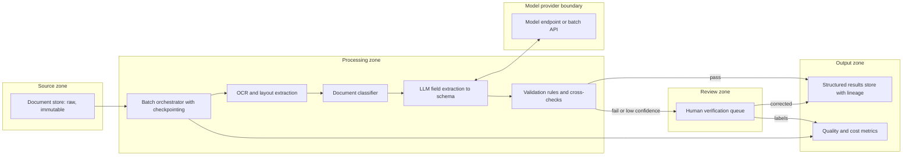

# Pattern: Batch Document Intelligence

- **Last verified:** 2026-10-27 · **Confidence:** High (technology-agnostic pattern)
- **Rung:** 2 (batch orchestration) with rung 3 (OCR/layout/classic ML) and rung 4 (LLM extraction) steps

## Appropriate use cases

- Backlog digitization: extract structured data from thousands to millions of contracts, invoices, forms, permits, or legacy archives.
- Periodic batches: monthly statement review, compliance sampling, document classification for retention.
- Enrichment of a document estate before RAG ingestion (metadata, classification, PII tagging).

## Preconditions and constraints

- Target schema per document type is defined with field-level validation rules.
- A labelled sample per document type exists for evaluation (field-level precision/recall).
- Throughput deadline and budget are known; batch windows fit model quota or batch APIs.
- Source documents' classification and residency permit the chosen processing location.

## Architecture diagram

A checkpointed batch pipeline layers OCR and classification under LLM extraction, validates every field, and routes exceptions to human verification with lineage retained.

## Core components

| Component | Responsibility |
|---|---|
| Raw document store | Immutable originals; document hash as identity |
| Batch orchestrator | Partitioning, checkpointing, retries, rate control, resumability |
| OCR/layout | Text, tables, reading order; script/language handling (including RTL scripts where relevant) |
| Classifier | Route by document type (rules, classic ML, or LLM) |
| LLM extraction | Schema-constrained extraction with evidence spans/page references |
| Validation | Field formats, cross-field and reference-data checks, totals reconciliation |
| Human verification | Exception handling; labels feed evaluation |
| Results store | Extracted fields + lineage (document hash, page, model/prompt version) |

**Example realizations:** Azure AI Document Intelligence, Amazon Textract, Google Document AI, or Docling/Tesseract for OCR; provider batch APIs for cost-efficient extraction; Airflow, Durable Functions, Step Functions, or Temporal for orchestration.

## Trust boundaries

1. Source documents are untrusted content (embedded instructions, malformed files).
2. Processing zone → model provider: document content leaves the zone; classification and residency apply.
3. Human reviewers see sensitive documents: role-based access and logging.

## NFR implications

- **Throughput/deadline:** compute from documents × pages × tokens vs quota or batch API turnaround.
- **Accuracy:** field-level metrics per document type; straight-through rate is the business KPI.
- **Resumability:** a batch of a million documents must resume from checkpoints, not restart.
- **Lineage:** every value traceable to document, page, and processing version.

## Security considerations

- File-type validation and malware scanning before parsing.
- Least-privilege read on raw store; write-only to results; no model access to other documents.
- PII handling per field; mask in review UI where not needed.
- Retention: intermediate artifacts (OCR text, prompts, outputs) have defined deletion.

## Operational requirements

- Batch dashboards: progress, throughput, error categories, cost to date vs budget.
- Sampling QA on auto-accepted outputs to detect silent quality loss.
- Re-run capability by document type after prompt/model changes.

## Failure modes

| Failure | Mitigation |
|---|---|
| OCR quality poor on scans/handwriting | Quality score gate; route to human or specialist OCR |
| Hallucinated field values | Require evidence spans; validate against document text |
| Batch API delays/expiry | Chunked submissions; deadline monitoring; synchronous fallback for urgent partitions |
| Budget overrun | Pre-flight cost estimate; per-batch budget stop |
| Schema drift across document variants | Per-variant eval slices; classifier routing |

## Cost drivers

Pages × OCR price; tokens per page × model price (batch APIs are typically discounted `[UNVERIFIED]` per provider); human verification effort; reprocessing runs.

## When NOT to use

- Documents are highly standardized templates. Template-based extraction or OCR + rules suffices (rung 1/3).
- Real-time per-document processing is required. Use event-driven processing.
- The goal is Q&A over documents rather than structured data. Use enterprise RAG.

## Solution-ladder rung

Rung 2 orchestration with rung-3 and rung-4 steps. Agents are rarely justified here.
