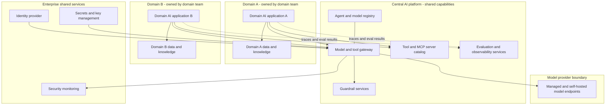

# Pattern: Central Platform with Domain Applications

- **Last verified:** 2026-10-27 · **Confidence:** Medium (pattern sound; the right degree of centralization is organization-specific)
- **Rung:** Cross-cutting (organizational and platform pattern)

## Appropriate use cases

- Several domain teams building AI applications that need the same capabilities: model access, guardrails, evaluation tooling, observability, MCP/tool catalog, identity patterns.
- Enterprises needing consistent governance (cost, residency, safety, audit) without centralizing every application.
- Reducing duplicated contracts, gateways, and vector stores across teams.

## Preconditions and constraints

- At least two or three domain consumers with overlapping needs. A platform for one consumer is premature.
- A platform team with a product mindset: roadmap, SLAs, documentation, support.
- Clear split of responsibilities: the platform provides capabilities and guardrails; domains own use cases, prompts, data, evaluation thresholds, and outcomes (AP-05, AP-06).
- Funding/chargeback model agreed.

## Architecture diagram

Domain teams own their applications and data, while a central platform provides shared, governed model access, guardrails, tool catalog, registry, and evaluation services.

## Core components

| Component | Owner | Responsibility |
|---|---|---|
| Domain AI applications | Domain team | Use-case logic, prompts, retrieval, domain evaluation thresholds |
| Domain data and knowledge | Domain team | Content, ACLs, quality, indexes |
| Model and tool gateway | Platform | Access control, quotas, metering, routing, logging |
| Guardrail services | Platform (policy owners: security) | Shared classifiers and policy checks, configurable per app |
| Tool/MCP catalog | Platform (tool owners: domains) | Discovery, approval, versioning of shared tools |
| Evaluation and observability | Platform | Shared tooling and dashboards; domains own datasets and thresholds |
| Registry | Platform | Inventory and lifecycle state of agents/models |

**Example realizations:** Azure API Management or another AI gateway; Microsoft Foundry projects per domain on a shared hub-style setup; Backstage for the catalog; OpenTelemetry collector plus an APM and an LLM observability tool.

## Trust boundaries

1. Domain ↔ domain: isolation of data, indexes, prompts, and traces. One domain can't read another's content through shared platform services.
2. Domain → platform: workload identity per application; quotas and policies per application.
3. Platform → providers: single governed egress to model endpoints.
4. Platform admins: privileged access to shared logs. Restrict and audit it.

## NFR implications

- **Availability:** the gateway is a shared critical dependency. Its SLO must exceed every consumer's.
- **Latency:** each shared hop adds latency; keep the request path short (gateway + model), and keep evaluation and tracing asynchronous.
- **Scalability:** noisy-neighbour control via per-application quotas.
- **Delivery speed:** the platform must not become a bottleneck. Self-service onboarding is an NFR.

## Security considerations

- Multi-tenant isolation in every shared service (logs, caches, eval stores, vector indexes if shared).
- Central policy enforcement for model access and residency; domain-specific policy remains with domains.
- Shared tools in the catalog carry owner, permissions, and review status. Catalog approval ≠ authorization for every app.

## Operational requirements

- Platform SLOs, on-call, status page, and versioned APIs with deprecation policy.
- Per-application cost attribution and budgets.
- Onboarding path (templates, golden path) and escalation route for platform gaps.

## Failure modes

| Failure | Mitigation |
|---|---|
| Platform becomes a bottleneck | Self-service, clear scope, escape hatch via ADR |
| Gateway outage takes down all AI apps | Zone/region redundancy; capacity headroom; documented degradation per app |
| Cross-tenant leakage via shared cache/logs | Tenant-scoped keys and storage; isolation tests |
| Over-centralization (platform owns use-case logic) | Ownership split recorded; domain-owned prompts and evals |
| Shadow AI outside the platform | Make the platform the easiest path; egress controls |

## Cost drivers

Platform team; shared gateway and observability infrastructure; enterprise model commitments (shared capacity can lower unit cost); onboarding and support effort.

## When NOT to use

- One AI application, or teams with no overlapping needs. Build within the application and revisit later.
- Using the platform to force every use case through one framework or one model. That violates "reuse without forced centralization" (AP-06).
- The organization can't fund a platform team. A thin set of shared standards and an existing API gateway may suffice.

## Solution-ladder rung

Cross-cutting; does not change any application's rung. Justify it by measured duplication or governance risk across domains.
