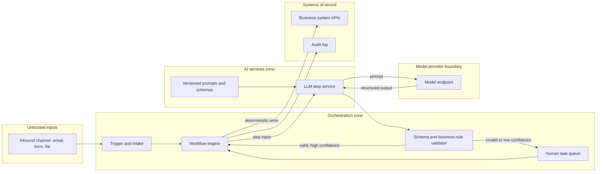

# Pattern: Deterministic Workflow with LLM Steps

- **Last verified:** 2026-10-27 · **Confidence:** High (technology-agnostic pattern)
- **Rung:** 2 (workflow) hosting rung-4 steps

## Appropriate use cases

- Known multi-step business processes where individual steps need language understanding: classify an inbound email, extract fields from a letter, summarize a case, draft a reply for review.
- Integration-heavy processes already automated (or automatable) on a workflow platform, where AI improves one or two steps.
- Processes requiring an audit trail per instance, SLAs, retries, and human tasks.

## Preconditions and constraints

- The process steps and branches can be enumerated. The LLM decides *content*, not *control flow*, except through validated, enumerated outputs (e.g. a category from a fixed list).
- Each LLM step has an output schema, a quality metric, and a threshold.
- A workflow engine or automation platform exists or is justified (reuse first).
- Systems of record expose APIs the workflow can call with a workload identity.

## Architecture diagram

The workflow engine owns control flow and writes; the LLM step only returns structured output that deterministic validation accepts or routes to a human.

## Core components

| Component | Responsibility |
|---|---|
| Trigger and intake | Receive input, assign correlation ID, store raw payload |
| Workflow engine | Control flow, retries, timeouts, compensation, instance state |
| LLM step service | Build prompt from versioned template, call model, parse to schema |
| Validator | Schema validation, business rules, confidence thresholds (deterministic) |
| Human task queue | Review of exceptions; corrections feed the eval set |
| Business system APIs | All state changes, called by the workflow with its own identity |
| Audit log | Per-instance record incl. model/prompt version |

**Example realizations:** n8n, Azure Logic Apps, Power Automate, Camunda, or Temporal as the engine; a small FastAPI/ASP.NET service or the platform's AI node as the LLM step; a managed model endpoint.

## Trust boundaries

1. Untrusted input → orchestration: content may contain prompt-injection payloads; treat it as data.
2. Orchestration → model provider: data classification decides what may be sent; private connectivity where required.
3. LLM output → orchestration: model output is untrusted until validated.
4. Orchestration → systems of record: workload identity with least privilege; the LLM has no direct access.

## NFR implications

- **Latency:** each LLM step adds seconds; acceptable for asynchronous processes, not for tight synchronous UIs.
- **Throughput:** bounded by model quota; use queueing and concurrency limits in the engine.
- **Accuracy:** per-step metrics; straight-through-processing rate vs human-review rate is the key business metric.
- **Auditability:** strong. Every instance has a deterministic trail.

## Security considerations

- The LLM step has **no tools** and no credentials. It transforms text into a schema.
- Enumerated outputs only for anything that drives branching; reject unknown values.
- Redact or minimize sensitive fields before the model call when not needed for the task.
- Business rules and limits run in the validator/engine (AP-14), never in the prompt.

## Operational requirements

- Version prompts and schemas with the workflow definition; eval gate in CI for prompt changes.
- Monitor: schema-failure rate, low-confidence rate, human-override rate, latency, tokens per instance.
- Runbook: switch the LLM step to "always human review" (feature flag) on quality incidents.

## Failure modes

| Failure | Mitigation |
|---|---|
| Model timeout/throttle | Engine retries with backoff; dead-letter after N; human fallback |
| Schema-invalid output | Single re-ask with error; then human queue |
| Plausible but wrong extraction | Confidence thresholds, cross-field rules, sampling review |
| Prompt injection in input changes output | Enumerated outputs, validation, no tools; injection cases in eval set |
| Silent model version change | Pin model version; regression eval on change |

## Cost drivers

Tokens per instance × volume; re-asks; human review effort (often the dominant cost); workflow platform licensing per execution/edition.

## When NOT to use

- Rules or templates already achieve the accuracy (rung 1). Don't add an LLM.
- The step requires open-ended tool use whose paths can't be enumerated. Consider a bounded agent step (`single-bounded-tool-agent.md`) invoked from the workflow.
- Answers must cite enterprise knowledge (`enterprise-rag.md`).

## Solution-ladder rung

Rung 2 orchestration with rung-4 steps. This is the default first choice for AI in known processes and the recommended host for any later agentic step.
