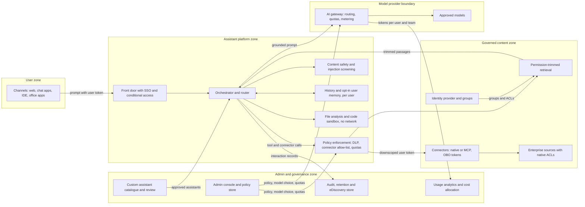

# Pattern: Enterprise Assistant / Copilot Platform

- **Last verified:** 2026-10-27 · **Confidence:** High for the technology-agnostic pattern `[JUDGMENT]`; Medium for the dated vendor evidence, which changes often (verify current status).
- **Rung:** 0 (buy or configure an existing assistant) → 5/6 (build or extend)

## Appropriate use cases

- A general-purpose conversational assistant for many employees: drafting, summarizing, analysis, Q&A over governed content, and light task help across functions.
- A single governed entry point that replaces unmanaged consumer AI tools ("shadow AI") and hosts user-built assistants under central policy.
- **Not** a single high-stakes business process. Build that as a dedicated pattern (`enterprise-rag.md`, `single-bounded-tool-agent.md`, `human-approved-action-agent.md`). You can expose it inside the assistant as a connector or a custom assistant.

## Preconditions and constraints

- **Permission hygiene comes before rollout.** The assistant finds whatever each user can already reach. Broad "everyone" shares, stale groups, and open sites become visible at once (DG-05). Run an oversharing assessment and remediation first.
- The identity provider is authoritative for users and groups, with SSO, provisioning (e.g. SCIM), and conditional access (SEC-02).
- Vendor data-use, retention, residency, and sub-processor terms are verified and dated for each model and feature in use (DG-11, `standards/data-governance.md` §6).
- Classification labels exist, or can be applied, so DLP and connector policy can act on them (DG-01).
- Records-management, legal-hold, and eDiscovery requirements for AI interactions are agreed with legal and compliance before go-live.

## Architecture diagram

Every retrieval and connector call runs with the requesting user's own downscoped identity, so the assistant can never show more than the user can already open. Admin policy is enforced outside the model, at the policy point and the gateway.

## Core components

| Component | Responsibility |
|---|---|
| Channels and front door | Web, chat-app, IDE, and office-app clients; SSO, conditional access, session handling |
| Orchestrator and router | Chooses plain chat, retrieval, connector or tool calls, file analysis, or the sandbox for each turn; applies the selected custom assistant's instructions, knowledge, and tool set |
| Policy enforcement point | Connector and tool allow-list per group; DLP on prompts, retrieved content, and outputs; per-user quotas; delegates decisions to policy, not to the model (SEC-10) |
| Permission-trimmed retrieval | Query-time security trimming across indexed sources; see `enterprise-rag.md` |
| Connectors | Native integrations or MCP servers using on-behalf-of, per-user tokens (SEC-06); vetted and version-pinned (SEC-12) |
| File upload and code sandbox | Parse user files in session scope; run generated code in an isolated, egress-blocked sandbox (see `agent-harness-sandboxed-execution.md`) |
| User memory | Opt-in, user-visible, editable, erasable; scoped per user and per project; validated writes (DG-12, AG-14) |
| Conversation history | Per-user history with admin-set retention; deletion propagates to derived copies (DG-04) |
| Content safety | Harm-category filters, jailbreak and indirect-injection classifiers; defense in depth only (SEC-04) |
| AI gateway | Model routing and approved-model list, per-user and per-team quotas, metering, fallback (see `hybrid-managed-and-self-hosted-models.md`) |
| Admin console | Connector, model, memory, retention, sharing, and custom-assistant policy; role-scoped administration |
| Custom assistant catalogue | Registry of user-built assistants with owner, scope, connectors, knowledge, sharing level, review state, and expiry (see `governed-model-and-agent-lifecycle.md`) |
| Audit and eDiscovery | Immutable interaction records (prompt, response, citations, connector calls), legal hold, export to records and SIEM tooling (SEC-08) |
| Usage analytics | Adoption, active use, feature use, cost per team; feeds chargeback and enablement |

**Example realizations:** Bought: ChatGPT Enterprise, Microsoft 365 Copilot, Claude Enterprise, or Gemini in Google Workspace, extended with connectors, MCP servers, and custom assistants. Built: an open-source chat front end (e.g. Open WebUI or LibreChat) over an AI gateway (e.g. LiteLLM or a cloud API-management gateway), an enterprise search index, and a container sandbox. These are examples, not recommendations.

## Trust boundaries

1. User → platform: authenticated user; every downstream access is attributed to this principal.
2. Platform → connectors and sources: **the main data boundary.** Per-user OBO tokens, downscoped per connector. The platform's own identity must never widen access (confused deputy, `standards/security-and-identity.md` §3).
3. Sources, files, email, and web → model: all untrusted content, an indirect prompt-injection vector.
4. Platform → model provider: only policy-permitted content crosses, under verified vendor terms and regions (DG-03, DG-11).
5. User A ↔ user B: memory, history, caches, and shared custom assistants are isolated per principal unless explicitly shared (SEC-14, DG-13).
6. Sandbox → anything: no network egress and no credentials; results return as data only.

## NFR implications

- **Latency:** time to first token for chat; connector fan-out and retrieval dominate grounded turns. Set p95 targets per route, not one global target.
- **Scale:** thousands of concurrent users with spiky, office-hours load. Quotas and gateway rate limits protect shared capacity.
- **Freshness:** permission changes and deletions must reach indexes and caches within a defined SLA (DG-07). Revocation lag is a security NFR.
- **Residency:** inference, history, memory, logs, and file storage regions must each be confirmed. Vendors may route inference across regions under load.

## Security considerations

- **Oversharing is the dominant risk.** Trimming at query time is necessary but not enough: it faithfully exposes bad permissions. Remediate broad shares, use discoverability restrictions as a temporary control, and apply label-based DLP that stops labeled content from being processed.
- **Indirect prompt injection** via shared documents, email, chat messages, and web pages. Layer the controls (SEC-09): isolate untrusted content; no consequential write tools by default; send writes through `human-approved-action-agent.md`; close exfiltration channels such as rendered images and links and open fetch tools (SEC-13).
- **Connectors and MCP servers:** admin allow-list per group, publisher vetting, scopes reviewed, per-user auth rather than one shared service account (SEC-01, SEC-12).
- **Custom assistants inherit the creator's reach.** One that embeds the creator's files or credentials and is shared organization-wide becomes a confused deputy. Shared assistants must run connectors with the *invoking* user's identity, and must not embed private knowledge without review.
- **Memory:** opt-in, user-visible, erasable, per-user scoped; memory writes come from validated summaries, so injected instructions can't persist (DG-12).
- Content safety and model refusals are defense in depth, never the access control (SEC-04).

## Operational requirements

- Oversharing assessment before each rollout wave, then on a schedule (follow the vendor's readiness blueprint where one exists). Track broadly shared sensitive sites as a KPI.
- Connector onboarding checklist per source (`standards/data-governance.md` §7), with an owner and a permission-sync lag measurement.
- Custom-assistant lifecycle: register → review by sharing scope → publish → periodic attestation → expire or retire orphans when the owner leaves.
- Kill switches per connector, model, custom assistant, and memory. Audit export to SIEM; eDiscovery, legal hold, and retention tested and evidenced.
- Adoption program: champions, role-based prompt libraries, training, and feedback loops. Measure weekly active use, not licenses assigned.
- Model change management: evaluate vendor model updates against a standing eval set before switching the default model; a degraded mode (chat without connectors) avoids total outage (AG-17).

## Failure modes

| Failure | Mitigation |
|---|---|
| Oversharing: user finds salary or M&A files via a broad share | Permission remediation first; discoverability restriction; label-based DLP; cross-user tests |
| Shadow custom assistants with embedded sensitive data, shared widely | Catalogue with owner and review; sharing scopes; invoking-user identity for connectors; expiry |
| Prompt injection from a shared doc or email exfiltrates data | No write tools by default; egress and link controls; injection screening; approval for actions |
| Memory or cache leaks across users | Per-user keys and scopes; no shared semantic cache across ACL sets; isolation tests |
| Runaway cost from heavy users, long contexts, agent loops, or premium models | Gateway quotas, budgets per team, default to cost-efficient model, alerts on outliers |
| Low adoption: licenses idle, value unproven | Phased rollout to high-value roles; enablement; usage analytics; reclaim idle seats |
| Stale or revoked access still answerable | Short token lifetimes; index permission-sync SLA; cache invalidation on permission change |

## Cost drivers

Per-seat licenses (bought) or tokens and infrastructure (built); premium-model and reasoning-token use; long contexts from files and retrieval; connector indexing and search tiers; sandbox compute; audit and history storage under long retention; permission-remediation and governance effort (often the largest one-off cost `[JUDGMENT]`); adoption and enablement staff.

## Buy vs build vs extend

| Option | Choose when | Watch for |
|---|---|---|
| **Use what is already licensed** (the copilot in the existing productivity suite) | Content mostly lives in that suite; its permission model is the one to trust | Oversharing exposure; feature gaps vs. cost of an extra seat |
| **Buy** a SaaS assistant | Need is general productivity; vendor terms, regions, and admin controls meet DG-03/DG-11 | Lock-in; overlapping seats with the suite copilot; connector coverage |
| **Extend** a bought assistant (connectors, MCP servers, custom assistants, agents) | Specific systems or workflows must be reachable from the assistant | Connector vetting, OBO auth, custom-assistant sprawl |
| **Build** on an AI gateway and open components | Residency or sovereignty rules out SaaS, required connectors can't be added, or deep customization or self-hosted models are mandated (`hybrid-managed-and-self-hosted-models.md`) | You now own safety, memory, audit, eDiscovery, and the admin console. Budget these as products, not features |

Record the decision in an ADR with lower rungs evaluated (`standards/architecture-principles.md` §4). Many enterprises end up with a hybrid: a bought assistant plus a few built domain applications exposed to it as connectors (`central-platform-domain-applications.md`).

## Observed in commercial assistants (dated evidence)

All claims accessed 2026-10-27. Vendor capabilities change often (verify current status).

| Product | Observation | Label |
|---|---|---|
| Microsoft Copilot (formerly Microsoft 365 Copilot) | "Only surfaces organizational data to which individual users have at least view permissions"; grounding via Microsoft Graph and Semantic Index honors the user's access boundary | `[VENDOR]` (source: https://learn.microsoft.com/en-us/copilot/microsoft-365/microsoft-365-copilot-privacy, accessed 2026-10-27) |
| Microsoft Copilot | Prompts, responses, and Graph data aren't used to train foundation LLMs; admins can search and set retention for interactions via Purview; users can delete activity history; admins choose which agents are allowed | `[VENDOR]` (source: same as above) |
| Microsoft Copilot | Restricted Content Discovery hides selected SharePoint sites from Copilot and org-wide search **without changing permissions**; described as a temporary governance control; propagation can take more than a week for sites with more than 500,000 items | `[VENDOR]` (source: https://learn.microsoft.com/en-us/sharepoint/restricted-content-discovery, accessed 2026-10-27) |
| Microsoft Copilot | Purview DLP can block Copilot processing of sensitivity-labeled files | `[UNVERIFIED]`: seen only in Message Center summaries; confirm on Microsoft Learn |
| Claude Enterprise | Owners set custom retention for chats, projects, and artifacts (minimum 30 days; default indefinite); some cloud-agent features are excluded; retention changes are audit-logged | `[VENDOR]` (source: https://support.claude.com/en/articles/10440198-custom-data-retention-controls-for-claude-enterprise, accessed 2026-10-27) |
| Claude Team / Enterprise | Owners control memory availability; it is off per member until they opt in; users can view, edit, pause, or reset; projects have separate memory; incognito chats don't contribute | `[VENDOR]` (source: https://support.claude.com/en/articles/11817273, accessed 2026-10-27) |
| Claude Team / Enterprise | Admins choose which connectors are enabled and for which groups; members sign in with their own accounts, or access is provisioned centrally through the IdP | `[VENDOR]` (source: https://support.claude.com/en/articles/15537633-authorize-mcp-connectors-for-your-entire-organization, accessed 2026-10-27) |
| ChatGPT Enterprise | Business content isn't used for training by default; Enterprise owners can set a custom retention policy (90-day minimum) | `[VENDOR]` (source: https://academy.openai.com/public/resources/data-governance-and-compliance, accessed 2026-10-27) |
| ChatGPT Enterprise | Admin GPT controls (third-party GPT allow or deny, action-domain allow-list, sharing limits) and a compliance-log export | `[UNVERIFIED]`: help center returned HTTP 403; seen in search snippets only |
| Gemini in Google Workspace | Workspace data isn't used to train or improve the underlying generative models outside Workspace without permission | `[VENDOR]` (source: https://support.google.com/mail/answer/14615114?hl=en, accessed 2026-10-27) |
| Gemini app (Workspace) | Vault retention rules and holds apply to Gemini app conversations and take precedence over user and admin deletion settings | `[VENDOR]` (source: https://knowledge.workspace.google.com/vault/retention/retain-gemini-app-messages-with-vault, accessed 2026-10-27) |
| Gemini in Google Workspace | Grounding respects existing Drive sharing permissions | `[UNVERIFIED]`: not confirmed in the pages retrieved |

**Cross-vendor observation** `[JUDGMENT]`: every vendor delegates access control to the source system's permissions. None of them fixes oversharing for you, so permission remediation stays the customer's job whichever option is chosen.

## When NOT to use

- The need is one well-defined process with measurable outcomes. Build that pattern directly, and optionally expose it in the assistant.
- Source permissions are known to be badly overshared and can't be remediated or restricted before rollout.
- Regulated or special-category data dominates and no vendor or built option meets residency and handling rules (`standards/data-governance.md` §2).
- You plan to build a custom general-purpose assistant only to avoid a license cost. Full lifecycle cost (safety, audit, eDiscovery, admin, adoption) usually exceeds seat cost `[JUDGMENT]`.

## Solution-ladder rung

Rung 0 when a bought or already-licensed assistant is configured, with policy, connectors, and governance. Extending it with grounded connectors or custom assistants adds rung 5 elements; agents with tools add rung 6 and need the agentic justification (`standards/agentic-ai-design-principles.md` §1). Building the platform yourself is a rung 5/6 composition. Justify it with the evidence in "Buy vs build vs extend".
