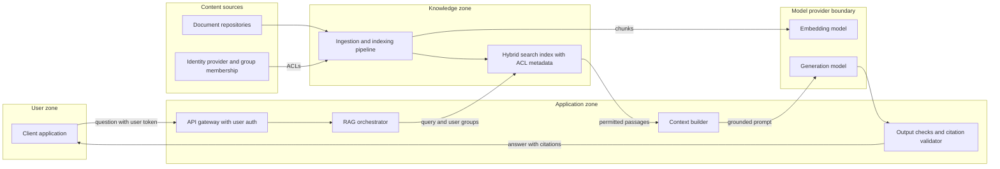

# Pattern: Enterprise RAG

- **Last verified:** 2026-10-27 · **Confidence:** High (technology-agnostic pattern)
- **Rung:** 5

## Appropriate use cases

- Employee or customer Q&A over policies, procedures, product documentation, contracts, or technical manuals, where answers must cite sources.
- Assisted drafting grounded in approved content.
- Search experiences where users want a synthesized answer plus links, not just a result list.

## Preconditions and constraints

- Content sources are identified, owned, and of acceptable quality. RAG amplifies stale or contradictory content.
- Source **access controls are known and can be propagated** to the index (document- or chunk-level). Without this, the pattern leaks data.
- An evaluation set of real questions with expected sources/answers exists or can be built.
- Residency and classification rules permit sending retrieved passages to the chosen model.

## Architecture diagram

Retrieval is trimmed by the requesting user's permissions before any content reaches the model, and answers are checked for valid citations before display.

## Core components

| Component | Responsibility |
|---|---|
| Ingestion pipeline | Parse, chunk, enrich, embed; carry ACLs, source URI, version, timestamps; propagate updates and deletions |
| Hybrid search index | Lexical + vector retrieval with filters; security trimming at query time |
| RAG orchestrator | Query rewriting (optional), retrieval, re-ranking, prompt assembly, model call |
| Context builder | Token budgeting; marks retrieved text as untrusted data |
| Output checks | Citation validity (cited passages were retrieved), groundedness checks, content safety |
| Identity provider | User identity and group membership used for trimming |

**Example realizations:** Azure AI Search, Elasticsearch/OpenSearch, or PostgreSQL + pgvector as the index; Document Intelligence/Docling/Unstructured for parsing; a managed embedding and generation model; orchestration in plain code or a framework.

## Trust boundaries

1. User → application: authenticated user token; the orchestrator acts on behalf of the user for retrieval.
2. Sources → ingestion: documents are untrusted content (they may contain injected instructions).
3. Index → model: only permission-trimmed passages cross; classification rules apply.
4. Model → user: output is untrusted until checked.

## NFR implications

- **Latency:** retrieval + re-rank + generation; streaming improves perceived latency. Set p95 targets per stage.
- **Freshness:** index-update latency is an NFR (how long until a changed or deleted document stops being cited?).
- **Quality:** retrieval recall@k and answer groundedness measured separately; most failures are retrieval failures.
- **Scale:** corpus size drives index choice; a separate vector database is often unnecessary (`technology-catalog.md` §3.3).

## Security considerations

- **Security trimming must be enforced in the retrieval query** with the user's groups, not by asking the model to ignore content.
- Deletion and permission changes must propagate to the index (and caches) within a defined SLA.
- Indirect prompt injection via documents: delimit retrieved content, give the model no tools in pure RAG, and validate output.
- Semantic caches must be scoped per ACL set or disabled. Shared caches leak answers across permission groups.
- OWASP LLM08:2025 Vector and Embedding Weaknesses applies directly `[VERIFIED]` (source: https://genai.owasp.org/llm-top-10/, accessed 2026-10-27).

## Operational requirements

- Ingestion monitoring: documents processed, failures, lag, ACL sync status.
- Offline eval on every change to chunking, embedding model, retrieval parameters, prompt, or model.
- Feedback capture (thumbs, corrections) routed to content owners and the eval set.
- Re-index plan for embedding model changes.

## Failure modes

| Failure | Mitigation |
|---|---|
| Answer from a document the user can't access | Query-time trimming; ACL tests in eval set |
| Stale/deleted content cited | Change-feed ingestion; deletion SLA; index version in traces |
| Confident answer with no supporting passage | "Answer only from sources" contract + groundedness check + abstain path |
| Poor retrieval for jargon/acronyms/IDs | Hybrid lexical+vector; synonym maps; re-ranker |
| Injected instructions in a document | Data delimiting; no tools; output checks |

## Cost drivers

Embedding the corpus (and re-embedding on model change); index service tier and replicas; generation tokens (retrieved context dominates input tokens); re-ranker calls; content curation effort.

## When NOT to use

- Users need to find documents, not answers. Use search (rung 3).
- Content is small and stable enough to fit a curated prompt or FAQ.
- ACLs cannot be propagated and content is not uniformly accessible. Fix that first.
- The task requires actions in systems. Combine with an agent pattern instead.

## Solution-ladder rung

Rung 5. Retrieval can also be exposed as a read-only tool to a rung-6 agent, but escalate only if task paths cannot be enumerated.
