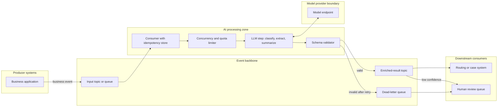

# Pattern: Event-Driven AI Processing

- **Last verified:** 2026-10-27 · **Confidence:** High (technology-agnostic pattern)
- **Rung:** 2 (event-driven) with rung-4 steps

## Appropriate use cases

- React to business events with AI enrichment: classify and route new support tickets, summarize new case notes, extract entities from uploaded documents, tag incoming transactions for review.
- High or bursty volumes where synchronous calls would overload model quotas.
- Decoupling producers (business systems) from AI consumers owned by different teams.

## Preconditions and constraints

- An event backbone exists (or is justified) with retention, replay, and dead-letter support.
- Each event can be processed independently, or ordering keys are defined.
- Consumers can be idempotent (an event may be delivered more than once).
- Downstream consumers accept eventual consistency (AI results arrive seconds to minutes later).

## Architecture diagram

Consumers pull events at a rate the model quota can sustain, validate each AI result, and publish enriched events or dead-letter failures for review.

## Core components

| Component | Responsibility |
|---|---|
| Event backbone | Durable delivery, retention, replay, partitioning, DLQ |
| Consumer | Deserialize, deduplicate (idempotency key = event ID), checkpoint offsets |
| Limiter | Concurrency matched to model quota; backpressure instead of throttling storms |
| LLM step | Stateless transformation to schema |
| Validator | Schema + business rules; confidence routing |
| Result topic | Enriched event with model/prompt version and correlation to the source event |

**Example realizations:** Kafka, Azure Event Hubs/Service Bus, Amazon SQS/EventBridge, Google Pub/Sub; consumers on Functions, Container Apps (KEDA-scaled), or Kubernetes; n8n event triggers for low volume.

## Trust boundaries

1. Producers → backbone: event payloads may carry untrusted user content.
2. Consumer → model provider: classification rules decide what fields are sent.
3. AI result → downstream: enriched events are advisory unless validated; downstream systems must not treat model output as authoritative for decisions requiring determinism.

## NFR implications

- **Throughput:** governed by model quota (tokens/minute and requests/minute), not consumer count.
- **Latency:** queueing delay under burst; define a freshness SLO (e.g. p95 event-to-result).
- **Durability:** replay enables reprocessing after a prompt/model fix.
- **Ordering:** partition by entity key where order matters; most AI enrichment does not need global order.

## Security considerations

- Least-privilege consumer identities per topic; no shared connection strings.
- Payload minimization before the model call; avoid sending full records when a few fields suffice.
- Poison messages crafted to trigger expensive or harmful model behavior: size limits, content checks, DLQ.
- Results topic access control: enriched events may contain derived sensitive data (summaries of confidential cases).

## Operational requirements

- Lag, throughput, DLQ depth, schema-failure rate, cost per event.
- Replay runbook (including how to avoid duplicate downstream effects).
- Autoscaling on lag, capped by quota.

## Failure modes

| Failure | Mitigation |
|---|---|
| Throttling storm when scaling out | Limiter tied to quota; exponential backoff with jitter |
| Duplicate processing | Idempotency store keyed on event ID |
| Poison message blocks partition | Bounded retries then DLQ; skip-and-continue |
| Prompt bug corrupts many results | Version tag on results; replay after fix; canary consumers |
| Model outage | Backlog accumulates safely; alert on lag; optional fallback deployment |

## Cost drivers

Tokens × event volume (the dominant cost; filter events that don't need AI); reprocessing on replay; backbone throughput units; consumer compute.

## When NOT to use

- The user waits synchronously for the result. Use a request/response service.
- Volume is low and an existing workflow platform already triggers on the event.
- Strict per-entity transactional consistency is required across steps. Use a workflow or durable execution engine.

## Solution-ladder rung

Rung 2 with rung-4 steps. Escalate a consumer to a bounded agent only with the rung-6 justification.
