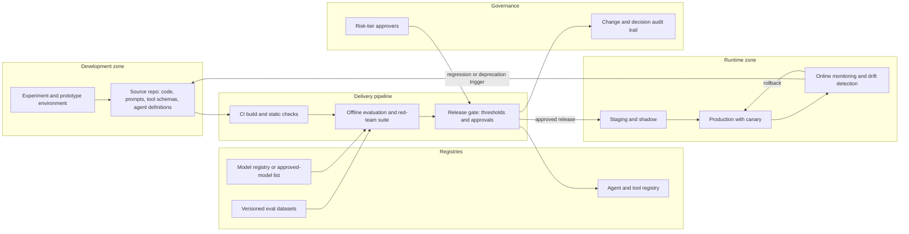

# Pattern: Governed Model and Agent Lifecycle

- **Last verified:** 2026-10-27 · **Confidence:** High (technology-agnostic pattern)
- **Rung:** Cross-cutting (required for production AI at T2+)

## Appropriate use cases

- Any production system containing models, prompts, tools, or agents that change over time.
- Organizations needing evidence for audit or regulation that each AI change was evaluated and approved.
- Platform teams providing a standard path to production for domain AI applications.

## Preconditions and constraints

- Every AI artifact is versioned: model ID + version, prompt templates, tool schemas, retrieval configuration, agent definitions, guardrail configuration (AP-08).
- Evaluation sets exist with numeric release thresholds (G8).
- Approval roles are defined per risk tier (G10).
- An inventory (registry) of agents and models in production exists or will be created.

## Architecture diagram

Every change to code, prompts, tools, or models passes the same evaluation and approval gate, is registered, rolls out progressively, and is monitored with triggers back to the start.

## Core components

| Component | Responsibility |
|---|---|
| Source repository | Single source of truth for prompts, tool schemas, agent definitions, configuration |
| CI | Build, unit tests, schema checks, secret scanning, dependency/model artifact scanning |
| Offline evaluation | Quality, safety, and adversarial suites against versioned datasets |
| Release gate | Numeric thresholds + tier-appropriate human approval |
| Model registry / approved list | Allowed models and versions with eval evidence and retirement dates |
| Agent and tool registry | Owner, purpose, version, identity, tools/permissions, risk tier, lifecycle state |
| Progressive rollout | Shadow → canary → full, with automated rollback triggers |
| Online monitoring | Quality sampling, safety signals, drift, cost, deprecation notices |
| Audit trail | Who changed what, evidence, approvals |

**Example realizations:** GitHub Actions/Azure DevOps pipelines; MLflow, Azure ML, or Foundry for registries and evaluations; promptfoo/Ragas/Inspect for eval suites; Backstage or a CMDB for the agent registry; feature flags for rollout.

## Trust boundaries

1. Experiment → repository: prototypes are not production; promotion requires the pipeline.
2. Pipeline → production: only the pipeline identity deploys; no manual prompt edits in production.
3. External model/artifact sources → registry: supply-chain review before approval.

## NFR implications

- **Change lead time:** gates add time. Size eval suites so a prompt change can pass in minutes to hours, not days.
- **Reproducibility:** any production response is attributable to exact artifact versions.
- **Compliance evidence:** gate records support audits and regulatory obligations.

## Security considerations

- Prompt and tool-definition changes are security-relevant changes (they alter agent behavior and permissions). Review them like code.
- Eval datasets may contain sensitive data: access control and retention.
- Registry is authoritative for permissions; runtime enforcers read from it rather than from agent self-description.
- Model artifacts: hash pinning, provenance, license, and serialization-safety checks (OWASP LLM03 Supply Chain, 2025 edition `[VERIFIED]`, source: https://genai.owasp.org/llm-top-10/, accessed 2026-10-27).

## Operational requirements

- Deprecation register with dates and owners; alerts ahead of provider retirement dates.
- Scheduled re-evaluation (e.g. quarterly) even without changes, to detect provider-side drift.
- Retirement procedure: disable, revoke identities and credentials, archive traces and evidence, remove from registry.

## Failure modes

| Failure | Mitigation |
|---|---|
| Hot-fix prompt edited in production | Runtime loads prompts only from versioned artifacts; config drift detection |
| Eval set overfit or stale | Held-out test split; refresh cadence; production-sampled cases |
| Forced migration at provider retirement | Deprecation register; candidate pre-evaluated well before retirement |
| Orphaned agents with live credentials | Registry ownership reviews; credential expiry |
| Gate bypass under pressure | Pipeline-only deploy permissions; documented emergency path with retrospective review |

## Cost drivers

Evaluation runs (tokens for candidate and judge models); human review for approvals and labels; registry/tooling; slower releases if gates are oversized.

## When NOT to use

- T1 prototypes and experiments. Use a lightweight checklist and keep them out of production.
- Do not build a bespoke lifecycle platform when CI/CD + an existing registry + an eval tool cover it (AP-06).

## Solution-ladder rung

Cross-cutting; applies to every rung that includes a model (4+), scaled by risk tier per `standards/architecture-quality-gates.md`.
