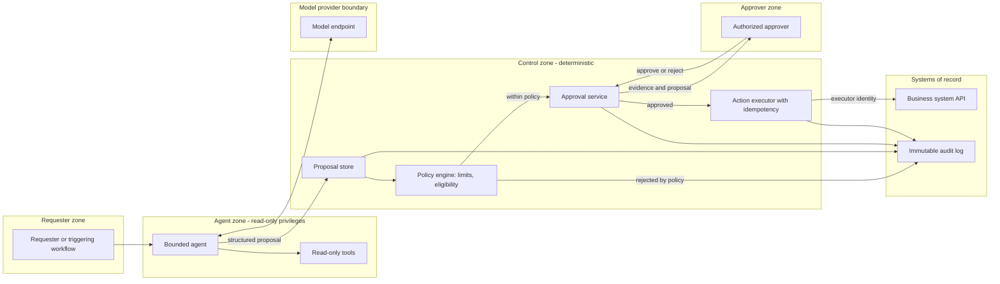

# Pattern: Human-Approved Action Agent

- **Last verified:** 2026-10-27 · **Confidence:** High (technology-agnostic pattern)
- **Rung:** 6, with deterministic approval controls

## Appropriate use cases

- Agents that prepare consequential changes (refunds, account changes, purchase orders, configuration changes, customer communications) where a human must approve before execution.
- Back-office copilots that assemble a case and propose an action with evidence.
- Gradual autonomy: start fully approved, then auto-approve narrow low-risk classes based on measured accuracy and an explicit decision.

## Preconditions and constraints

- Actions are expressible as **structured proposals** (action type, target, parameters, justification, evidence) that a deterministic policy can evaluate.
- Approvers, their authority limits, and SLAs are defined; approval UI shows evidence, not only the agent's narrative.
- The executing system supports idempotent operations and, ideally, reversal/compensation.
- Separation of duties: the agent's identity cannot execute the action itself.

## Architecture diagram

The agent can only propose; deterministic policy filters proposals, a human approves, and a separate executor identity performs the write.

## Core components

| Component | Responsibility |
|---|---|
| Bounded agent | Gathers evidence with read-only tools; emits a structured proposal |
| Proposal store | Immutable record of proposal, evidence references, model/prompt versions |
| Policy engine | Deterministic eligibility and limits (amount caps, customer status, duplicates) (AP-14) |
| Approval service | Routes to approvers by authority; enforces SLA, escalation, four-eyes where required |
| Action executor | Executes approved proposals exactly once with its own identity; re-checks policy at execution time |
| Audit log | Tamper-evident trail of proposal → policy → approval → execution |

**Example realizations:** LangGraph `interrupt` or Microsoft Agent Framework human-in-the-loop for the pause; n8n/Logic Apps/Temporal for approval workflow; OPA or Cedar for policy; ITSM or case-management UI for approvals.

## Trust boundaries

1. Agent zone holds **no write privileges**. Compromise yields bad proposals, not actions.
2. Agent → control zone: proposals are untrusted input to the policy engine.
3. Approver → approval service: strong authentication; approver identity recorded.
4. Executor → systems of record: dedicated identity, scoped to approved action types.

## NFR implications

- **End-to-end latency** is dominated by human approval. Design the SLA and escalation around it.
- **Throughput** is limited by approver capacity. Measure approval queue depth.
- **Accuracy:** the key metrics are proposal acceptance rate, modification rate, and post-execution reversal rate.
- **Auditability:** complete chain required (often regulatory at T3/T4).

## Security considerations

- Policy re-evaluated at execution time (TOCTOU: state may change between approval and execution).
- Proposals bind to exact parameters; approval of a proposal can't be replayed for different parameters (hash/sign the proposal).
- Approval UI shows source evidence and highlights policy-relevant fields, to avoid rubber-stamping and to resist persuasive model text.
- Prevent self-approval and approval-fatigue attacks (rate limits on proposals per requester).

## Operational requirements

- Approver dashboards, SLA alerts, escalation paths.
- Kill switch that stops proposal creation while allowing in-flight approved actions to complete or be held.
- Periodic review of auto-approval classes, if any, against measured error rates.

## Failure modes

| Failure | Mitigation |
|---|---|
| Rubber-stamp approvals | Evidence-first UI, sampling QA of approvals, approver metrics |
| Agent crafts proposal to pass policy but wrong intent | Policy on facts from systems of record, not agent-provided values |
| Double execution | Idempotency key per proposal; executor state machine |
| Approval backlog | Capacity planning; triage by risk; SLA escalation |
| State drift before execution | Re-check policy and preconditions at execution |

## Cost drivers

Approver time (usually dominant); agent tokens per case; approval tooling; audit storage and retention.

## When NOT to use

- Actions are low-impact and reversible. A bounded agent with idempotent writes may suffice.
- Volume makes human approval infeasible and policy can fully decide. Use deterministic automation (rung 1–2) with the LLM only for extraction.
- No one has authority or capacity to approve. Fix the operating model first.

## Solution-ladder rung

Rung 6 with deterministic controls. This is the default pattern for any agent touching consequential actions at T3; at T4 it's the minimum.
