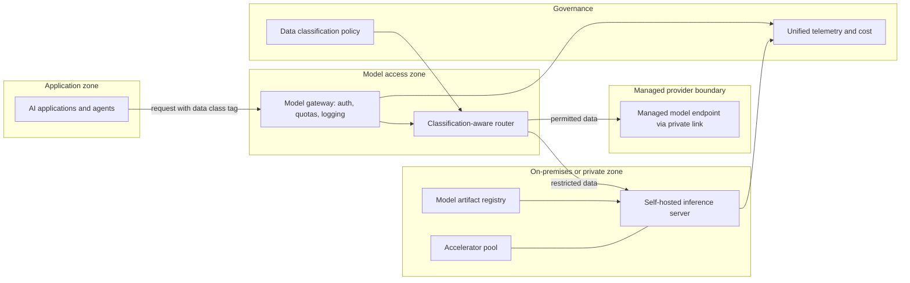

# Pattern: Hybrid Managed and Self-Hosted Models

- **Last verified:** 2026-10-27 · **Confidence:** Medium (pattern sound; self-hosting economics are highly use-case specific)
- **Rung:** Cross-cutting (applies to any rung 4+ pattern)

## Appropriate use cases

- Some data classes cannot leave a boundary (on-prem, sovereign, air-gapped segment), while other workloads can use managed frontier models.
- Sustained high-volume, narrow tasks (classification, extraction, embeddings) where a self-hosted open-weight model clears the quality bar and utilization is high.
- Resilience or sovereignty strategy requiring an inference path that does not depend on a single external provider.

## Preconditions and constraints

- Data classification rules map each data class to permitted inference locations. **The router enforces these rules; the model does not.**
- Evaluation shows each workload's assigned model meets its threshold (`knowledge/model-selection-guide.md` §3).
- GPU capacity (with HA headroom) and a platform team able to operate serving engines exist or are funded.
- Open-weight model licenses reviewed for the intended use.

## Architecture diagram

A gateway routes each request by its data classification tag to either self-hosted or privately connected managed inference, under one policy and one telemetry pipeline.

## Core components

| Component | Responsibility |
|---|---|
| Model gateway | Single entry point: authentication, quotas, metering, logging with redaction |
| Classification-aware router | Deterministic routing by data class and workload; no fallback that violates classification |
| Self-hosted inference | Serving engine with OpenAI-compatible API, behind the gateway (servers often have minimal auth) |
| Model artifact registry | Versioned weights with hash, license, eval results |
| Accelerator pool | GPU capacity with scheduling and HA headroom |
| Managed endpoint | Private connectivity; region-pinned deployment |
| Unified telemetry | Same trace schema and cost attribution across both paths |

**Example realizations:** vLLM or SGLang on Kubernetes GPU nodes (vLLM: Apache-2.0, OpenAI-compatible server, latest PyPI 0.32.0 `[VERIFIED]`, source: https://pypi.org/pypi/vllm/json, accessed 2026-10-27); Azure API Management, Kong, or LiteLLM as gateway; Microsoft Foundry/Bedrock/Vertex managed endpoints via private link.

## Trust boundaries

1. Applications → gateway: workload identity; data class asserted by the calling application and validated where possible.
2. Gateway → managed provider: data leaves the enterprise boundary. Only permitted classes cross.
3. Gateway → self-hosted: internal, but the inference server must not be reachable except via the gateway.
4. Model artifacts → serving: supply-chain boundary (weights are executable risk, e.g. unsafe serialization formats).

## NFR implications

- **Quality:** each route is evaluated separately; behavior differs between models, so outputs must share schemas.
- **Capacity:** self-hosted capacity is fixed. Queueing/admission control required; managed overflow allowed only for permitted classes.
- **Latency:** self-hosted latency depends on batching and load; measure under realistic concurrency.
- **Availability:** two independent paths, but restricted data has only one. Its availability equals the on-prem path's.

## Security considerations

- **Fail closed:** if the self-hosted path is down, restricted requests must not fail over to managed models.
- Scan and pin model artifacts; prefer safe weight formats; verify hashes on load.
- Gateway logs must respect the same classification (don't ship restricted prompts to a cloud log store).
- Patch the serving stack (engine, drivers, CUDA, base images) on a defined cadence.

## Operational requirements

- GPU utilization, queue depth, tokens/s, error rates per route; cost per transaction per route.
- Model upgrade pipeline with eval gate for both paths.
- Capacity planning review cadence; reservation management for accelerators.

## Failure modes

| Failure | Mitigation |
|---|---|
| Classification bypass (restricted data sent to managed) | Router policy tests; DLP checks at gateway; audit sampling |
| Self-hosted saturation | Admission control, priority queues, capacity alerts |
| GPU node failure | N+1 replicas; health-based routing |
| Model behavior divergence across routes | Shared schemas; per-route evals; documented differences |
| Stale open-weight model | Lifecycle review; registry with revisit triggers |

## Cost drivers

Accelerators (owned or reserved) and their utilization; platform team effort; managed token spend; gateway; duplicated eval and prompt work for two model families.

## When NOT to use

- A managed offering meets residency and privacy requirements with private connectivity. Self-hosting adds cost and risk without benefit.
- Volume is low or spiky. GPU idle time makes self-hosting uneconomic.
- No team can operate GPU serving reliably.

## Solution-ladder rung

Cross-cutting infrastructure pattern; does not change the application's rung. Its existence must trace to a residency, sovereignty, cost, or resilience requirement (AP-01).
