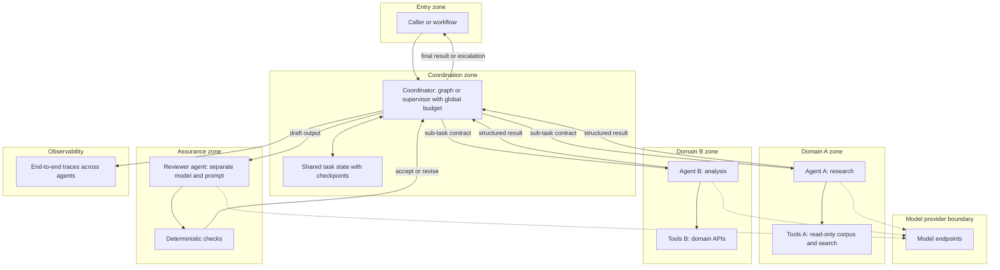

# Pattern: Multi-Agent Collaboration

- **Last verified:** 2026-10-27 · **Confidence:** Medium (pattern is sound; production evidence for multi-agent benefit is use-case specific)
- **Rung:** 7

## Appropriate use cases

- Work that splits into **genuinely separable sub-tasks** with different context, tools, permissions, or owning teams: e.g. a research agent with web/corpus access, and a separate drafting agent with no external access.
- Separation of duties as a control: a reviewer/critic agent with a different model, prompt, and authority than the producer.
- Parallel exploration where sub-tasks are independent and latency matters.
- Cross-domain collaboration where each domain team owns and operates its own agent behind a contract.

## Preconditions and constraints

- Rung-7 justification recorded: a single bounded agent was evaluated and is measurably worse (quality, isolation, or latency), or isolation is a requirement (`standards/agentic-ai-design-principles.md` §1).
- Each agent has an owner, identity, toolset, and contract (input/output schema).
- The coordinator (supervisor or deterministic graph) has hard limits: total steps, depth, fan-out, budget, time.
- Evaluation of the **whole system** end to end, not only per agent.

## Architecture diagram

A coordinator with a global budget dispatches sub-task contracts to agents isolated by domain and permission, and an independent reviewer plus deterministic checks gate the output.

## Core components

| Component | Responsibility |
|---|---|
| Coordinator | Decomposition, dispatch, aggregation; prefer a deterministic graph over a free-form supervisor where possible |
| Shared task state | Checkpointed state; agents receive only the slice they need (context isolation) |
| Domain agents | Bounded agents with their own identity and tools |
| Reviewer + checks | Independent critique and deterministic validation before release |
| Inter-agent contracts | Typed messages; versioned; no free-text handoffs for consequential data |
| End-to-end tracing | One trace ID across all agents and tools |

**Example realizations:** Microsoft Agent Framework orchestration patterns (sequential, concurrent, handoff, group chat) or LangGraph supervisor/subgraphs in one runtime; A2A or HTTP/MCP between independently owned agent services across runtimes. See `knowledge/framework-comparison.md`.

## Trust boundaries

1. Coordinator → agent: each agent is a separate principal; it does not inherit the union of all permissions.
2. Agent → agent outputs: untrusted input to the coordinator and to other agents (cross-agent prompt injection).
3. Domain zones: tools and data scoped per domain; cross-domain data flow only via the coordinator.
4. Cross-runtime calls (A2A/HTTP): mutual authentication and authorization per call.

## NFR implications

- **Latency:** parallel branches help; serial handoffs and review loops hurt. Model the critical path.
- **Cost:** multiplies with agents × steps × review iterations. Global budget is mandatory.
- **Reliability:** compound failure probability rises with each agent; measure end-to-end success.
- **Debuggability:** requires end-to-end tracing; without it, incidents are unresolvable.

## Security considerations

- Permission union risk: never give the coordinator the tools of every agent.
- Cross-agent injection: an agent processing untrusted content can emit instructions to others. Use structured contracts and validation at each hop.
- Rogue/compromised agent containment: per-agent kill switch and identity revocation.
- OWASP Agentic Top 10 risks (goal hijack, tool misuse, identity and privilege abuse) apply per agent *and* per hop `[VENDOR]` (source: https://genai.owasp.org/resource/owasp-top-10-for-agentic-applications-for-2026/, accessed 2026-10-27).

## Operational requirements

- Agent registry entries for every agent (owner, version, tools, identity, risk tier).
- System-level eval suite with fault injection (one agent wrong, slow, or adversarial).
- Runbooks per agent and for the coordinator; ability to degrade to a single-agent or human path.

## Failure modes

| Failure | Mitigation |
|---|---|
| Endless delegation or review loops | Max iterations, depth, global budget; deterministic termination |
| Error propagation (agent A's mistake trusted by B) | Typed contracts, validation, reviewer independence |
| Context loss in handoffs | Explicit state schema; checkpointed shared state |
| Partial failure of one agent | Timeouts; partial results with explicit gaps; escalation |
| Emergent cost spikes | Per-agent and global budgets; alerts on cost per task |

## Cost drivers

Total model calls across agents and iterations; duplicated context per agent; reviewer passes; tracing volume; operating several agent services and their evals.

## When NOT to use

- "Roles" are just sections of one prompt. Use one agent.
- Sub-tasks share the same tools, data, and permissions. One agent is simpler and easier to evaluate.
- The process is known. Use a workflow invoking LLM steps or a single agent step.
- There's no capability to run end-to-end tracing and system-level evaluation.

## Solution-ladder rung

Rung 7, the top of the ladder. Typically T3/T4. Requires the strongest justification and red-team review.
