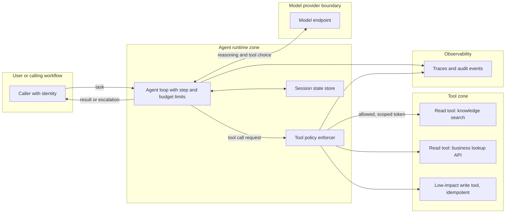

# Pattern: Single Bounded Tool Agent

- **Last verified:** 2026-10-27 · **Confidence:** High (technology-agnostic pattern)
- **Rung:** 6

## Appropriate use cases

- Investigative or diagnostic tasks where the next lookup depends on the previous result: IT incident triage, order-status investigation, policy-plus-account questions.
- Assistants that combine a few read-mostly tools (search, lookup APIs, calculators) in an order that cannot be scripted in advance.
- A single agentic step inside a deterministic workflow (`deterministic-workflow-with-llm-steps.md`).

## Preconditions and constraints

- The agentic justification (`standards/agentic-ai-design-principles.md` §1) is recorded: lower rungs were tried or ruled out with evidence.
- The toolset is **small and explicit** (typically under about 10 tools `[JUDGMENT]`), each with a typed schema and an owner.
- Tools are read-only or have low-impact, reversible, idempotent writes. Consequential writes use `human-approved-action-agent.md`.
- Loop bounds are defined: max steps, max tokens, wall-clock timeout, cost ceiling.

## Architecture diagram

The model chooses tools, but a deterministic policy enforcer authorizes every call with scoped credentials, and the loop is bounded in steps and cost.

## Core components

| Component | Responsibility |
|---|---|
| Agent loop | Model-driven tool loop with hard limits; returns result or structured escalation |
| Tool policy enforcer | Allow-list, argument validation, per-tool authorization using the caller's delegated identity or a scoped workload identity |
| Tools | Typed, owned, versioned interfaces (direct API or MCP) |
| Session state | Conversation/task state with retention policy |
| Traces/audit | Every model call and tool call with inputs, outputs, identity, versions |

**Example realizations:** Microsoft Agent Framework, LangGraph, OpenAI Agents SDK, Claude Agent SDK, or plain SDK code for the loop; MCP servers or direct functions for tools; OpenTelemetry for traces.

## Trust boundaries

1. Caller → agent: authenticated; delegated user context carried for on-behalf-of tool access.
2. Agent → model: prompts include tool results (untrusted content).
3. Agent → tools: **the main boundary.** Authorization is enforced here, outside the model.
4. Tool results → agent: untrusted (indirect prompt injection vector).

## NFR implications

- **Latency:** variable (N model calls + tool calls). Set a p95 target *and* a hard timeout.
- **Cost:** variable per task. Enforce a per-task budget and track cost distribution, not just the mean.
- **Reliability:** non-deterministic paths. Evaluate on task success rate over repeated runs.
- **Explainability:** traces show the path taken; required for support and audit.

## Security considerations

- Least-privilege tools; prefer delegated user permissions so the agent can't see more than the user.
- No credentials in prompts or model-visible state; tokens are injected by the enforcer.
- Validate tool arguments against schemas and business rules (AP-14).
- MCP servers: allow-listed, version-pinned, descriptions reviewed; follow the current MCP authorization spec (revision 2026-07-28 at time of writing) `[VERIFIED]` (source: https://modelcontextprotocol.io/specification/versioning, accessed 2026-10-27).
- Map threats to OWASP Agentic Top 10 (ASI01 goal hijack, ASI02 tool misuse, ASI03 identity and privilege abuse) `[VENDOR]` (source: https://genai.owasp.org/resource/owasp-top-10-for-agentic-applications-for-2026/, accessed 2026-10-27).

## Operational requirements

- Kill switch per agent and per tool.
- Eval suite: scripted scenarios with expected tool sequences/outcomes, adversarial tool outputs, budget-exhaustion cases.
- Dashboards: task success, steps per task, tool error rate, budget hits, escalation rate.

## Failure modes

| Failure | Mitigation |
|---|---|
| Looping/thrashing between tools | Step cap, repeated-call detection, budget ceiling |
| Wrong tool or hallucinated arguments | Schema validation, enumerations, few clear tools |
| Tool output hijacks the agent | Treat as data; no privilege escalation possible via enforcer |
| Tool outage | Timeouts; graceful escalation with partial results |
| Duplicate writes on retry | Idempotency keys on write tools |

## Cost drivers

Number of model calls per task (often 3–10× a single call `[JUDGMENT]`); context growth from tool outputs; reasoning tokens; tracing storage.

## When NOT to use

- The sequence of steps is known. Use a workflow with LLM steps.
- Only retrieval is needed. Use RAG.
- Tools perform consequential, irreversible actions. Use the human-approved pattern.
- "Agent" is wanted for branding rather than measurable benefit.

## Solution-ladder rung

Rung 6. Requires the agentic justification; host it inside a rung-2 workflow where the surrounding process is known.
