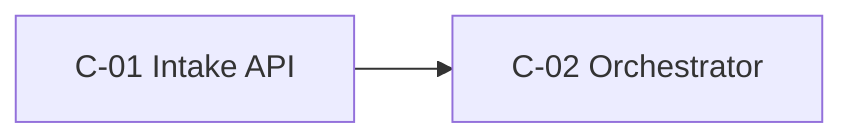

<!-- TEMPLATE: remove this line once the document is filled in -->
# Architecture Review Report: <System / use-case title>

<!-- guidance: Copy to use-cases/<id>/03-review-board/review-report.md. Use it for a Mode B review/redesign or any formal board review. It consolidates the specialist reports (round-<n>/*.md) into board findings (F-BRD-).
     Be honest: list what you did NOT inspect. Never claim you tested or verified something you didn't. An existing system is not right because it was built, and not wrong because something newer exists.
     Prefer targeted remediation over redesign unless the evidence forces a redesign (proportionate challenge).
     T1: findings plus a short disposition. T3+: every section, with a transition architecture. -->

- **Use-case ID:** <id> · **Mode:** B · **Tier:** T3 · **Review round:** 1 · **Date:** YYYY-MM-DD
- **Board chair:** <name> · **Specialists consulted:** <agent names; link round-<n>/ reports>

## Executive Summary

<!-- guidance: Five to eight lines for approvers: the overall verdict (Sound · Sound with conditions · Material gaps · Not viable as proposed), the top 3 findings, the recommended direction, and the decisions needed. -->

## Scope and Baseline

### Intended vs implemented

| Aspect | Intended (docs / diagrams) | Implemented (code / IaC / config observed) | Gap |
|---|---|---|---|
| (example) Model access | Via enterprise AI gateway (design v2) | Direct SDK calls to the provider in `svc/extract/client.py` | Bypasses metering and policy |

### Evidence inspected

| Artifact | Path / source | Version / commit | Inspected by |
|---|---|---|---|
| (example) Terraform | `infra/` | abc1234 | platform-architect |

### Not inspected

<!-- guidance: Be explicit. Findings in these areas are limited to inference or unverified concerns. -->

| Area / artifact | Reason (no access / out of scope / time) | Effect on confidence |
|---|---|---|
| (example) Production configuration and logs | No access granted | Runtime findings are Inference only |

## Findings

<!-- guidance: Severity per .claude/skills/architecture-review/references/severity-rubric.md (Critical / High / Medium / Low).
     Basis ∈ Verified fact · Inference · Assumption · Unverified concern.
     Class ∈ Mandatory (blocks approval) · Recommended · Optional · Future.
     Merge duplicate specialist findings and cite the source IDs (e.g., "from F-SE-03, F-RT-01"). An open Critical blocks G5 and G10. -->

| ID | Severity | Affects | Evidence | Basis | Issue | Impact | Likelihood / confidence | Remediation | Class | Owner | Acceptance criterion | Verification |
|---|---|---|---|---|---|---|---|---|---|---|---|---|
| F-BRD-01 | (example) High | C-03, NFR-003 | `svc/extract/client.py:42`; F-PL-02 | Verified fact | Model calls bypass the AI gateway | No cost metering or policy enforcement; data egress unmonitored | H / H | Route calls through the gateway; remove direct keys | Mandatory | Platform lead | 0 direct provider calls in code scan; gateway logs show 100% of traffic | TST-060 code scan + gateway log check |

### Strengths worth retaining

- <!-- guidance: Record what works and why, so that remediation doesn't break it. -->

## Disposition

<!-- guidance: One row per component or capability. Disposition ∈ Retain / Improve / Replace / Consolidate / Remove / Defer / Investigate. Each non-Retain disposition links findings. -->

| Component / capability | Current | Disposition | Rationale | Findings | Target (C- / ADR) |
|---|---|---|---|---|---|
| (example) n8n orchestration | Orchestrates the extraction flow | Retain | Fits rung 2; well operated | — | C-02 |
| (example) Custom agent loop | Duplicates orchestration | Consolidate | Two orchestrators own one workflow (AP-04) | F-BRD-03 | C-02, ADR-004 |

## Target Architecture

<!-- guidance: Summarize the target here. If it is substantial, produce 02-design/solution-design.md and link it. Include at least a container diagram with nodes matching the component catalogue. -->

- **Target summary:**
- **Key decisions:** ADR-…
- **Solution-ladder position (and change from current, if any):**

*Caption: <one sentence>.*

## Transition Architecture

<!-- guidance: Describe the safe intermediate states between current and target. Each state must be deployable and reversible. T1/T2: may be "Not required because …". -->

| State | What changes | What stays | Exit criterion | Rollback |
|---|---|---|---|---|
| (example) T-State 1 | Gateway in front of existing calls | Prompts, orchestration | 100% of traffic via the gateway for 1 week | Re-point the SDK endpoint |

## Remediation Roadmap

| Order | Finding(s) | Action | Class | Owner | Depends on | Exit / verification | Milestone (relative) |
|---|---|---|---|---|---|---|---|
| 1 | F-BRD-01 | (example) Route model calls via the gateway | Mandatory | Platform lead | Gateway onboarding | TST-060 Pass | Before pilot |

## Open Decisions and Residual Risks

| ID | Item | Decision owner | Needed by |
|---|---|---|---|
| DEC-0xx | | | |
