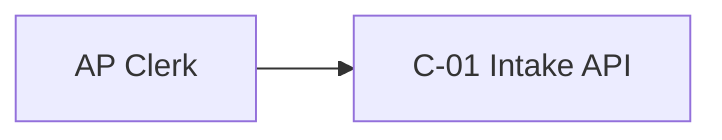
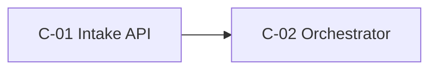

<!-- TEMPLATE: remove this line once the document is filled in -->
# Solution Design: <Use-case title>

<!-- guidance: Copy to use-cases/<id>/02-design/solution-design.md. Used for Mode A/C, and for the Mode B target architecture. This file is the evidence for G3 and, together with the diagrams, for G7.
     Every component and decision traces to an FR/NFR/CON/RSK/ASM ID. Recommend one option per decision (standards/architecture-principles.md §5).
     T1: sections may be short paragraphs, with one context diagram. T2: all tables plus context and container diagrams. T3+: all diagrams, with the full operational-completeness checklist. -->

- **Use-case ID / version:** <id> / v0.1 · **Mode / tier:** A / T2 · **Date:** YYYY-MM-DD · **Status:** Draft | For review | Approved

## Executive Summary

<!-- guidance: Write this for approvers who will read only this section. Aim for half a page with no jargon. Cover: the problem and the value, what we will build (one sentence), why this approach rather than something simpler, the key decisions (ADR IDs), the top 3 risks, the cost order of magnitude, and what we need approved. -->

- **Recommendation:**
- **Why this approach:**
- **Key decisions:** ADR-001 …, ADR-002 …
- **Top risks and how they are contained:**
- **Estimated run cost (order of magnitude, with evidence label):**
- **Decisions requested from approvers:**

## Solution Approach

### Solution-ladder justification

<!-- guidance: Climb only as far as the requirements force (standards/architecture-principles.md §4). Rule out every lower rung with a requirement-based reason. Rung ≥ 6 also needs the agentic justification in standards/agentic-ai-design-principles.md §1. Hybrids are normal: list each part's rung. -->

| Rung | Pattern | Sufficient? | Reason (requirement IDs) |
|---|---|---|---|
| 0 | Process change / configure existing product | No | (example) No existing product extracts from supplier PDFs (INV-002 assessed) |
| 1 | Deterministic rules | No | |
| 2 | Workflow / event-driven | Partly: orchestration | |
| 3 | Search / conventional ML | | |
| 4 | LLM step in deterministic workflow | **Chosen** | |
| 5 | RAG | Not needed | |
| 6–7 | Agent / multi-agent | Not needed | Task path is enumerable (FR-001..FR-006) |

**Chosen pattern:** <e.g., rung 2 orchestration with rung 4 extraction steps>

### Reuse of existing investments

| INV ID | Capability | Decision (Reuse / Extend / Replace / Not used) | Rationale and cost |
|---|---|---|---|
| INV-001 | (example) n8n | Reuse for orchestration | Meets FR-00x; avoids a second orchestrator (AP-04) |

## Architecture Overview

<!-- guidance: Mermaid diagrams. Each block has a `%% Title:` line and a one-sentence caption below it. Node names must match the component catalogue (C- IDs or exact names). T1: context diagram only. T2: + container. T3+: all five. You may move diagrams to 02-design/diagrams/*.md and link them here. -->

*Caption: <one sentence on what the context diagram shows>.*

*Caption:*

<!-- Placeholders still to draw: Deployment view (%% Title: Deployment), Key sequence for FR-001 (%% Title: Sequence – <flow>), Trust boundaries (%% Title: Trust boundaries; must agree with threat-model.md). -->

## Component Catalogue

<!-- guidance: One responsibility per component (AP-04), with a named owning team (AP-05). No component without a requirement trace (AP-01). -->

| ID | Component | Responsibility | Owner (team) | Technology | ADR | Requirement IDs |
|---|---|---|---|---|---|---|
| C-01 | (example) Intake API | Authenticate and accept documents, enqueue jobs | AP Platform team | Existing API gateway | ADR-001 | FR-001, NFR-001 |

### Shared vs domain-owned capabilities

| Capability | Shared enterprise service or domain-owned? | Provider / owner | Rationale (AP-06) |
|---|---|---|---|
| (example) AI gateway / model access | Shared | Enterprise AI platform | Central metering and policy; no bottleneck for this load |
| (example) Extraction prompts and eval sets | Domain-owned | AP product team | Domain knowledge and change cadence |

## Technology Selection

<!-- guidance: Material choices only. Fill Alternative only if it has a specific reason to exist. Fill Rejected only if recording it adds value (e.g., a stakeholder's PREF). Time-sensitive claims need an evidence label and a source with an access date. -->

| Decision | Recommended | Alternative (reason it exists) | Rejected (reason) | Evidence label | Evidence date | ADR | Lock-in / exit cost |
|---|---|---|---|---|---|---|---|
| (example) LLM for extraction | Model X via enterprise gateway | Model Y (fallback for regional outage) | Self-hosted Z (cost at volume, NFR-003) | [VENDOR] | YYYY-MM-DD | ADR-002 | Low: gateway abstraction |

## Security and Identity

<!-- guidance: Summarize here; detail goes in 05-validation/threat-model.md. Authorization for consequential actions is enforced outside the model (AP-14, G4 blocking rule). -->

- **Identities (user / workload / agent / tool) and how they are separated:**
- **Delegated access semantics (on-behalf-of vs service identity):**
- **Authorization enforcement points:**
- **Secrets management (no credentials reachable from model context):**
- **Untrusted-content controls per ingestion path:**

## Data and Knowledge

| Data / knowledge asset | Classification | Owner | Store | Retention | Residency | Used by (C-) |
|---|---|---|---|---|---|---|
| (example) Invoice images | Confidential | AP Ops | Object storage, in-region | 7 years | CON-001 | C-01, C-03 |

- **Data protection in transit, at rest, and in prompts/logs (masking, redaction):**
- **Knowledge freshness and governance (if RAG):**

## Operations and Reliability

### Operational-completeness checklist (AP-13)

<!-- guidance: Every row is either "Designed: §link" or "Not required because …". A blank row means the design is not enterprise-ready. Depth scales with tier. -->

| Capability | Status | Where / why |
|---|---|---|
| Identity and access | Designed | §Security and Identity |
| Data protection | | |
| Integration (contracts, retries, idempotency) | | |
| Human approval points | | |
| Tool side effects (limits, reversibility, dry-run) | | |
| Failure handling (timeouts, fallbacks, degraded mode) | | |
| Observability (logs, metrics, traces, AI telemetry) | | |
| Evaluation (offline and online) | | test-and-evaluation-plan.md |
| Capacity and DR (RTO/RPO) | | |
| Cost controls (budgets, quotas, alerts) | | |
| CI/CD and IaC | | |
| Versioning of model / prompt / tool / agent / config | | |
| Governance (approvals, re-evaluation, retirement) | | |
| Ownership and support model | | |
| Runbooks | | 06-delivery/runbooks/ |

## Risks and Open Decisions

| ID | Risk / open decision | Likelihood | Impact | Mitigation / next step | Owner | Status |
|---|---|---|---|---|---|---|
| RSK-001 | (example) Extraction quality drops on new supplier layouts | M | M | Drift eval on weekly sample; human review fallback | AP product owner | Open |
| DEC-001 | (example) Model hosting | — | — | ADR-002 Proposed; awaiting platform owner | Platform owner | Open |
