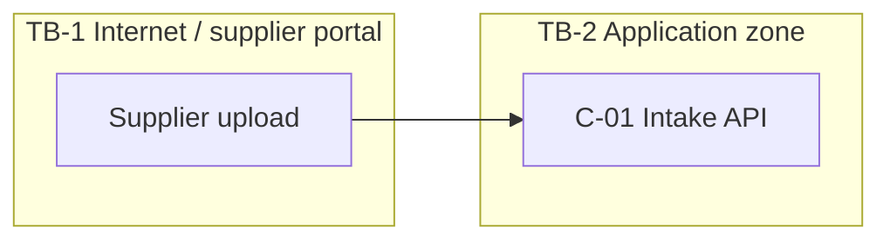

<!-- TEMPLATE: remove this line once the document is filled in -->
# Threat Model: <Use-case title>

<!-- guidance: Copy to use-cases/<id>/05-validation/threat-model.md. This file is the evidence for gate G4. Produced by the threat-modeling skill.
     Method: STRIDE for classic threats, plus AI-specific categories (prompt injection, tool misuse, excessive agency, and the others below). Each threat needs a mitigation, an owner, a verification test, and a residual rating.
     Blocking rule: authorization for any consequential action delegated to model reasoning fails G4.
     T1: the asset list, one boundary diagram, and the AI checklist may be enough. T2: full threat table for every boundary-crossing flow. T3+: every threat has a test ID, and the residual risk is signed off. -->

- **Use-case ID / version:** <id> / v0.1 · **Tier:** T2 · **Date:** YYYY-MM-DD
- **Design baseline:** 02-design/solution-design.md (version/date) · **Modeled by:** <name>

## Scope and Assets

**In scope:** <components C-.., flows, environments> · **Out of scope (and why):**

| Asset | Type (data / model / prompt / tool / credential / service) | Classification | Owner | Security property at stake (C/I/A) | Location (C-) |
|---|---|---|---|---|---|
| (example) Supplier bank details | Data | Restricted | Finance | C, I | C-04 Data store |
| (example) System prompt and tool definitions | Prompt | Internal | AP product team | I | C-03 |
| (example) ERP write credential | Credential | Secret | Platform | C | Key vault |

## Trust Boundaries

<!-- guidance: Draw every place where trust level changes: user → app, app → model provider, retrieved/untrusted content → model context, model → tool, tool → business system, tenant → tenant. Node names must match the component catalogue. -->

*Caption: <one sentence on the boundaries shown>.*

### Data flows crossing boundaries

| Flow ID | From → To | Boundary | Data / content | Trusted? | Authentication / authorization | Controls |
|---|---|---|---|---|---|---|
| DF-01 | (example) Supplier portal → C-01 | TB-1 → TB-2 | PDF invoice (untrusted content) | No | mTLS + supplier token | AV scan, content isolation before model |

### Threat actors

| Actor | Motivation | Capability | Entry points |
|---|---|---|---|
| (example) Malicious supplier | Payment fraud | Crafts document content | DF-01 (indirect prompt injection) |
| (example) Curious insider | Data access | Valid user account | UI, logs |

## Threats

<!-- guidance: Category ∈ STRIDE (Spoofing, Tampering, Repudiation, Information disclosure, Denial of service, Elevation of privilege) or AI (Prompt injection, Tool misuse, Excessive agency, Confused deputy, Memory poisoning, Exfiltration, Denial of wallet, Supply chain, Model/data poisoning). Likelihood: L / M / H. Impact: L / M / H / C (Critical), per the threat-modeling skill. Residual: L / M / H / C after mitigation. No numeric scores; avoid false precision. -->

| ID | Category | Boundary / flow | Scenario | Likelihood | Impact | Mitigation | Owner | Test ID | Residual |
|---|---|---|---|---|---|---|---|---|---|
| T-001 | (example) Prompt injection (indirect) | DF-01 | Invoice text instructs the model to change the payee account | H | H | Model output is a proposal only; payee is validated in code against the vendor master (AP-14); human approval for changes | AP Platform | TST-021 | L |
| T-002 | | | | | | | | | |

### AI-specific checklist

<!-- guidance: Tick each line, or state "N/A because …". Link the T- IDs it produced. -->

- [ ] **Direct prompt injection:** user input cannot override system policy or tool permissions. T-…
- [ ] **Indirect prompt injection:** every retrieved, uploaded, emailed, or tool-returned content path is treated as untrusted. T-…
- [ ] **Tool misuse:** each tool has least-privilege scope, input validation, and rate/amount limits outside the model. T-…
- [ ] **Excessive agency:** the agent cannot take actions beyond the FRs, and consequential actions require deterministic policy and/or human approval. T-…
- [ ] **Confused deputy:** tools act with the end user's delegated rights, not a broad service identity, where that matters. T-…
- [ ] **Memory / context poisoning:** persistent memory, caches, and knowledge stores have write controls and provenance. T-…
- [ ] **Data exfiltration via output or egress:** output filtering, no arbitrary URL fetch or render, and egress allow-lists. T-…
- [ ] **Denial of wallet:** per-user and per-tenant token and cost quotas, recursion and loop limits, and budget alerts. T-…
- [ ] **Supply chain:** models, packages, MCP servers, plugins, and datasets come from pinned and verified sources. T-…
- [ ] **Secrets:** no credential is reachable from model context or logs. T-…

## Residual Risk

<!-- guidance: Every threat whose residual rating is M or H must be accepted by a named person with authority (not "the team"). For T3+, record the date and a review trigger. -->

| Threat ID | Residual rating | Why it is not reduced further | Accepted by (name, role) | Date | Review trigger |
|---|---|---|---|---|---|
| T-00x | (example) M | Human approval is the final control; fatigue risk monitored | <Head of AP Ops> | YYYY-MM-DD | Approval override rate > 5%/month |

### G4 checklist

- [ ] Assets, trust boundaries, and data flows drawn and consistent with solution-design.md
- [ ] User, workload, agent, and tool identities separated
- [ ] Consequential actions gated by deterministic policy and/or human approval
- [ ] Every threat has a mitigation, an owner, a test ID, and a residual rating
- [ ] Residual M/H risks accepted by a named owner
