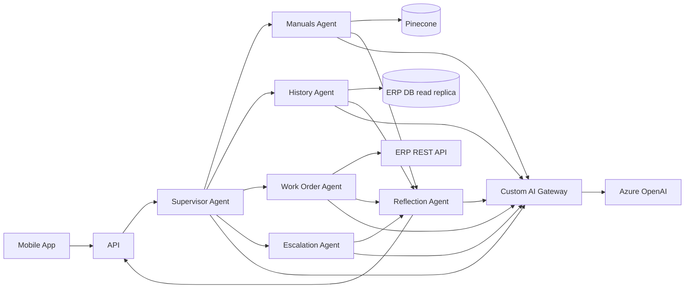

# Field Service Assistant: Architecture (v0.9 draft)

> **TEST FIXTURE. Fictional system ("Contoso Utilities")**, written to exercise the framework's Mode B review. It deliberately contains design weaknesses. It is not a real organization's architecture.

## 1. Business context

Field technicians call the dispatch desk about 400 times a day. They ask about asset history, and they ask dispatch to open follow-up work orders in the ERP. The goal is a chat assistant in the technicians' mobile app that answers asset questions from manuals and maintenance history, and that can create and update work orders.

Success metrics (from the sponsor): cut dispatch-desk calls by 40%, and get the median time to a work order under 2 minutes.

## 2. Requirements (as provided by the product owner)

- R1: Answer questions about asset maintenance history and equipment manuals.
- R2: Create follow-up work orders in the ERP from the conversation.
- R3: Update the status of existing work orders.
- R4: Escalate to a human dispatcher on request.
- NFR-A: "Fast responses" for technicians in the field.
- NFR-B: Available during working hours. The sponsor mentioned 99.5%.
- NFR-C: Customer and asset data must stay in-region (company data-residency policy).
- NFR-D: Every work order change must be auditable (internal audit requirement).

## 3. Constraints

- Azure is the mandated cloud (enterprise policy, per the CIO memo).
- The existing n8n instance runs today's dispatch integrations with the ERP (create/update work order flows already exist and are in production).
- The team has Python skills; nobody on it has prior agent-framework experience.

## 4. Proposed architecture

A multi-agent system built on LangGraph, running on Azure Kubernetes Service:

| Component | Responsibility |
|---|---|
| Supervisor Agent | Routes every user message to a specialist agent |
| Manuals Agent | RAG over equipment manuals (PDF) |
| History Agent | Queries maintenance history in the ERP database (read replica) using generated SQL |
| Work Order Agent | Creates and updates ERP work orders by calling the ERP REST API directly |
| Escalation Agent | Posts escalation messages to the dispatch Teams channel |
| Reflection Agent | Reviews every answer from the other agents before it is returned |
| Pinecone | Vector store for manual chunks |
| Custom AI Gateway | New in-house service that proxies all LLM calls, with keys stored in its config |
| Azure OpenAI | Model endpoint (GPT-class model). Region to be decided |

Flow: mobile app → API → Supervisor → (specialist agent) → Reflection Agent → response.

The Work Order Agent's system prompt instructs it to "never create more than 3 work orders per conversation and never set priority to EMERGENCY".

All prompts and responses are logged to Application Insights for debugging.

## 5. Open items

- Model region not chosen yet.
- Evaluation: "we will test with the technicians during the pilot".
- DR: "AKS is highly available".

Caption: the drafted multi-agent topology. Every specialist answer passes through the Reflection Agent.
