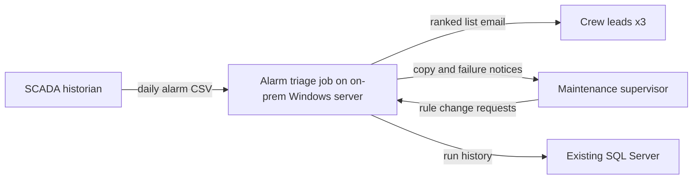
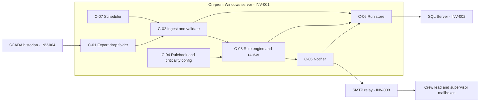

# Solution Design: Daily SCADA Alarm Triage (On-Premises)

- **Use-case ID / version:** alarm-triage-onprem / v0.1 · **Mode / tier:** A / T1 · **Date:** 2026-10-27 · **Status:** For review

## Executive Summary

- **Recommendation:** Replace the 90-minute manual triage with a small scheduled Python job on the existing on-prem Windows server. Each morning it reads the historian's alarm CSV, applies the ~40-rule rulebook exactly as written, ranks the results, logs the run in the existing SQL Server, and emails the list to the crew leads through the existing SMTP relay. If anything goes wrong it tells the supervisor instead of sending a wrong list.
- **Why this approach:** The rules are fixed, known, and work on structured rows. Code applies them faster, identically every day, and can be tested rule by rule. Nothing in the task needs judgement over unstructured content, so AI adds cost and new failure modes without adding value. An AI agent would also need a self-hosted model on-prem (CON-001), which means new hardware and operations for no measured gain.
- **Key decisions:** ADR-001 deterministic rules job (rungs 1–2), with no LLM or agent in this release. Design notes cover the rulebook format, scheduler, and packaging.
- **Top risks and how they are contained:** (1) The written rulebook doesn't match what the supervisor actually does (RSK-001): contained by a 10-day golden replay and a 10-day parallel run before switch-over. (2) The export doesn't arrive (RSK-002): contained by a cut-off check that alerts the supervisor, with the manual process as fallback. (3) The historian may already do this (RSK-004): checked in week 1 before any build.
- **Estimated run cost (order of magnitude, with evidence label):** Near zero incremental: no new licences, hardware, or services; reuses the server, SQL Server, and relay `[JUDGMENT]`. Build effort roughly 2–4 engineer-weeks including rulebook encoding and parallel run `[JUDGMENT]`.
- **Decisions requested from approvers:** Accept ADR-001 (Maintenance Manager, with the CEO informed); confirm ASM-001, ASM-002, ASM-011; Information Security Officer to confirm the package-source approach (Q-007).

## Solution Approach

### Solution-ladder justification

| Rung | Pattern | Sufficient? | Reason (requirement IDs) |
|---|---|---|---|
| 0 | Process change / configure existing product | Not yet ruled out; assumed No | The historian's own alarm reporting might apply the rulebook and email results. Not assessed (ASM-011, Q-001). If it can meet FR-002–FR-005, rung 0 wins and this design is shelved. SQL Server reporting subscriptions were considered as a rung-0 variant: a 40-rule rulebook with per-rule tests (FR-007) and fail-loud behaviour (FR-005) is easier to build and test in code than in report definitions, and the IT team prefers Python (PREF-001) `[JUDGMENT]` |
| 1 | Deterministic rules | **Chosen: rule evaluation and ranking** | Rules are fixed thresholds, code lists, and criticality (ASM-005). FR-002, FR-003, NFR-003 require identical, explainable, testable outcomes (AP-14) |
| 2 | Workflow / event-driven | **Chosen, minimal: scheduled job** | A single daily sequence: validate → evaluate → rank → record → email. Windows Task Scheduler covers it (FR-005, NFR-001). No workflow engine needed: one linear job, one owner (AP-04) |
| 3 | Search / conventional ML | Not needed | No labelled-data ranking problem; priority is defined by the rulebook (FR-003) |
| 4 | LLM step in deterministic workflow | Not needed | Inputs are structured CSV rows; no extraction, summarisation, or free-text judgement is required (ASM-005). An LLM would make a deterministic outcome probabilistic (NFR-003) and on-prem hosting would add hardware and operations (CON-001, NFR-009). Revisit if a rule needs judgement over free-text alarm descriptions |
| 5 | RAG | Not needed | No question answering over enterprise documents |
| 6–7 | Agent / multi-agent | Not needed; fails the agentic justification test | See below and ADR-001 |

**Chosen pattern:** rung 1 rules engine inside a rung 2 scheduled job. No AI component.

**Agentic justification test (`standards/agentic-ai-design-principles.md` §1.1), run because a stakeholder proposed agents (PREF-002):**

| Test item | Result |
|---|---|
| Paths can't be enumerated | **Fails.** One fixed path, every day. Branching depends only on rule outcomes, which code evaluates |
| Measurable value of autonomy | **Fails.** No metric improves over the deterministic job: it already meets OBJ-01 (≤ 10 min) and OBJ-03 (100% agreement) |
| Bounded toolset | Could pass, but there is nothing for the agent to choose between |
| Risk tier confirmed | Rung 6 would raise the autonomy factor to T3, adding deliverables and controls for no benefit |
| Evaluation plan | Would need an evaluation set to prove the agent reproduces the rulebook; the rulebook itself is the cheaper, exact specification |
| Cost and latency impact | Worse: on-prem GPU or CPU inference, model operations, and prompt versioning versus a sub-minute script |
| Failure path | Worse: non-deterministic errors in the inclusion of maintenance alarms are harder to detect than code defects caught by rule tests |

**Handling PREF-002.** The CEO's preference is respected as a goal (modernise, use automation well), not as a mandate. ADR-001 explains in plain terms why an agent would make this task slower to build, costlier to run on-prem, and less reliable, and names the conditions under which an AI step would be worth adding: free-text judgement in rules, a rulebook that grows past what people can maintain, or a later scope with unstructured inputs (for example, technician notes). The encoded, tested rulebook and the run history in SQL Server are also the clean, labelled foundation that any later AI use case would need.

### Reuse of existing investments

| INV ID | Capability | Decision (Reuse / Extend / Replace / Not used) | Rationale and cost |
|---|---|---|---|
| INV-001 | Windows server | Reuse as runtime host | Load is trivial (one ~2,000-row file/day, ASM-010); already inside the on-prem boundary (CON-001) |
| INV-002 | SQL Server | Reuse: one new schema for run history | Durable audit of each run (FR-008); idempotency check (FR-009); already backed up (ASM-010) |
| INV-003 | SMTP relay | Reuse for list and failure notices | Already approved internal mail path (FR-004, FR-005) |
| INV-004 | Historian CSV export | Reuse as input contract | No change to SCADA; scheduled export assumed (ASM-006) |

## Architecture Overview

*Caption: The job sits entirely on-premises between the historian export and the maintenance team's mailboxes; nothing leaves the site.*

*Caption: One Python job, triggered by the scheduler, validates the file, applies the versioned rulebook, records the run, and sends the result through the existing relay.*

**Daily flow and interfaces**

1. 05:30 (ASM-006): historian writes `alarms_<YYYYMMDD>.csv` to C-01. Contract: agreed column list, UTF-8, one header row. The schema is pinned in C-04 and checked by C-02.
2. 05:45: C-07 starts the job. C-02 checks C-06 for an existing delivered run for that date (idempotency key = export date + input file SHA-256, FR-009). If found, it stops without sending.
3. C-02 validates the file (FR-001). On failure it records the reason and C-05 sends a failure notice (FR-005).
4. C-03 evaluates every row against every active rule and ranks the result deterministically (FR-002, FR-003). Pure function: same input + same rulebook version = same output.
5. C-06 records the run and results. C-05 sends the list (FR-004). Delivery status is written back to C-06.
6. Cut-off watchdog: a second scheduled task at 06:00 checks C-06 for a completed run for the day. If none exists (job never started, server issue), it sends a failure notice (NFR-006). If SMTP itself is down, both tasks write to the Windows event log, which IT monitoring already watches (ASM-010).

Timeouts: SQL and SMTP calls use a 30 s timeout with up to 3 retries 60 s apart, which stays inside the 06:30 cut-off. System of record: the historian for alarms; C-04 for rules; C-06 for what was sent.

## Component Catalogue

| ID | Component | Responsibility | Owner (team) | Technology | ADR | Requirement IDs |
|---|---|---|---|---|---|---|
| C-01 | Export drop folder | Receive the daily historian export; read-only to the job | IT Infrastructure (folder); SCADA team (export) | NTFS share on INV-001, ACL-restricted | — | FR-001 |
| C-02 | Ingest and validate | Locate the file, check idempotency, validate schema and bounds, orchestrate the run, raise failures | Maintenance IT developer (assumed) | Python 3 (`csv`, `hashlib`), pinned version | ADR-001 | FR-001, FR-005, FR-009, FR-010, NFR-002 |
| C-03 | Rule engine and ranker | Evaluate rules per row; rank; attach matched rule IDs | Maintenance IT developer (assumed) | Python 3, pure functions, no I/O | ADR-001 | FR-002, FR-003, FR-006, NFR-003 |
| C-04 | Rulebook and criticality config | Hold the ~40 rules, asset criticality list, input schema, and recipients as versioned data with per-rule tests | Maintenance supervisor (content); developer (format) | YAML or CSV files in on-prem source control, deployed by tagged release | — (design note DEC-002) | FR-002, FR-007, NFR-007 |
| C-05 | Notifier | Render and send the list or failure notice to configured recipients only | Maintenance IT developer (assumed) | Python 3 `smtplib` → INV-003 | — | FR-004, FR-005, FR-006 |
| C-06 | Run store | Persist run records, results, delivery status; enforce retention | IT Infrastructure (DB); developer (schema) | Dedicated schema in INV-002 | — | FR-008, FR-009, NFR-008 |
| C-07 | Scheduler and watchdog | Start the job daily; check the cut-off; run retention purge | IT Infrastructure | Windows Task Scheduler on INV-001 | — (design note DEC-003) | NFR-001, NFR-006 |

### Shared vs domain-owned capabilities

| Capability | Shared enterprise service or domain-owned? | Provider / owner | Rationale (AP-06) |
|---|---|---|---|
| Email delivery | Shared (existing) | IT, SMTP relay | Already exists; no reason to duplicate |
| Database hosting | Shared (existing) | IT, SQL Server | Already exists and backed up |
| Rulebook content and tests | Domain-owned | Maintenance | Domain knowledge and change cadence belong to maintenance |
| AI platform / model gateway | Not required | — | No AI component in this design |

## Technology Selection

| Decision | Recommended | Alternative (reason it exists) | Rejected (reason) | Evidence label | Evidence date | ADR | Lock-in / exit cost |
|---|---|---|---|---|---|---|---|
| Solution pattern | Deterministic Python rules job (rungs 1–2) | Configure historian alarm reporting (rung 0), only if ASM-011 proves false | LLM agent (PREF-002): fails agentic test, needs on-prem model hosting; cloud LLM: violates CON-001 / PRH-001 | [JUDGMENT] | 2026-10-27 | ADR-001 | Very low: ~1–2k lines of code and data files |
| Language and runtime | Python 3, a currently supported minor version, pinned in a virtual environment (PREF-001) | — | — | [UNVERIFIED]: supported Python version and lifecycle not researched in this session; IT to pin a supported release | 2026-10-27 | — | None |
| Rulebook format | Versioned YAML/CSV data files with per-rule tests in on-prem source control | SQL table with an edit form, only if non-developers must edit rules without a release | Rules hard-coded in Python (harder for the supervisor to review) | [JUDGMENT] | 2026-10-27 | — | None |
| Scheduler | Windows Task Scheduler | — | A workflow engine (one linear daily job; AP-04, AP-03) | [JUDGMENT] | 2026-10-27 | — | None |
| SQL Server driver | Python ODBC driver for SQL Server from the internal package mirror (ASM-009) | Write run records to a CSV log only, if no driver can be approved | — | [UNVERIFIED]: driver availability via internal mirror not checked | 2026-10-27 | — | Low |

No cloud service appears in any row. No research tools were used: every time-sensitive fact (Python lifecycle, driver availability) is marked `[UNVERIFIED]` with a validation owner.

## Security and Identity

Lightweight T1 checklist (`docs/operating-model.md` §3: security specialist skipped at T1; checklist still applied).

- **Identities (user / workload / agent / tool) and how they are separated:** One workload identity: a dedicated Windows/AD service account for the job (no interactive logon). Users (supervisor, crew leads) only receive email. Developers deploy through source control; they don't use the service account. No agent or tool identities exist.
- **Delegated access semantics (on-behalf-of vs service identity):** App-only. The job acts for no user.
- **Authorization enforcement points:** NTFS ACL on C-01 (read for service account, write for the export process only); SQL Server permissions limited to the job's own schema (NFR-004); SMTP relay accepts mail from the server only to internal domains; recipients come from C-04, never from file content.
- **Secrets management (no credentials reachable from model context):** No model context exists. SQL access uses Windows integrated authentication, so no stored password. If the relay requires credentials, they are stored in Windows Credential Manager for the service account, never in the repository or logs.
- **Untrusted-content controls per ingestion path:** The CSV is treated as untrusted data: strict schema and type validation, maximum file size and row count, no evaluation of cell content as code, formula-leading characters (`=`, `+`, `-`, `@`) escaped in email output, and parameterised SQL only.
- **Egress:** Host firewall allows outbound only to the SQL Server, SMTP relay, and file share (NFR-005). No internet egress is needed at runtime.
- **Supply chain:** Python and packages come from an internal mirror or approved offline wheels, pinned with hashes (SEC-12, ASM-009, Q-007). Keep dependencies to the standard library plus the SQL driver.

## Data and Knowledge

| Data / knowledge asset | Classification | Owner | Store | Retention | Residency | Used by (C-) |
|---|---|---|---|---|---|---|
| Daily alarm CSV | Internal (ASM-001) | SCADA / Operations | C-01 share | 30 days on the share, then delete (proposed) | On-prem (CON-001) | C-02 |
| Rulebook, criticality list, schema, recipients | Internal | Maintenance supervisor | C-04 source control | Full version history | On-prem | C-03, C-05 |
| Run records and listed alarms | Internal | Maintenance Manager | C-06 schema in SQL Server | 13 months (NFR-008) | On-prem | C-02, C-05 |
| Daily list email | Internal | Maintenance supervisor | Recipients' mailboxes | Per mail retention policy | On-prem mail | Crew leads |

- **Data protection in transit, at rest, and in prompts/logs (masking, redaction):** No personal data in alarm rows. Recipient addresses live only in config. SQL Server and file share use existing at-rest controls. TLS on SMTP and SQL connections where the existing services support it (to confirm with IT). There are no prompts. If ASM-001 changes to Confidential, revisit encryption and the tier.
- **Knowledge freshness and governance (if RAG):** Not applicable (no RAG). Rulebook freshness is governed by the change process in FR-007.

## Operations and Reliability

### Operational-completeness checklist (AP-13)

| Capability | Status | Where / why |
|---|---|---|
| Identity and access | Designed | §Security and Identity |
| Data protection | Designed | §Data and Knowledge |
| Integration (contracts, retries, idempotency) | Designed | §Architecture Overview: file contract, 3 bounded retries, idempotency key |
| Human approval points | Designed (light) | No per-run approval; supervisor in copy; parallel-run sign-off before switch-over; rule changes reviewed (FR-007) |
| Tool side effects (limits, reversibility, dry-run) | Designed | One email per date (FR-009); `--dry-run` flag writes the email to a file instead of sending |
| Failure handling (timeouts, fallbacks, degraded mode) | Designed | FR-005 notices, watchdog (NFR-006); degraded mode = supervisor's manual process, documented in the runbook |
| Observability (logs, metrics, traces, AI telemetry) | Designed | Run record per run (C-06); Windows event log for errors; monthly on-time report. No AI telemetry because no AI component |
| Evaluation (offline and online) | Designed | Golden replay + parallel run (TST-003). No AI evaluation needed. No test-and-evaluation-plan.md at T1 |
| Capacity and DR (RTO/RPO) | Designed (light) | Load trivial (NFR-002). RTO: next working day; fallback is manual. RPO: covered by existing SQL Server and file backups (ASM-010) |
| Cost controls (budgets, quotas, alerts) | Not required because there is no metered or paid component (NFR-009) | — |
| CI/CD and IaC | Designed (light) | On-prem source control; tests run on every change (TST-002, TST-006); tagged release copied to the server by IT. IaC not required: one scheduled task and one schema, scripted |
| Versioning of model / prompt / tool / agent / config | Designed | Code and rulebook versioned and tagged; rulebook version printed in every email and stored per run. No model or prompt |
| Governance (approvals, re-evaluation, retirement) | Designed | ADR-001 revisit triggers; rulebook owner; retire if historian takes over (ASM-011) |
| Ownership and support model | Designed (assumed roles) | Maintenance owns rules and acceptance; IT owns server, DB, relay, scheduler; developer on business-hours support. Roles to confirm (ASM-008) |
| Runbooks | Designed (outline) | Two runbooks to write before go-live in `06-delivery/runbooks/`: "No list by 06:30" and "Change a rule". Not yet written |

**Rollout:** (1) week 1: validate ASM-011, ASM-005, ASM-006, ASM-001, ASM-002; (2) encode rules with tests; (3) golden replay of 10 historical days; (4) 10-day parallel run with the supervisor still producing the manual list; (5) switch over on Maintenance Manager sign-off. **Rollback:** disable the scheduled task; the supervisor resumes the manual process the same morning.

## Risks and Open Decisions

| ID | Risk / open decision | Likelihood | Impact | Mitigation / next step | Owner | Status |
|---|---|---|---|---|---|---|
| RSK-001 | The written rulebook doesn't match the supervisor's actual practice (tacit rules) | M | M | Rulebook workshop; golden replay; parallel run; each discrepancy becomes a rule fix or a documented manual error | Maintenance supervisor | Open |
| RSK-002 | Export missing, late, or format changed by a historian upgrade | M | L | Schema check, cut-off watchdog, failure notice; SCADA team notifies before export changes | SCADA / Operations team | Open |
| RSK-003 | Tier understated: list is relied on for safety, or data is Confidential (ASM-002, ASM-001) | L | H | Validate before build; if true, re-tier and produce T2/T3 deliverables | Maintenance Manager; Information Security Officer | Open |
| RSK-004 | Rung 0 is actually sufficient: historian already supports rule-based alarm reports (ASM-011) | L | M | Check in week 1 before build; prefer rung 0 if it meets FR-002–FR-005 | SCADA / Operations team | Open |
| RSK-005 | Sponsor expectation mismatch: CEO expects "AI agents" | M | L | ADR-001 explains the rationale and revisit triggers; present the encoded rulebook and run history as the foundation for later AI use cases | Maintenance Manager | Open |
| RSK-006 | Package installation path conflicts with the "no cloud services" policy (ASM-009) | L | M | Internal mirror or offline wheels; minimise dependencies; ISO decision Q-007 | IT Infrastructure Lead | Open |
| DEC-001 | Solution pattern | — | — | ADR-001 Proposed; awaiting Maintenance Manager | Maintenance Manager | Open |
| DEC-002 | Rulebook storage and change process | — | — | Design note above: versioned files with tests | Maintenance supervisor | Proposed |
| DEC-003 | Scheduler and packaging | — | — | Design note above: Windows Task Scheduler + pinned venv | IT Infrastructure Lead | Proposed |

**Constraint conflicts:** none. CON-001 and PRH-001 are met by every component. The one open interpretation point is whether build-time package download from a public index counts as a "cloud service" (Q-007); the design avoids it by using an internal mirror or offline wheels.

### T1 gate self-check (coordinator, lightweight)

No `05-validation/quality-gates.md` at T1 (`docs/conventions.md` §4); recorded here instead. No specialists were briefed (T1; coordinator self-check per `docs/operating-model.md` §3).

| Gate | Outcome | Evidence | Conditions (owner, due) | Assessed by | Date |
|---|---|---|---|---|---|
| G1 | PASS-WITH-CONDITIONS | 00-intake/use-case-brief.md | ASM-001, ASM-002, ASM-011 validated (owners in brief, before build) | Board chair | 2026-10-27 |
| G2 | PASS | 01-requirements/requirements.md | — | Board chair | 2026-10-27 |
| G3 | PASS-WITH-CONDITIONS | This document; ADR-001 | ADR-001 accepted by Maintenance Manager; rung 0 check (ASM-011) | Board chair | 2026-10-27 |
| G4 | PASS (lightweight checklist) | §Security and Identity | — | Board chair | 2026-10-27 |
| G5, G6, G8–G10 | N/A | Optional at T1 | — | Board chair | 2026-10-27 |
| G7 | See validator output | tools/validate-deliverables.sh, tools/validate-diagrams.sh; manual check that diagram nodes match C-01..C-07 | — | Board chair | 2026-10-27 |

Not verified: nothing was built or run; no historian, rulebook, sample file, or server was inspected; no time-sensitive facts were researched.
