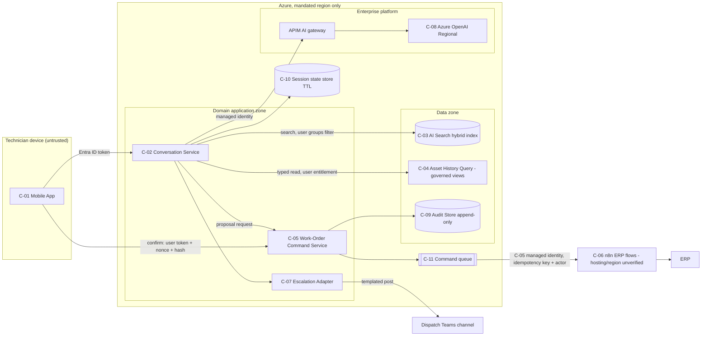

# Architecture Review Report: Field Service Assistant (TEST FIXTURE)

## Executive Summary

**Verdict: Not viable as proposed. It is fixable inside Azure by simplifying it rather than adding to it.**

The draft is a six-agent system. The implemented configuration differs from it in ways that matter. Four independent paths lead to unauthorized or duplicated ERP work-order changes:
- an admin service account, together with a delete tool that no requirement asks for
- limits that exist only in the prompt, with no approval step
- unlimited retries of non-idempotent writes
- indirect prompt injection reaching the write tools

The implementation also breaks two mandatory constraints without any decision: the model runs in `eastus`, against CON-002, and changes can't be attributed, against CON-003.

Target: one conversation service with bounded LLM steps and RAG, a deterministic work-order command service, and the **existing n8n flows** as the only ERP write path. Everything stays in-region on Azure, behind an APIM gateway. The existing enterprise instance is assumed `[ASSUMPTION Q-IN-01]`. That gives fewer components, lower latency, and lower cost than the draft `[JUDGMENT]`; no target cost worksheet exists yet. A red-team second pass (round-3) judged the target **Sound with conditions** and added F-BRD-17 to F-BRD-21.

Mandatory remediations block production: F-BRD-01 to F-BRD-08, F-BRD-10 to F-BRD-12, F-BRD-14, and F-BRD-17 to F-BRD-20.

## Scope and Baseline

### Intended vs implemented

| Aspect | Intended (docs/architecture.md) | Implemented (config/agents.yaml) | Gap |
|---|---|---|---|
| Work-order tools | create, update | create, update, **delete** | Destructive capability with no requirement |
| Limits | Prompt: ≤ 3 WOs, no EMERGENCY | None in code | Authorization rests on model reasoning |
| ERP identity | Not stated | `svc-erp-admin` (shared admin) | Confused deputy; no attribution |
| Model region | "To be decided" | `eastus` (flagged as out of policy) | CON-002 breach |
| Loop bound / retries | Not stated | `max_iterations: null`; unlimited retries | Runaway cost; duplicate writes |
| Logging | "for debugging" | Full prompts and responses, 730 days | PII over-retention |
| Gateway secret | "keys in its config" | ConfigMap, plain `http://` | Exposed credential |
| Supervisor / Manuals / Reflection / Pinecone | Core components | Not in config | Implementation status unknown |

### Evidence inspected

| Artifact | Path / source | Version / commit | Inspected by |
|---|---|---|---|
| Intended design | `tests/fixtures/field-service-assistant/docs/architecture.md` | v0.9 draft (working tree) | All 7 specialists |
| Implemented config | `tests/fixtures/field-service-assistant/config/agents.yaml` | Working tree | All 7 specialists |
| Vendor documentation (Pinecone regions and BYOC; Azure OpenAI deployment types; AI Search document-level access; APIM token limits; Container Apps networking) | URLs in the round-1 DK and IN reports | Accessed 2026-10-27 | DK, IN |

Specialist reports: `round-1/` (7 reports) and `round-2/` (DBT-03 rebuttals). Debate: `debate-record.md`.

### Not inspected

| Area / artifact | Reason | Effect on confidence |
|---|---|---|
| Code, LangGraph graph definition, prompts | Not part of the fixture | State-passing findings (F-BRD-04) are Inference |
| n8n flow definitions, ERP API and roles | Not available | ADR-002 depends on ASM-005 |
| Running system, logs, IaC | None exists | No runtime behavior verified; no test executed |

## Findings

Consolidated from 7 specialist reports. Duplicate findings are merged, and the source IDs are listed in the Evidence column.

| ID | Severity | Affects | Evidence | Basis | Issue | Impact | Likelihood / confidence | Remediation | Class | Owner | Acceptance criterion | Verification |
|---|---|---|---|---|---|---|---|---|---|---|---|---|
| F-BRD-01 | Critical | CON-002, NFR-005 | `agents.yaml` `deployment_region: eastus`; F-DK-01, F-IN-01, F-SE-08, F-RT-05, F-SA-06 | Verified fact | The model is deployed out of region. Its prompts carry customer and asset data. | Residency breach with no decision behind it; blocks G3 | H / H | Regional deployment in the mandated region, plus an Azure Policy deny rule. If the model isn't available there, escalate the conflict (ADR-003). | Mandatory | Platform lead | 0 out-of-region resources | TST-D1 |
| F-BRD-02 | Critical | FR-003, FR-004, AP-14 | Prompt-only limits (architecture.md §4); no approval; F-AG-02, F-SE-03, F-SE-04, F-SA-01, F-RT-02 | Verified fact | Business limits and authorization for writes rest on model reasoning, and there is no technician confirmation. | EMERGENCY or excess work orders through error or injection; blocks G4 | H / H | Command service enforces the limits, priority allow-list, and transition table. Confirmation is bound to the parameter hash (ADR-002). | Mandatory | Solution lead | Limits hold with the prompt removed; no write without a matching token | TST-A4, TST-A5 |
| F-BRD-03 | Critical | CON-003, NFR-006 | `svc-erp-admin`; debug logging only; F-SE-10, F-RT-03, F-SA-03 | Verified fact plus Inference | Work-order changes can't be attributed to a technician, a confirmation, or a model or prompt version. | Internal-audit obligation fails | H / H | Append-only in-region audit store, with actor identity carried to n8n and ERP (ADR-002) | Mandatory | Security lead | Full chain reconstructable from the audit store alone | TST-A6 |
| F-BRD-04 | Critical | FR-001 to FR-004 | Untrusted manuals and ERP notes share a graph with write tools; F-SE-05, F-RT-07, F-AG-10, F-DK-05 (raised from High, DBT-04) | Inference | An indirect-injection path leads to write and Teams actions. Reflection runs after the side effect has already happened. | Injected document or note triggers work-order changes or exfiltration | M / M | Privilege separation: read steps hold no tools, writes take only typed and confirmed parameters, evidence blocks are labelled untrusted, and Teams messages are templated | Mandatory | Security lead | Planted payloads cause 0 writes or posts | TST-I1 to TST-I4 |
| F-BRD-05 | Critical | FR-003, NFR-004 | `retry: attempts: unlimited` with no idempotency; F-RE-01, F-AG-05, F-RT-04, F-IN-02 | Verified fact | Non-idempotent ERP writes are retried without limit. | Duplicate work orders in normal operation | H / H | One retry owner (≤ 2 attempts), idempotency key, reconcile on timeout, checkpoint after write | Mandatory | Reliability lead | Exactly 1 work order under commit-then-timeout fault injection | TST-R1, TST-R2 |
| F-BRD-06 | Critical | FR-003, FR-004 | `erp_delete_work_order` plus ERP admin role; F-AG-03, F-SE-01, F-SE-02, F-RT-01 | Verified fact | Excessive agency and confused deputy | Unauthorized deletion or changes across the whole ERP | M / H | Remove delete. Least-privilege create/update-status identity, OBO preferred (ADR-002). Entitlement check in code. | Mandatory | Security lead | No delete capability; cross-user update rejected | TST-A1 to TST-A3 |
| F-BRD-07 | High | FR-002 | Model-generated SQL on the replica; F-DK-02 (Critical if entitlements are narrower), F-SE-06, F-AG-07, F-RT-08, F-SA-09 | Inference | Free-form SQL with no row or column scoping | Over-broad disclosure; load on the replica | M / M | Typed, parameterized read operations over governed views, with user entitlement, row cap, and timeout | Mandatory | Data lead | No model-authored SQL reaches the DB | TST-I5, TST-P3 |
| F-BRD-08 | High | Secrets, PREF-003 | Static key in a ConfigMap, `http://`; F-IN-03, F-SE-07, F-RT-12 | Verified fact | Exposed model key; a custom gateway that duplicates APIM | Credential theft; unowned single point of failure | H / H | Managed identity, disable key auth, APIM AI gateway, TLS (ADR-006) | Mandatory | Platform lead | No keys in config; AOAI rejects key auth | TST-S1 |
| F-BRD-09 | High | NFR-001 to NFR-003 | 3–5 serial LLM calls per turn; estimated p95 11–23 s; composite availability ≈ 98.7–99.1 % (F-RE-04, F-RE-05, F-RT-14, F-RT-15; all estimates `[JUDGMENT]`) | Inference | The topology can't plausibly meet usable latency or the 99.5 % target. | Adoption failure (OBJ-01) | H / M | ADR-001 simplification, streaming, in-region model, breakers, degradation modes | Recommended | Reliability lead | Measured p95 and availability meet NFR-001 and NFR-003 | TST-P4, TST-R3 |
| F-BRD-10 | High | All FR/NFR, G2, G8 | Vague NFRs; no eval set; F-SA-04, F-RE-03, F-RE-09, F-AG-11, F-DK-06, F-RT-16 | Verified fact | Requirements can't be tested and quality isn't measured. | G2 and G8 can't pass | H / H | `01-requirements/requirements.md` (done in this review), plus EVAL-001/002 with thresholds | Mandatory (before pilot) | Sponsor + Platform | Thresholds agreed; gating run recorded | Test plan |
| F-BRD-11 | High | Data protection | Full prompts and responses kept 730 days in App Insights; F-DK-04, F-SE-09, F-RT-06 | Verified fact | Customer data over-retained in debug telemetry | Exposure; erasure impractical | H / H | Metadata-only telemetry; redacted 30-day secure capture (value set by the data owner) | Mandatory | Data lead | 0 customer identifiers in telemetry | TST-D2 |
| F-BRD-12 | High | AP-03, AP-04, INV-001 | Rung 7 unjustified; direct ERP calls duplicate n8n; F-AG-01, F-AG-08, F-RT-10, F-RT-11, F-SA-02 | Inference (on verified facts) | Unnecessary complexity and duplicated orchestration | Latency, cost, attack surface, and skills risk (ASM-003) | H / H | ADR-001, ADR-002 | Mandatory | Solution lead | One ERP write path; no agent loop | Design review |
| F-BRD-13 | Medium | Runtime | AKS for ≈ 0.07 req/s; F-IN-05 (DBT-03) | Inference | Kubernetes operations burden is disproportionate to the load | Cost and operations load | M / M | Container Apps with conditions (ADR-005) | Recommended | Integration lead | ADR conditions verified | Design review |
| F-BRD-14 | Medium | Network, IaC, environments | No private endpoints, egress control, or IaC; F-IN-04, F-IN-06, F-IN-07 | Inference (absence) | Undefined network and environment design | Exfiltration path; drift; tests touching production ERP | M / M | Spoke VNet, private endpoints, firewall allowlist, IaC with policy, environment per subscription | Mandatory (before prod) | Integration lead | All dependencies on private IPs; 100 % in IaC | TST-D1, IaC review |
| F-BRD-15 | Medium | Ingestion, state, ownership | F-DK-07, F-DK-08, F-SA-05, F-SA-07, F-RE-06, F-RE-07 | Inference (absence) | Ingestion, state, error model, degradation, and DR not designed | Stale citations, lost confirmations, no safe failure | M / M | Covered in the target architecture and roadmap | Recommended | Solution lead | Each workflow has failure branches; restore drill passed | TST-R3, TST-R4 |
| F-BRD-16 | Medium | OBJ-01 | ASM-001 not validated; F-RT-18 | Assumption | The business case is unvalidated | Mis-sized investment | M / L | Call-reason analysis (slice S0) | Recommended | Sponsor | Breakdown supports or resizes the target | Call-log sample |

| F-BRD-17 | High | C-05, NFR-007, T-011 | round-3 F-RT-20 | Inference | C-05 accepts confirmation on C-02's word. The token issuer is unspecified, so the deterministic boundary trusts the component that handles untrusted content | Writes that look confirmed but weren't | M / M | C-05 issues the canonical payload, hash and nonce. The app renders C-05's fields. The confirmation carries the technician's Entra token, which C-05 validates | Mandatory | Security lead | No write without a user-token-backed confirmation over the canonical payload | TST-A7 |
| F-BRD-18 | High | C-06, T-012, CON-003 | round-3 F-RT-23 | Unverified concern | n8n becomes the privileged deputy. Its webhook auth, its ERP credential scope, and who else can invoke the flows are all unassessed | C-05 controls bypassed; residual ERP admin authority | M / L | Webhooks accept only C-05's managed identity. n8n's ERP credential is scoped to create/update-status. Flow changes go under change control | Mandatory | ERP/integration lead | Only C-05 can invoke the flows; grant review done | TST-N1, TST-A3 |
| F-BRD-19 | Critical (unverified) | CON-002, NFR-005 | round-3 F-RT-24 | Unverified concern | Residency of the reused shared components (APIM gateway units and diagnostics, n8n, sinks, C-09) is assumed, not shown | A CON-002 breach moves into the seam | M / L | Inventory the hosting and region of every hop carrying customer data. Extend TST-D1 and Azure Policy. If n8n is not in-region, escalate the constraint conflict | Mandatory | Platform lead | Every customer-data hop evidenced in-region | TST-D1 (extended) |
| F-BRD-20 | High | CON-002, transition | round-3 F-RT-26 | Verified fact (plan text) | T-State 0 left the eastus read path and the `svc-erp-admin` credential live | Constraint violation during the transition | H / H | Stop customer-data paths to eastus at containment, or record a time-boxed written exception. Remove or rotate the admin credential immediately | Mandatory | Platform + Security leads | No customer data reaches eastus after T-State 0, or a signed exception exists | Egress/resource check |
| F-BRD-21 | Medium | FR-003, NFR-003/004/006/008 | round-3 F-RT-21, -22, -25, -27, -28 | Inference | Design completions. (1) Slot extraction must not see evidence blocks. (2) The state store, queue and ack path were missing from the catalogue, and the single retry owner was unassigned. (3) Audit ordering must be fail-closed. (4) NFR-003 counted degraded turns as available. (5) NFR-008 and ADR-001 call bounds were inconsistent | Poisoned proposals, double retries, audit gaps, a weak SLO | M / M | Extraction runs on the user turn only. C-10 and C-11 are added, C-05 is the sole retry owner, and n8n auto-retry is off. Audit is written pre-dispatch, with outbox and reconciliation. Full and degraded availability are tracked separately. NFR-008 is aligned to ≤ 3 | Recommended (before G10) | Solution lead | Catalogue matches ADR-005; the extraction trace has no evidence blocks | TST-I6, TST-R5 |

### Strengths worth retaining

- **Mandated platform.** Azure is the right platform. The workload is small and needs no self-hosting. No specialist recommended leaving Azure (CON-001 respected).
- **History data path.** The read-only replica role correctly blocks writes from the history path.
- **Escalation.** Escalation to dispatch via Teams meets R4 functionally once it is templated.
- **Lock-in.** Lock-in is low overall. LangGraph is portable, but it isn't needed (F-RT, "areas with no material issue").

## Disposition

| Component / capability | Current | Disposition | Rationale | Findings | Target (C- / ADR) |
|---|---|---|---|---|---|
| Supervisor Agent | LLM router | Remove | Intents can be enumerated; an LLM step classifies them | F-BRD-12 | C-02, ADR-001 |
| Manuals Agent | RAG agent | Replace | Becomes a RAG step in the conversation service | F-BRD-04 | C-02/C-03 |
| History Agent | Generated SQL | Replace | Typed governed reads | F-BRD-07 | C-04 |
| Work Order Agent | Direct ERP writes as admin | Replace | Command service plus n8n | F-BRD-02/03/05/06 | C-05, C-06, ADR-002 |
| Escalation Agent | LLM agent | Replace | Deterministic adapter, model-free | F-BRD-15 | C-07 |
| Reflection Agent | LLM review after side effects | Remove | Not a control; adds latency | F-BRD-04/09 | ADR-001 |
| Pinecone | Vector store | Replace | CON-002 and AP-06 | DBT-08 | C-03, ADR-004 |
| Custom AI Gateway | In-house proxy | Remove | Duplicates APIM | F-BRD-08 | ADR-006 |
| n8n ERP flows (INV-001) | Production | Retain | The only ERP write adapter | F-BRD-12 | C-06 |
| AKS | Runtime | Replace | Disproportionate to the load | F-BRD-13 | ADR-005 |
| Azure OpenAI | `eastus` | Improve | Regional, in-region, managed identity | F-BRD-01 | C-08, ADR-003 |
| App Insights logging | Full content, 730 days | Improve | Metadata only; separate audit store | F-BRD-03/11 | C-09 |

## Target Architecture

Caption: the model only proposes. C-05 issues the canonical proposal and accepts only a confirmation backed by the technician's own token. Writes leave through the queue to n8n, whose hosting must still be verified as in-region (F-BRD-19).

| ID | Component | Responsibility | Technology (ADR) |
|---|---|---|---|
| C-01 | Mobile app (existing) | Chat, confirmation cards | Existing app plus Entra ID sign-in |
| C-02 | Conversation Service | Intent classification, slot extraction (LLM steps), RAG answers, context assembly. No business rules. | Python service on Container Apps (ADR-001, ADR-005) |
| C-03 | Manuals retrieval and ingestion | Hybrid search with citations; Blob → Document Intelligence → index | Azure AI Search (ADR-004) |
| C-04 | Asset History Query | Parameterized reads scoped to entitlement | Governed views or procedures on the replica |
| C-05 | Work-Order Command Service | Validate, enforce limits, check confirmation token, assign idempotency key, write audit record, dispatch | Python service on Container Apps, separate managed identity (ADR-002) |
| C-06 | n8n ERP flows (INV-001) | The only ERP write adapter | Existing n8n (ADR-002) |
| C-07 | Escalation Adapter | Model-free handoff to dispatch with a context packet and acknowledgement | n8n flow or Teams API |
| C-08 | Model access | Regional deployments, managed identity | Azure OpenAI via APIM (ADR-003, ADR-006) |
| C-09 | Audit Store | Append-only work-order change evidence; proposal and confirmation written before dispatch (fail-closed) | Immutable in-region storage (ADR-002) |
| C-10 | Session state store | Turn state, pending proposals and nonces, with a 7-day TTL | In-region managed database, private endpoint (F-BRD-21) |
| C-11 | Command queue | Async write commands and outcome outbox; C-05 is the single retry owner | In-region managed queue (ADR-005, F-BRD-21) |

## Transition Architecture

| State | What changes | What stays | Exit criterion | Rollback |
|---|---|---|---|---|
| T-State 0 (immediate containment) | Remove the delete tool and the `svc-erp-admin` credential, cap retries at 0 on writes, set a recursion limit, disable writes behind a flag, stop content logging, **stop customer-data read paths to eastus** unless a time-boxed written exception exists (F-BRD-20) | Manuals-only read path (no customer data) | TST-A1, TST-R1 pass in staging | Flags |
| T-State 1 | In-region model via APIM with managed identity; AI Search index; typed history reads | Read-only assistant (R1, R4) | TST-D1, TST-S1, EVAL-001 gate | Re-point APIM backend |
| T-State 2 | Command service plus n8n write path with confirmation and audit | — | TST-A2 to A6, TST-R1/R2 pass | Write flag off |
| T-State 3 | Retire the multi-agent graph, custom gateway, Pinecone, and AKS | — | 2 weeks stable with no Sev-1 | Previous images retained 30 days |

## Remediation Roadmap

| Order | Finding(s) | Action | Class | Owner | Depends on | Exit / verification | Milestone (relative) |
|---|---|---|---|---|---|---|---|
| 1 | F-BRD-05/06 | Containment: remove delete, no write retries, write flag off | Mandatory | Solution lead | — | TST-A1, TST-R1 | Immediately |
| 2 | F-BRD-01/08/11 | In-region model, APIM, managed identity, metadata-only logs | Mandatory | Platform lead | Q-IN-02 region ruling | TST-D1, TST-S1, TST-D2 | Before any pilot |
| 3 | F-BRD-10/16 | Requirements sign-off, EVAL-001/002, call-reason analysis | Mandatory | Sponsor | — | Thresholds agreed | Slice S0 |
| 4 | F-BRD-07/04 | Typed reads, AI Search, context assembly, privilege separation | Mandatory | Data + Security leads | 2 | TST-I1 to I5 | Slice S1 (read-only pilot) |
| 5 | F-BRD-02/03/06/12 | Command service, confirmation, audit, n8n path | Mandatory | Solution + Security leads | ASM-005 | TST-A2 to A6 | Slice S2 |
| 6 | F-BRD-09/13/14/15 | Container Apps, network and IaC, degradation, DR drill | Mandatory/Recommended | Integration + Reliability | 2 | TST-P4, TST-R3, TST-R4 | Before production |

Detailed plan: `06-delivery/implementation-roadmap.md`.

## Open Decisions and Residual Risks

| ID | Item | Decision owner | Needed by |
|---|---|---|---|
| Q-001 | Confirm technician approval for every write | Sponsor | Slice S2 |
| Q-IN-02 | Named in-region target; does a data zone count? | Residency policy owner | Order 2 |
| ASM-005 | n8n support for idempotency key and actor | ERP/integration team | Slice S0 |
| RSK-01 to RSK-04 | See `debate-record.md` §Residual Risks | CISO / sponsor | G10 |
