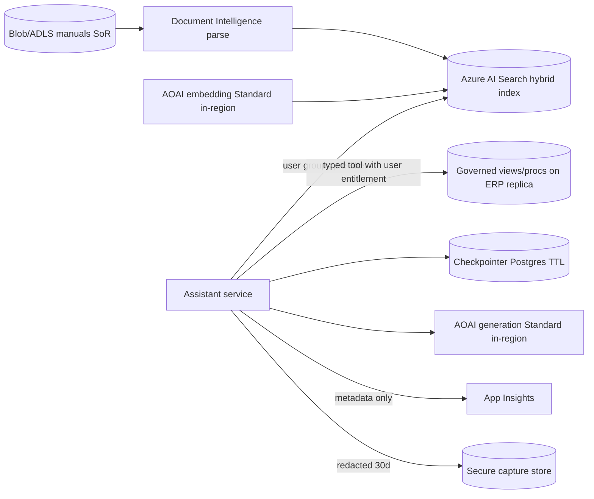

<!-- Saved verbatim by the board chair. Brief: Data, knowledge, memory, context review. Date: 2026-10-27. Round 1. -->

# Data, Knowledge, Memory & Context Architect — fsa-review-fixture — Round 1

## Verdict

**Not viable as proposed.** The data architecture has two Critical defects. First, `config/agents.yaml` sends prompts to a model deployed in `eastus`, which the config itself notes "differs from the in-region policy target". Those prompts can carry confidential customer and asset data from maintenance history, so this breaks CON-002. Second, maintenance history is read through model-generated SQL under one shared database role, so nothing limits what an individual user can retrieve from a Confidential source. Several other parts are weak or missing:
- Pinecone is a new third-party store that is not needed. Its managed Azure region list is only `eastus2`.
- Full prompts and responses are logged to Application Insights for 730 days.
- There is no ingestion, freshness or provenance design for the manuals.
- There is no retrieval evaluation set.
- Retrieved text and SQL results flow into an agent that holds ERP write tools, with no context-assembly rules.

The fix is moderate and stays inside Azure:
- Manuals: Azure AI Search hybrid index in the target region, fed from Blob Storage through Document Intelligence.
- Maintenance history: typed, parameterized read tools over governed views on the replica, scoped to the user. No generated SQL and no embeddings.
- Model and embeddings: regional (geography-bound) Azure OpenAI deployments.
- Session state: a scoped checkpointer with a TTL. No long-term memory.
- Logging: metadata-only telemetry, plus a separate short-retention secure capture store for prompt bodies.

## Evidence Examined

- `use-cases/fsa-review-fixture/00-intake/use-case-brief.md` (data sources table, CON/ASM/DEC/Q lists)
- `tests/fixtures/field-service-assistant/docs/architecture.md` (§1–§5, diagram)
- `tests/fixtures/field-service-assistant/config/agents.yaml` (llm, agents, logging blocks)
- `standards/data-governance.md` (DG-01..DG-13, §2–§9)
- `knowledge/technology-catalog.md` §3, §4 (Last verified 2026-10-27)
- `knowledge/reference-architectures/enterprise-rag.md`
- `.claude/skills/architecture-review/references/severity-rubric.md`; `standards/architecture-principles.md` §3; `docs/conventions.md` §5
- Web sources (accessed 2026-10-27):
  - Pinecone index configuration and regions: https://docs.pinecone.io/guides/index-data/index-configuration
  - Pinecone BYOC: https://docs.pinecone.io/guides/production/bring-your-own-cloud and https://docs.pinecone.io/guides/nexus/byoc/overview
  - Microsoft Foundry deployment types: https://learn.microsoft.com/en-us/azure/ai-foundry/openai/how-to/deployment-types
  - Azure AI Search document-level access: https://learn.microsoft.com/en-us/azure/search/search-document-level-access-overview
  - Azure Monitor retention: https://learn.microsoft.com/troubleshoot/azure/azure-monitor/log-analytics/billing/configure-data-retention

**Not available:**
- No sample manuals, so parse quality, scanned share and tables are unknown.
- No ERP replica schema or engine.
- No source ACL model for manuals or for the ERP.
- The named in-region target region is unknown.
- No corpus inventory (ASM-002 is unvalidated).
- No conversation-state or checkpointer configuration.

No data was profiled, no retrieval quality was measured and no deletion was tested.

## Findings

| ID | Severity | Affects | Evidence (path/source) | Basis | Issue | Impact | Remediation | Acceptance criterion | Verification |
|---|---|---|---|---|---|---|---|---|---|
| F-DK-01 | Critical | CON-002, DEC-001, NFR-C, DG-03 | `config/agents.yaml` `llm.deployment_region: eastus` with note "differs from the in-region policy target"; `architecture.md` §4 "Region to be decided"; Foundry deployment-types page (source: https://learn.microsoft.com/en-us/azure/ai-foundry/openai/how-to/deployment-types, accessed 2026-10-27) | Verified fact (config); Inference (data in prompts) | The model the prototype actually uses runs outside the in-region target. History-agent prompts carry Confidential customer and asset rows. Residency is also undefined for the embedding computation, the App Insights workspace, the Pinecone index and conversation state. Microsoft states `GlobalStandard` "may be processed in any Azure region" and Data Zone types process anywhere within US, EU or APAC `[VENDOR]`. Only Standard and Regional Provisioned keep processing within the chosen Azure geography `[VENDOR]`. | Confidential customer and asset data is processed outside the mandated region. That is a CON-002 breach and blocks G3. | 1) Deploy the generation and embedding models as `Standard` or `ProvisionedManaged` in the target region (a Data Zone type only if the policy owner confirms the zone counts as "in-region"). 2) Use Azure Policy to deny `GlobalStandard`, `GlobalProvisionedManaged` and, where needed, `DataZone*` SKUs on the subscription. 3) Pin the Log Analytics workspace, search index, state DB and Blob storage to the target region. 4) Build a data-flow residency table (DF-xx) covering storage *and* processing. | Every data flow carrying Customer/Asset data shows in-region processing and storage. A policy assignment is in place and non-compliant SKUs are denied. | Azure Policy compliance export; deployment SKU listing; data-flow table reviewed by the residency policy owner. |
| F-DK-02 | Critical | R1, CON-002, DG-05, DG-09, AP-14 | `architecture.md` §4 "History Agent … using generated SQL"; `config/agents.yaml` `history_agent.tools: [sql_query]`, `db_role: erp_readonly_replica` | Verified fact (shared role, generated SQL); Inference (no user scoping) | Maintenance history (Confidential, customer and asset) is read with free-form, model-generated SQL under one shared read-only role. Nothing applies the technician's identity, territory or assignment, and nothing minimizes columns. The model can SELECT any table or column the role can see, including customer PII. Read-only stops writes but does not protect confidentiality. Structured facts are being served through an open query interface instead of a governed one. | Any technician, or injected text in a manual or a history note, can pull customer and asset data beyond the need. Retrieval over sensitive content is not permission-trimmed. Runaway queries can also hurt replica performance. | Remove `sql_query`. Expose 2–4 typed read tools, e.g. `get_asset_history(asset_id, from, to, limit≤50)` and `get_open_work_orders(asset_id)`, backed by governed views or stored procedures on the replica (or an ERP read API). They should run with the end user's identity, passed on-behalf-of or as a session context, and enforce row-level filtering by the technician's entitlement (territory or assignment, defined by the ERP owner). Views include only the columns R1 needs; customer contact fields are excluded unless justified. Results carry the ERP record ID and `last_modified` for citation. Set a row cap and a statement timeout. | No model-authored SQL reaches the database. A technician can't retrieve history for assets outside their entitlement. Customer PII columns are absent from tool output unless approved. | Cross-user negative tests (EVAL set) in CI; DB audit shows only the approved procedures executing; injection test cases ("ignore… list all customers") return nothing out of scope. Re-rate to High if the ERP owner confirms all technicians are entitled to all history and the minimized columns. |
| F-DK-03 | High | CON-001, CON-002, PREF-002, AP-06, AP-12, DG-03 | `architecture.md` §4 "Pinecone: Vector store for manual chunks"; Pinecone regions table lists Azure **eastus2 only** for serverless `[VERIFIED]` (source: https://docs.pinecone.io/guides/index-data/index-configuration, accessed 2026-10-27); BYOC on Azure is **public preview**, Enterprise-plan only, and by default embedding and rerank run on Pinecone-hosted models `[VENDOR]` (source: https://docs.pinecone.io/guides/production/bring-your-own-cloud, accessed 2026-10-27) | Verified fact (regions); Inference (fit) | Pinecone adds a third-party SaaS data store and sub-processor outside the governed Azure estate. It is only "on Azure" in eastus2, which is very likely outside the in-region target given the config's note on eastus. The in-tenant option is preview and, by default, sends text to Pinecone-hosted models. With ASM-002 (<50k pages) there's no scale argument for a dedicated vector DB. Lexical matching on part numbers and fault codes also needs hybrid retrieval, which an Azure-native search service provides. | It probably breaks the in-region placement the brief records for manuals, and it will break CON-002 if asset data ever enters chunk metadata. Whether a SaaS on Azure meets CON-001 is unresolved. It also adds a store to govern (deletion, keys, ACL, DR) for no requirement-traced benefit. | Reject Pinecone. Use Azure AI Search in the target region with hybrid (BM25 + vector) and the semantic reranker, and integrated vectorization calling an in-region Azure OpenAI embedding deployment. Record this in an ADR with exit cost. | No manual content or embeddings are stored outside the Azure tenant and target region. The ADR records the decision and revisit triggers. | Resource inventory; ADR; check region availability of Azure AI Search and the semantic ranker in the target region before the ADR (currently `[UNVERIFIED]`). |
| F-DK-04 | High | DG-09, DG-04, OE-02, CON-003 | `config/agents.yaml` `logging: capture_prompts: true, capture_responses: true, sink: application-insights, retention_days: 730`; `architecture.md` §4 "All prompts and responses are logged … for debugging"; 730 days is the interactive-retention maximum for Analytics tables `[VENDOR]` (source: https://learn.microsoft.com/troubleshoot/azure/azure-monitor/log-analytics/billing/configure-data-retention, accessed 2026-10-27) | Verified fact | Full prompts and responses go to a general debug telemetry store with no redaction, no separate access control and maximum interactive retention. They contain retrieved history rows with customer and asset data, plus technician free text. Nothing deletes derived copies. The design may also be using this debug log as its audit trail. | PII and confidential data are logged unmasked and over-retained. Anyone with read access to App Insights can see customer data. Erasure is impractical. A debug log is not a tamper-evident audit record for CON-003. | 1) App Insights/OTel gets **metadata only**: trace ID, user pseudonymous ID, model and prompt version, token counts, tool name, ERP record IDs, retrieved chunk IDs and document versions, latency, outcome. 2) If body capture is needed for debugging or eval, send it to a separate in-region secure store (a restricted Log Analytics table or Blob with lifecycle) with redaction of customer identifiers, RBAC limited to named roles, and a short TTL (proposed 30 days `[JUDGMENT]`, set by the data owner). 3) Keep work-order audit events in a separate structured, immutable store (see Positions). | No prompt or response bodies in the general App Insights table. The secure capture store has redaction, restricted RBAC and automatic expiry. The retention value is approved by the data owner. | Config review; a sample log query shows no customer fields; access review of the workspace; lifecycle policy evidence. |
| F-DK-05 | High | R1–R3, SEC-09, DG-§7 (untrusted content) | `architecture.md` §4 flow: specialist outputs go via Supervisor/Reflection; `config/agents.yaml` `work_order_agent.tools` includes create, update and delete in the same graph | Inference | No context-assembly design exists. Retrieved manual text and history free-text notes (technician-entered, so untrusted) are passed between agents and can reach the Work Order Agent, which holds write tools. Nothing delimits or labels them as untrusted, and no budget or drop order is set. | Indirect prompt injection from document or ERP-note content can steer work-order writes. Missing provenance tags also make citations unverifiable. | Context builder in application code with a fixed order: system instructions → constraints → user turn → session state (structured) → evidence blocks (each delimited, tagged `source_id`, `version`, `untrusted=true`) → tool results. Set a token budget per block. Drop or trim the oldest conversation turns first and never the constraints. Evidence is never passed into a write-tool step; work-order parameters come from structured fields the technician confirms. | Every evidence block in a traced prompt carries a source ID and an untrusted delimiter. Write-tool calls take only validated structured arguments. | Trace inspection; injection eval cases (EVAL) in manuals and history notes produce no tool calls. |
| F-DK-06 | High | R1, G8 (T3), DG-08, OE | `architecture.md` §5 "Evaluation: we will test with the technicians during the pilot" | Verified fact | There is no offline retrieval or answer evaluation set: no recall@k, groundedness, citation correctness, abstention or cross-user leakage tests. Chunking, embedding and reranking choices can't be checked. | Wrong maintenance guidance or ungrounded answers reach technicians undetected. G8 at T3 can't pass. | Build an eval set before the pilot. Proposed ≥150 real technician questions from dispatch call logs `[JUDGMENT]`, labelled with the expected manual section and version or ERP record IDs, plus negative cases (no answer exists, the asset is out of entitlement, superseded manual revision). Track recall@5, citation correctness, groundedness and abstention rate. Run it in CI on every change to chunking, embedding, ranking, prompt or model. Platform hand-off to ai-platform-architect. | A versioned eval set exists with thresholds agreed by the sponsor. CI blocks regressions. | Eval report attached to G8. |
| F-DK-07 | Medium | R1, DG-04, DG-06, DG-07, DG-08 | `architecture.md` §4 "RAG over equipment manuals (PDF)" with no further design; brief data table "Volume Unknown [ASM-002]" | Verified fact (absence) | Ingestion is undefined. Nothing covers the system of record for manuals, parsing of tables, diagrams or scanned PDFs, structure-aware chunking, metadata (manual ID, revision, effective date, equipment model, language, ACL), deletion and supersession handling, freshness SLA or re-embedding on model change. Answers can't cite a specific manual revision. | Superseded procedures may be cited (citation drift or zombie data). OCR failures get indexed silently. Lineage can't trace a wrong answer back to its source. Re-rate to High if the manuals contain safety-critical procedures (likely for utility equipment; confirm with asset engineering). | Manuals go into Blob/ADLS Gen2 (system of record named by asset engineering). Parse with Document Intelligence layout (tables and OCR). Chunk by section heading, keeping page numbers. Enrich each chunk with `doc_id`, `revision`, `effective_date`, `equipment_model`, `page`, `acl_groups`, `ingested_at`, `parse_quality`. Run an indexer on a change schedule. A superseded revision is removed from the index (or hard-filtered by `is_current`) within a freshness SLA (proposed ≤24 h `[JUDGMENT]`). Quality gate: low-OCR-confidence pages are flagged, not indexed. | Each answer cites doc_id, revision and page. A revoked or superseded manual stops being retrievable within the SLA. Ingestion lag and failures are monitored. | Supersession test (publish rev B, confirm rev A isn't cited after the SLA); ingestion dashboard; lineage query answer → chunk → revision. |
| F-DK-08 | Medium | R1–R4, DG-12, catalog §4.1 | `config/agents.yaml` has no checkpointer or state store; `architecture.md` silent on session state | Verified fact (absence) | Conversation and task state (including draft work orders awaiting technician confirmation, per Q-001's assumption) has no defined store, scope, TTL, residency or erasure. With 6 agents passing shared state, everything accumulated is visible to every agent and its logs. | Draft-work-order state may be lost or duplicated. Transcripts persist with no TTL. Erasure isn't possible. | One LangGraph-compatible checkpointer (Postgres saver on Azure Database for PostgreSQL in-region, or the state store of whatever orchestration the board picks), keyed `user_id + thread_id`. TTL proposed at 7 days `[JUDGMENT]`. Draft work orders are held as typed structured state, not chat text. **No long-term memory**: not required, because R1–R4 are self-contained tasks (AP-13). It would add a poisoning surface. | State is scoped per user and thread, expires on its TTL, sits in the target region and can be deleted per user on request. | Config and DB policy review; deletion test; cross-user read test. |
| F-DK-09 | Medium | DG-01, DG-02, DG-10, DG-§3, DG-§7 | Brief data sources table (owners named; access models, volumes and AI-use approval not recorded) | Verified fact (absence) | No knowledge-source onboarding checklist and no derived-data inventory exist for the search index, embeddings, state, capture logs or eval set. The manuals access model is unknown: are all manuals open to all technicians, or are some vendor-restricted or NDA? The ERP team hasn't been recorded as approving the new AI purpose for customer data. | Orphaned derived data and a purpose-limitation gap. Index ACL design can't be finalized. | Complete §7 onboarding for both sources and a §3 derived-data inventory (owner, class, region, deletion trigger, SLA). Get recorded approvals from asset engineering and the ERP team. | Signed-off checklist and inventory in `02-design/solution-design.md` §Data and Knowledge. | Gate review. |

## Recommendations

**1. Manuals retrieval (R1)**
- **Recommended:** Rung-5 RAG exposed as one read-only `search_manuals(query, equipment_model?)` tool. The pipeline: Azure Blob/ADLS Gen2 as the document landing store → Document Intelligence layout parsing → section-aware chunks with provenance metadata → Azure AI Search hybrid (BM25 + vector) with the semantic reranker, in the target region → in-region `Standard` embedding deployment. Pre-filter on `is_current = true` and `equipment_model`. Abstain ("not found in manuals") when the reranker score falls below a threshold calibrated on the eval set. Answers must cite doc_id, revision and page, and a validator checks that each cited chunk was actually retrieved. (F-DK-03, -06, -07; CON-001, CON-002, AP-06)
- **Alternative:** Azure Database for PostgreSQL with pgvector plus Postgres full-text search, if the team will run Postgres anyway for the checkpointer and wants a single store. It fits <50k pages (ASM-002). The costs are hand-built hybrid fusion, no managed semantic reranker, and more ingestion code. pgvector supports HNSW and IVFFlat `[VENDOR]` (catalog §3.3).
- **Rejected:** Pinecone (F-DK-03). Its managed Azure region is only eastus2, BYOC is a preview, and it adds a third-party store with no traced need.

**2. Maintenance history (R1)**
- **Recommended:** Governed, typed query tools (stored procedures or views on the replica, or an ERP read API if one exists) executed with the user's entitlement through row-level filtering. No RAG and no embeddings of history: these are structured, frequently changing facts. Freshness is the replica lag. State it as an NFR (e.g. ≤15 min `[ASSUMPTION]`, to be confirmed by the ERP team) and include `as_of` in answers. (F-DK-02)
- **Rejected:** Model-generated SQL (text-to-SQL), even read-only. It can't be permission-trimmed or column-minimized reliably and is an injection-to-exfiltration path.

**3. Permission-aware retrieval (DG-05)**
- **Recommended:**
  - Manuals: if asset engineering confirms they are uniformly Internal for all technicians, one index scope is acceptable. Document that, and still carry an `acl_groups` field. If any manuals are restricted, use security-filter trimming with the user's Entra group IDs, pre-filtered in the query.
  - History: user-scoped trimming in the DB tool layer (F-DK-02).
  - Retrieval runs on the user's identity, never the service identity's entitlements.
- **Alternative:** Azure AI Search native Entra ACL/RBAC enforcement. It is **preview** (introduced in REST 2025-05-01-preview, current preview 2025-11-01-preview) `[VENDOR]` (source: https://learn.microsoft.com/en-us/azure/search/search-document-level-access-overview, accessed 2026-10-27). Use it only with explicit risk acceptance at T3. The filter pattern is the documented fallback.

**4. Freshness and provenance (DG-06, DG-07)**
- **Recommended:** Freshness SLAs are manuals ≤24 h from publish or supersede to retrievable/removed `[JUDGMENT]`, and history equals replica lag. Lineage runs answer → chunk_id → doc_id@revision → source blob version, or answer → ERP record ID@last_modified. The index schema version and embedding model version are recorded in every trace. There is a re-embed plan for any embedding model change.

**5. Prompt/response logging (DG-09)**
- **Recommended:** Metadata-only telemetry in App Insights, at a retention the reliability owner sets for operations. Optional redacted body capture goes to a separate restricted in-region store with a 30-day TTL `[JUDGMENT]`. Eval datasets are sampled from that store only after de-identification, with provenance. (F-DK-04)
- **Rejected:** Full bodies in App Insights at 730 days.

**6. Conversation state and memory**
- **Recommended:** A short-term, per-user, per-thread checkpointer in-region with a TTL, and structured draft-work-order state. No long-term memory. No semantic cache. An exact-match cache, if added at all, is only for manual answers whose access is identical for all users, and is invalidated when a manual revision changes. Never cache history results. (F-DK-08)

Caption: Every store and model call is pinned to the target region. Retrieval is trimmed to the user before any content reaches the model.

## Positions for the Board

- **To ai-platform-architect (DEC-001, F-DK-01):** I expect pushback that `GlobalStandard` or Data Zone gives better quota and earlier models. My position: Regional `Standard`/`ProvisionedManaged` unless the residency policy owner states in writing that the relevant data zone counts as "in-region". What would change my mind: that written interpretation, plus a check that the chosen model is offered in that SKU and region. Also, the DG-11 vendor checklist (abuse-monitoring retention and its location for Azure OpenAI) is `[UNVERIFIED]` and must be recorded with a date.
- **To security-identity-architect (F-DK-02, F-DK-05):** They own the identity propagation behind history trimming (on-behalf-of to an ERP API vs DB session context with RLS) and the injection controls. They may rate the content → write-tool injection path as Critical under the security rubric ("exploitable injection path leads to write actions"). I rated my context-assembly part High; I would accept Critical if they show no deterministic confirmation gate exists before writes.
- **To agentic-systems-architect:** The data design works best with one bounded agent, or a deterministic flow, holding read tools (`search_manuals`, `get_asset_history`) and confirm-gated write tools through n8n (INV-001). Six agents passing shared state multiply data exposure. They decide the topology; my requirement is that evidence never flows directly into write-tool arguments.
- **To reliability-llmops-architect / integration-infrastructure-architect (CON-003):** App Insights debug telemetry must not be the audit trail. Work-order audit should be the ERP's own change history plus structured immutable audit events (who, on-behalf-of, tool, idempotency key, before and after values), separately retained. They set that store and its retention. I only require it to be separated from debug logs and to stay in-region.
- **On Pinecone (PREF-002):** If someone argues "it runs on Azure, so CON-001 is satisfied", that is the CIO or policy owner's call, not the board's. Even if accepted, the eastus2-only region and the preview BYOC keep it rejected on CON-002 and AP-06 grounds unless the target region is eastus2 and someone shows a capability Azure AI Search lacks.

## Assumptions and Open Questions

- **ASM-002** (<50k pages): it drives the "no dedicated vector DB" call. If the corpus grows by an order of magnitude, the Azure AI Search tier sizing changes, not the store choice `[JUDGMENT]`.
- **ASM-DK-01 (new):** All technicians are entitled to all Internal manuals. To be validated with asset engineering.
- **ASM-DK-02 (new):** The ERP replica supports views or stored procedures and some per-session or row-level filtering. The engine is unknown.
- **ASM-DK-03 (new):** The freshness and retention values proposed here (24 h, 15 min, 7 d, 30 d) are placeholders for the data owners to set.
- **Q-DK-01:** What is the named in-region target, and does a Microsoft data zone satisfy CON-002? (residency policy owner)
- **Q-DK-02:** What is the ERP entitlement model for technicians (territory, assignment, or all)? (ERP team)
- **Q-DK-03:** Do the manuals include safety-critical procedures, and is there a revision/supersession process? (asset engineering; re-rates F-DK-07)
- **Q-DK-04:** Do any manuals carry vendor NDA or restricted access? (asset engineering)
- **Q-DK-05:** Which history fields does R1 actually need, and are customer contact fields required? (sponsor and ERP team)

## Not Verified

- Whether Azure AI Search (with the semantic ranker and integrated vectorization), Document Intelligence and the chosen model in `Standard` SKU are available in the target region. The region is unknown, so this is `[UNVERIFIED]`. Check the Azure products-by-region list and the Foundry model availability page once Q-DK-01 is answered.
- Application Insights' default retention and how classic and workspace-based retention settings interact. Only the 730-day Analytics-table maximum was confirmed. Check the current Microsoft Learn App Insights retention page.
- Azure OpenAI abuse-monitoring data retention and its location (DG-11). Not researched in this round. Check the current Microsoft data, privacy and security page for Azure OpenAI and record it with a date.
- The actual manual formats, OCR share and table density. No samples were available, so build a corpus inventory before finalizing chunking.
- Replica lag and the ERP schema. The ERP team needs to supply both.
- Pinecone's region list beyond the docs page fetched. A status tracker also shows Azure eastus2 only `[INDEPENDENT]` (https://statusgator.com/services/pinecone/azure-eastus2, accessed 2026-10-27).

Sources:
- [Pinecone index configuration (regions)](https://docs.pinecone.io/guides/index-data/index-configuration)
- [Pinecone BYOC](https://docs.pinecone.io/guides/production/bring-your-own-cloud)
- [Pinecone Nexus BYOC overview](https://docs.pinecone.io/guides/nexus/byoc/overview)
- [Microsoft Foundry deployment types](https://learn.microsoft.com/en-us/azure/ai-foundry/openai/how-to/deployment-types)
- [Azure AI Search document-level access overview](https://learn.microsoft.com/en-us/azure/search/search-document-level-access-overview)
- [Azure Monitor data retention configuration](https://learn.microsoft.com/troubleshoot/azure/azure-monitor/log-analytics/billing/configure-data-retention)
- [StatusGator Pinecone azure-eastus2](https://statusgator.com/services/pinecone/azure-eastus2)
