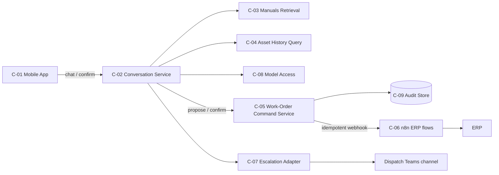

<!-- Saved verbatim by the board chair. Brief: End-to-end solution review, FR coverage, target shape. Date: 2026-10-27. Round 1. -->

# Solution Architect — fsa-review-fixture — Round 1

## Verdict

**Not viable as proposed.** Of the four requirements, only R1 (answer asset questions) has a plausible path through the design, and even that has no acceptance criterion. The write requirements, R2 (create work orders) and R3 (update status), sit on a path where several things are true at once:
- the model is the only control on the write;
- the Work Order Agent calls the ERP REST API directly, so a second orchestrator sits beside the n8n flows that already create and update work orders in production (INV-001);
- there is no idempotency or confirmation contract, while the implemented config retries without limit;
- the implementation has a delete tool that no requirement asks for.

R4 (escalate to a dispatcher) is happy-path only. The requirements have no IDs and no acceptance criteria. The catalogue has no owners or interfaces, and two components (Reflection Agent, Custom AI Gateway) trace to no requirement. The config differs from the design on points that matter: model region, delete tool, admin credential, unbounded loop. Targeted fixes are not enough for the write path; it needs a redesign. The read path (R1) and escalation (R4) can be kept with remediation. The target shape I recommend is below: one deterministic conversation service with one bounded LLM step, a deterministic work-order command service, and the existing n8n flows as the only way to write to the ERP.

## Evidence Examined

- `/Users/pranthy/Projects/DEWA/ai-architect/enterprise-ai-architecture-framework/use-cases/fsa-review-fixture/00-intake/use-case-brief.md`: all sections.
- `/Users/pranthy/Projects/DEWA/ai-architect/enterprise-ai-architecture-framework/tests/fixtures/field-service-assistant/docs/architecture.md`: §1–§5 and the Mermaid diagram. This is the intended design.
- `/Users/pranthy/Projects/DEWA/ai-architect/enterprise-ai-architecture-framework/tests/fixtures/field-service-assistant/config/agents.yaml`: what is implemented. I inspected it statically and did not run or test anything.
- Standards: `standards/architecture-principles.md`, `standards/architecture-quality-gates.md`, `docs/conventions.md`, `.claude/skills/architecture-review/references/severity-rubric.md`.
- **Not available / gaps:**
  - no `01-requirements/requirements.md`: the requirements have no FR IDs, no MoSCoW priority and no acceptance criteria;
  - no component catalogue with `C-` IDs, owners or interfaces;
  - no sequence or deployment views;
  - no ERP, n8n or Teams interface contracts;
  - no code beyond the config;
  - no test plan.

I did not read the review checklist, the reference architectures or `knowledge/deployment-patterns.md`. I did no web research, and no finding relies on a time-sensitive product claim.

**Trace matrix (as drafted)**

| Req | Realizing component(s) | Verifying test | Status |
|---|---|---|---|
| R1 history | Supervisor → History Agent (generated SQL) → ERP read replica → Reflection | None | Partly (no acceptance criterion; schema coupling) |
| R1 manuals | Supervisor → Manuals Agent → Pinecone → Reflection | None | Partly (no ingestion component) |
| R2 create | Supervisor → Work Order Agent → ERP REST | None | Unsafe (see F-SA-01/02) |
| R3 update | Work Order Agent → ERP REST | None | Unsafe; status transition rules undefined |
| R4 escalate | Escalation Agent → Teams | None | Happy path only (F-SA-05) |
| NFR-A fast | — | None | Not measurable; the 5-hop serial chain plus a 120 s timeout works against it |
| NFR-B 99.5 % | "AKS is highly available" | None | Not designed |
| NFR-C / CON-002 | — | None | Conflicts with config `eastus` |
| NFR-D / CON-003 | Prompt logging (not an audit trail) | None | Not met (F-SA-03) |
| (none) | Reflection Agent, Custom AI Gateway, `erp_delete_work_order` | — | Orphans (AP-01) |

## Findings

| ID | Severity | Affects | Evidence (path/source) | Basis | Issue | Impact | Remediation | Acceptance criterion | Verification |
|---|---|---|---|---|---|---|---|---|---|
| F-SA-01 | Critical | R2, R3, CON-003, AP-14, AP-04 | architecture.md §4: "system prompt instructs it to never create more than 3 work orders… never set priority to EMERGENCY"; agents.yaml `work_order_agent.retry.attempts: unlimited`, `on: [timeout, 5xx]`; no confirmation step (brief Q-001) | Verified fact (config and doc inspected) | The write path has no deterministic command boundary. The business limits exist only in the prompt. No component validates a proposed work order, no idempotency key is in the contract, and no technician confirmation is required. The model therefore decides on its own whether and what to write, and the writes are retried blindly on timeout. | Duplicate work orders (a timeout after the ERP has committed, followed by a retry, gives a second order) and EMERGENCY priorities or excess orders whenever the model ignores the prompt. Both are expected in normal operation (likelihood H). Wrong or duplicate work orders lead to misdispatch. | Add a deterministic **Work-Order Command Service**, the only caller of the ERP write flows. It:  • takes a schema-validated `WorkOrderProposal`;  • enforces in code the per-conversation limit, the allowed priorities and the allowed status transitions;  • requires a technician confirmation token;  • requires an idempotency key (conversation ID + proposal hash);  • retries only when the operation is idempotent, with a fixed limit and backoff, and reconciles by idempotency key after a timeout.  Remove the write tools from the model's toolset. The model can only *propose*. | No ERP write can happen without (a) a passed deterministic policy check and (b) a technician confirmation. A replay of the same idempotency key creates exactly one work order. | Contract tests on the command service. A fault-injection test (ERP times out after commit, then retry) shows one work order. A red-team prompt asking for EMERGENCY priority or 4 work orders is rejected by code, not by the model. |
| F-SA-02 | High | R2, R3, INV-001, AP-04, AP-06, AP-07 | architecture.md §3 (n8n create/update flows in production), §4 ("calling the ERP REST API directly") | Verified fact | Duplicate orchestration of the ERP integration. The Work Order Agent rebuilds create/update against the ERP REST API while the production n8n flows already do it. Two paths now own the same responsibility, and the n8n flows' existing validation, mapping and error handling are bypassed. | Two sources of truth for ERP write logic. Changes on the ERP side must be made in both. The extra build effort falls on a team with no agent-framework experience (ASM-003). Each path behaves differently on failure. | Make the existing n8n create/update flows the only adapter for ERP writes. The Command Service (F-SA-01) calls them through a versioned webhook contract `{idempotency_key, actor_id, payload}` → `{status, wo_id, error_code}`. Confirm with the ERP/integration team that n8n can carry the idempotency key and the actor identity, or add that to the flows. | No component other than n8n holds ERP write credentials or calls ERP write endpoints. | Static inspection of config and code for ERP endpoints and credentials. An integration test through n8n in a non-production ERP. |
| F-SA-03 | High | NFR-D / CON-003 | agents.yaml `erp_credentials: svc-erp-admin`, `logging.capture_prompts: true`; architecture.md §4 "logged to Application Insights for debugging" | Inference | Auditability is not designed into the end-to-end flow. The only record is debug logging of prompts and responses. Changes in the ERP would be attributed to a shared admin account, not to the technician. Nothing links the conversation, the proposal, the confirmation and the ERP change. | CON-003 is not demonstrably met. Audit cannot answer "who changed WO-x, on what basis, when." This becomes Critical if internal audit requires the human actor to be attributed (open: Q below). | The Command Service writes an append-only audit record for every proposal, confirmation, policy decision and ERP result, correlated by conversation ID, idempotency key and technician ID. The technician identity goes to n8n and the ERP. The identity mechanism belongs to SE. A debug log is not an audit trail; keep the two separate. | For any ERP work-order change, the audit store returns actor, timestamp, before/after state, proposal, confirmation and correlation ID. | Audit query test on sample changes, reviewed with internal audit. |
| F-SA-04 | High | All FRs/NFRs, G2 | architecture.md §2 (R1–R4 free text; NFR-A "fast", NFR-B "mentioned 99.5%"); §5 "test with the technicians during the pilot" | Verified fact | The requirements cannot be tested. There are no FR IDs, no priorities and no acceptance criteria. NFR-A has no metric, and NFR-B has no measurement window or point. No requirement maps to a test. R3 has no defined status model and R4 has no defined handoff outcome. | G2 cannot pass. Nobody can say when R1–R4 are "done," and NFR-A cannot be used as a budget for design decisions such as the Reflection hop. | Produce `01-requirements/requirements.md` with FR-001…FR-004. Each gets MoSCoW and an acceptance criterion, for example:  • FR-002: work order created ≤ 2 min median after confirmation, no duplicates;  • FR-003: only the allowed status transitions;  • FR-004: the dispatcher receives a context packet and acknowledges within X.  Give NFRs measurable targets (e.g. p95 first token / full answer, availability during working hours). The latency budget belongs to RE. | Every Must FR and NFR has an acceptance criterion and a mapped test ID. | G2 checklist review. |
| F-SA-05 | High | R4, R2, R3 | architecture.md §4 flow (single happy path); agents.yaml `teams_post_message`, `request_timeout_seconds: 120` | Inference | The design covers the happy path only. No path is defined for: ERP or n8n unavailable, a failed Teams post, an escalation nobody acknowledges, invalid input, an ambiguous asset ID, model unavailable, or a 120 s timeout. There is no user-facing error model. Escalation is fire-and-forget: no context handoff, no acknowledgement, no fallback. | R4 is only partly met. It is the safety valve for every other failure, and it can fail silently. Technicians fall back to phoning dispatch without knowing whether an action happened, which undermines OBJ-01. | Define an error model per interface (`error_code`, user-facing message, retryable flag).  • R4: escalation through an adapter (an n8n flow or the Teams API) that sends a context packet, tracks acknowledgement and falls back to showing the dispatch phone number.  • R2/R3: a "pending, reconciling" state shown to the technician.  • Model outage: a non-AI degraded mode (escalate or call).  Resilience patterns belong to RE. | Each workflow has a sequence diagram with at least the timeout, dependency-down and invalid-input branches. Every branch ends in a known state that the user can see. | Walkthrough plus fault-injection tests per branch. |
| F-SA-06 | Critical (dedupe with DK/IN/SE) | NFR-C / CON-002, G7 | agents.yaml `deployment_region: eastus # differs from the in-region policy target`, `erp_delete_work_order`, `svc-erp-admin`, `max_iterations: null`, `retention_days: 730`; architecture.md §5 "Model region not chosen yet" | Verified fact (config) | The implementation differs from the intended design and from the constraints. The model region is set out-of-region while the design says it is undecided (DEC-001). There is a delete tool for which no requirement or design exists (Q-002). An admin service account is used where the design says nothing. There is no recursion limit. The prototype is not an implementation of the reviewed design. | Customer and asset data flowing to an out-of-region endpoint conflicts with CON-002 without a decision, which is Critical. A review of the doc alone would miss the real risk surface. | Treat the config as the baseline. Close DEC-001 with an in-region deployment that satisfies CON-002 (DK/IN own this). Remove `erp_delete_work_order`. Set an iteration and step limit (RE owns this). Add a design ↔ config conformance check to CI. | Config and design agree. The model endpoint region satisfies CON-002. No tool exists without a requirement trace. | A conformance check script in CI. Static review of the deployed config. |
| F-SA-07 | High | R1, R2, R3, NFR-A, NFR-B, AP-13 | architecture.md §4 "running on AKS", §5 "AKS is highly available"; agents.yaml `runtime` | Inference | The runtime and deployment view is undefined. There is:  • no deployable-unit breakdown (is each of the 6 agents its own service or one process?);  • no statement of what is stateful (conversation state, LangGraph checkpoint store, pending proposals);  • no model for long-running or asynchronous work (ERP writes held in a synchronous 120 s request);  • no per-environment injection of configuration, prompts or model versions. | The design cannot be built or scaled as written. Losing state on restart can orphan confirmations or duplicate them. The synchronous chain works against NFR-A. | Specify the runtime: a stateless conversation service (horizontally scalable); conversation and proposal state in a managed in-region store; ERP writes handed off asynchronously (command service → n8n), with status returned by polling or push; prompts, tool schemas and model deployment names loaded as versioned config per environment. Hosting choice (AKS or a lighter Azure container option) belongs to IN. | The deployment view lists each deployable unit, its scaling unit, its state and its config source. | Design review. A restart test in the middle of a confirmation shows no loss or duplicate. |
| F-SA-08 | Medium | AP-01, AP-03, NFR-A | architecture.md §4 Reflection Agent ("reviews every answer"), Custom AI Gateway; Supervisor routing | Inference | Some components trace to no requirement, and responsibilities overlap.  • Reflection Agent: no requirement, no acceptance criterion; it adds a serial LLM hop to every answer.  • Custom AI Gateway: no requirement.  • The Supervisor and the specialists both make routing decisions.  • Manual ingestion and indexing has no component at all, although R1 depends on it. | Extra latency and cost with no measured benefit. Unclear ownership of the conversation flow. R1 cannot work without an ingestion pipeline. | Remove Reflection or replace it with deterministic output checks (schema, citation present, grounding check) that run only where a requirement calls for them. Agentic necessity belongs to AG. Gateway reuse belongs to PL/EA. Add a manual-ingestion component (DK). | Every catalogue component has at least one requirement trace and an owner. | G7 orphan check. |
| F-SA-09 | Medium | R1 (history), AP-07, AP-11 | architecture.md §4 History Agent "using generated SQL"; agents.yaml `sql_query`, `erp_readonly_replica` | Inference | Integrating through a shared database. Model-generated SQL couples the assistant to the ERP schema, which another domain owns. There is no defined query contract and no row limit. | Answers break whenever the ERP schema changes. Results are non-deterministic. Queries can be expensive or unbounded. Injection and data scope belong to SE/DK and may raise this rating. | Replace with parameterized, read-only query operations (e.g. `get_asset_history(asset_id, from, to, limit)`) over a view or API owned by the ERP team. The model chooses parameters only. | No free-form SQL is generated by the model. Every history query goes through a versioned operation with limits. | Contract tests. Inspection that the `sql_query` tool is gone. |
| F-SA-10 | Medium | AP-08, AP-11 | architecture.md §4, §5; agents.yaml (no versions anywhere) | Verified fact | No contract has a version: prompts, tool definitions, the ERP/n8n payloads, model deployment. Model outputs are not schema-validated before use. | Changes cannot be traced or rolled back. A change of model or provider breaks parsing silently. | Version every prompt, tool schema and integration contract. Validate every model output against a JSON schema at the seam, and reject or re-ask on failure. Keep model access behind one client interface (PL owns the gateway choice). | Every artifact has a version and a lifecycle state. Invalid model output never reaches the command service. | Inspection plus negative tests with malformed outputs. |
| F-SA-11 | Medium | Feasibility, ASM-003 | architecture.md §3 (no agent-framework experience), §4 (6 agents + AKS + custom gateway + Pinecone) | Judgment | Big-bang delivery. Six agents, a new gateway, a new vector store and the AKS platform all have to work before any requirement works. The team has never built with an agent framework. No thin vertical slice is defined. | High delivery risk. The riskiest assumptions (ASM-001 call reasons, retrieval quality, whether n8n accepts an idempotency key and actor) are tested last. | Deliver in slices:  • **S0** (parallel spike): n8n contract with idempotency key and actor, plus a call-reason analysis (ASM-001).  • **S1**: R1 manuals and history read-only, plus R4 escalation.  • **S2**: R2 create with confirmation, through the command service and n8n.  • **S3**: R3 status update. | Each slice is releasable on its own and has acceptance tests. | Roadmap review. |
| F-SA-12 | Low | G7 | architecture.md diagram vs §4 table | Verified fact | Diagram and catalogue disagree. App, API and the ERP DB read replica are in the diagram but not in the catalogue. Teams is in the catalogue text but not in the diagram. Escalation output goes through Reflection, which makes no sense for a Teams post. | Small risk of confusion. | Align names and use `C-` IDs, per conventions §7. | Every diagram node is in the catalogue, and the reverse. | `tools/validate-*.sh` plus a manual check. |

## Recommendations

**D1: Solution shape (R1–R4).**
- **Recommended:** a hybrid. Rung 2 for writes and escalation: the existing n8n flows plus a deterministic command service. Rung 5 for R1: RAG over manuals plus parameterized history queries. One rung-4 LLM step for intent and slot extraction, behind a single deterministic conversation service.
- **Alternative:** at most one bounded rung-6 agent, and only with read tools plus a `propose_work_order` tool. Use it only if evaluation shows that fixed intent routing can't handle the technicians' real queries. AG decides whether that is justified.
- **Rejected:** the 6-agent LangGraph supervisor/reflection topology (PREF-001). No requirement needs separate contexts, permissions or owners per agent, and it adds hops against NFR-A.
- Covers FR R1–R4, NFR-A, AP-03, ASM-003.

**D2: ERP write integration.**
- **Recommended:** n8n (INV-001) is the only ERP write adapter, called by the command service through a versioned webhook contract with idempotency key and actor ID. Covers R2, R3, CON-003, AP-04, AP-06.
- **Rejected:** direct ERP REST calls from an agent.

**D3: Business rules and confirmation.**
- **Recommended:** limits, allowed priorities and status transitions are enforced in code in the command service. Technician confirmation is mandatory before any write (ASM per Q-001). The model only proposes. Covers R2, R3, AP-14.

**D4: History access.**
- **Recommended:** parameterized read operations over a view or API owned by the ERP team. Model-generated SQL is rejected. Covers R1, AP-07.

**D5: Runtime.**
- **Recommended:** a stateless conversation service plus a managed in-region state store. ERP writes are handed off asynchronously with a pending state. Prompts, schemas and model deployment are versioned config per environment. Covers NFR-A, NFR-B, AP-08, AP-13. The concrete Azure services belong to IN.

**Target solution shape**

| ID | Component | Single purpose | Interface | Traces to |
|---|---|---|---|---|
| C-01 | Technician mobile app (existing) | Chat UI and confirmation cards | HTTPS to C-02 | R1–R4 |
| C-02 | Conversation Service | The single orchestrator of the conversation flow: intent, slots, response composition. No business rules | Sync REST to C-01; calls C-03/C-04/C-05/C-07/C-08 | R1–R4, NFR-A |
| C-03 | Manuals Retrieval (+ ingestion) | Grounded passages with citations | `search(query, asset_type, k)` v1 | R1 (store selection by DK) |
| C-04 | Asset History Query | Parameterized read-only history | `get_asset_history(asset_id, range, limit)` v1 | R1, CON-002 |
| C-05 | Work-Order Command Service | Validate, require confirmation, idempotency, audit, dispatch | `propose` / `confirm(idempotency_key, actor)` v1, async status | R2, R3, CON-003 |
| C-06 | n8n ERP flows (INV-001) | The only adapter for ERP create/update | Versioned webhook `{idempotency_key, actor_id, payload}` | R2, R3 |
| C-07 | Escalation Adapter | Dispatcher handoff with context, acknowledgement and fallback | `escalate(context)` → `{ticket, ack_status}` | R4 |
| C-08 | Model access (in-region Azure OpenAI through the platform-approved gateway) | LLM calls behind one client interface, outputs schema-validated | Internal client v1 | R1–R3, CON-001, CON-002 (gateway choice by PL) |
| C-09 | Audit Store (append-only) | Work-order change evidence | Write by C-05 only | CON-003 |

Caption: one orchestrator (C-02) and one deterministic write path (C-05 → C-06), where the model only proposes and code decides and writes.

**R2 sequence (summary).** The technician asks. C-02 calls C-08 to extract a `WorkOrderProposal` and validates it against the schema. C-05 runs the policy check (limits, priority, asset exists) and returns the proposal or a rejection reason. C-01 shows a confirmation card. The technician confirms. C-05 writes the audit record and sends the webhook to C-06 with the idempotency key. ERP returns a work-order ID, the audit record is updated, and the technician is notified.
- On n8n timeout: the state becomes "pending". C-05 reconciles by idempotency key (no blind retry) and notifies the technician of the outcome.
- On policy rejection: the reason is shown and escalation is offered.

## Positions for the Board

- **AG (agentic necessity).** I expect AG to agree that rung 7 is unjustified. The open question is whether a single bounded agent (rung 6) adds anything over intent routing. Evidence that would move me: an evaluation on real call transcripts where fixed routing misses more than a set share of requests.
- **SE.** F-SA-01 also amounts to authorization resting on model reasoning (G4 blocker). The admin service account and the delete tool are over-broad permissions. SE should own the identity and least-privilege design; I only require that the actor identity passes end to end (F-SA-03).
- **DK / IN.** The `eastus` region against CON-002 (F-SA-06) is theirs to rate and resolve through DEC-001. So is the choice of Pinecone vs an in-region Azure store (PREF-002) and the 730-day prompt retention. The board should merge F-SA-06 with their finding, not count it twice.
- **PL / EA.** I need only one model-access seam (C-08). Whether that is the custom gateway (PREF-003) or existing API management is their decision. I'll defer unless they choose something that has no versioned client interface.
- **RE.** Unbounded retries and `max_iterations: null` overlap with F-SA-01/F-SA-07. RE owns the latency budget for NFR-A and the degraded mode for NFR-B.
- **ERP/integration team (decision owner for the ERP access model).** D2 depends on n8n accepting an idempotency key and an actor ID. If n8n cannot be changed, the fallback is for C-05 to enforce idempotency itself, through a lookup by key before each write. That is weaker, and I would want it recorded in an ADR.

## Assumptions and Open Questions

- I assumed technician confirmation is acceptable before every write (Q-001, open with the sponsor). If the sponsor requires writes without confirmation, the tier and the design of C-05 change.
- I treated deletion as not required (Q-002).
- Open: does CON-003 require the human actor to be attributed in the ERP itself, or only in an audit trail kept beside it? This decides whether F-SA-03 is High or Critical. Directed to internal audit through the sponsor.
- Open: do the n8n flows support idempotency keys, caller identity and synchronous vs asynchronous responses? Directed to the ERP/integration team.
- ASM-001 (40 % call reduction from R1+R2) is not validated. A call-reason analysis is part of slice S0.
- ASM-003 (Python team, no agent-framework experience) supports the simpler shape.

## Not Verified

- How the n8n flows actually behave (validation, error codes, idempotency, audit). There is no artifact. Verify by inspecting the flows in a non-production instance.
- Whether the "in-region" target excludes `eastus`. I relied on the config comment. Verify against the data-residency policy (DK/IN).
- What the ERP REST and read-replica schemas look like, and whether ERP-owned views exist for C-04. Verify with the ERP team.
- Whether `agents.yaml` reflects what is deployed. I inspected it only; there is no running system. Verify against the deployed environment.
- All latency claims about the serial multi-hop chain are Judgment. No measurements exist; verify with a prototype load test (RE).

