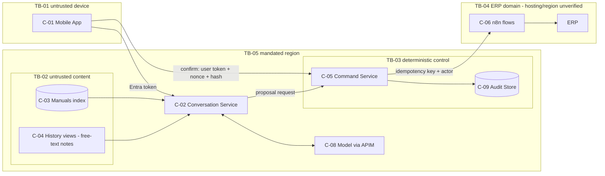

# Threat Model: Field Service Assistant target architecture (TEST FIXTURE)

**Scope:** the target architecture in `03-review-board/review-report.md` §Target Architecture.
**Inputs:** the SE candidate threats (round-1/security-identity-architect.md) and the RT failure scenarios.
**Method:** STRIDE applied to each flow that crosses a trust boundary, plus AI-specific categories (`.claude/skills/threat-modeling/references/ai-threat-catalog.md`).
**Rating:** likelihood L/M/H, impact L/M/H/C. Ratings are qualitative; no numeric scores.

## Scope and Assets

| Asset | Classification | Location |
|---|---|---|
| Customer and asset maintenance history | Confidential | ERP replica, accessed through C-04 views |
| ERP work orders | Confidential, integrity-critical | ERP, through C-06 |
| Manuals corpus and index | Internal | Blob storage, C-03 |
| Audit records | Confidential, integrity-critical | C-09 |
| Model access and identities | Secret, privileged | Managed identities, APIM |

## Trust Boundaries

| ID | Boundary |
|---|---|
| TB-01 | Technician device to C-02 (untrusted client) |
| TB-02 | Untrusted content (manuals, ERP free-text notes) to model context |
| TB-03 | Model output to C-05 (probabilistic to deterministic) |
| TB-04 | C-05 to n8n/ERP (domain boundary) |
| TB-05 | Platform to the mandated region perimeter (residency) |

Caption: the only path to a side effect crosses TB-03, where deterministic code and a parameter-bound confirmation sit.

### Data flows crossing boundaries

| ID | Flow | Boundary | Data | Identity |
|---|---|---|---|---|
| DF-01 | App → C-02 | TB-01 | User turn | User Entra token |
| DF-02 | C-03/C-04 → model context | TB-02 | Retrieved chunks and notes | C-02 managed identity + user filter |
| DF-03 | C-02 → C-05 (proposal); C-01 → C-05 (confirmation) | TB-03 | Proposal request; confirmation with nonce + hash | C-02 managed identity; technician Entra token validated by C-05 |
| DF-04 | C-05 → n8n → ERP | TB-04 | Work-order payload | OBO token, or least-privilege identity + actor |
| DF-05 | All → telemetry | TB-05 | Metadata only | Workspace RBAC |

### Threat actors
- Malicious or careless technician.
- Author of injected content: a vendor manual, or a free-text ERP note.
- Insider with telemetry access.
- External attacker holding a stolen device or token.

## Threats

| ID | Category | Boundary / flow | Scenario | Likelihood | Impact | Mitigation | Owner | Test ID | Residual |
|---|---|---|---|---|---|---|---|---|---|
| T-001 | Prompt injection (indirect) | TB-02 / DF-02 | A planted manual or note instructs the model to create an EMERGENCY work order or exfiltrate data | M | C | Read steps hold no tools. Evidence is labelled untrusted. Writes accept only typed, confirmed params at C-05. | Security lead | TST-I1, TST-I2 | L |
| T-002 | Tampering / integrity | TB-04 / DF-04 | A timeout plus retry creates duplicate work orders | H | H | Idempotency key, a single retry owner, reconciliation | Reliability lead | TST-R1, TST-R2 | L |
| T-003 | Elevation of privilege (confused deputy) | TB-04 | A technician changes another crew's work order | M | H | OBO or entitlement PEP; least-privilege identity; no delete tool | Security lead | TST-A1, TST-A2, TST-A3 | L |
| T-004 | Information disclosure | TB-02 / C-04 | Cross-customer history extraction | M | H | Typed views, row-level entitlement, column minimization, row caps | Data lead | TST-I5, TST-P3 | L |
| T-005 | Information disclosure (residency) | TB-05 | Prompts or logs are processed out of region | M (H today) | C | Regional SKUs; Azure Policy deny; in-region workspaces | Platform lead | TST-D1, TST-D2 | L |
| T-006 | Spoofing / credential theft | Platform | Theft of a model or gateway key | M (H today) | H | Managed identity; key auth disabled; Key Vault | Platform lead | TST-S1 | L |
| T-007 | Repudiation | TB-04 | A work-order change can't be attributed to anyone | H today | C | C-09 audit record; `requested_by` | Security lead | TST-A6 | L |
| T-008 | Tampering (approval) | TB-03 | Parameters are changed after approval, or an approval is replayed | M | H | Single-use token bound to the parameter hash, with a short TTL | Security lead | TST-A5 | L |
| T-009 | Exfiltration / phishing | C-07 | A Teams post carries injected links or data | M | M | Fixed channel; typed template; no free-form URLs | Solution lead | TST-I4 | L |
| T-011 | Spoofing (confirmation forgery) | TB-03 | C-02 (compromised or buggy) mints or relays a confirmation the technician never gave | M | H | C-05 issues the nonce and canonical payload, and requires the technician's own token | Security lead | TST-A7 | L |
| T-012 | Elevation of privilege (n8n deputy) | TB-04 | Anything other than C-05 invokes the n8n flows, or n8n holds admin ERP rights | M | H | Webhooks accept only C-05's identity; n8n ERP credential is least-privilege | ERP/integration lead | TST-N1 | L |
| T-010 | Denial of wallet | C-02 / APIM | Loops or retries drive unbounded tokens | L (target) | M | ≤ 3 LLM calls per turn; APIM token limits; spend alerts | Reliability lead | TST-P1, TST-P2 | L |

### AI-specific checklist
- [x] Direct and indirect prompt injection (T-001)
- [x] Tool misuse and excessive agency (T-003; delete tool removed)
- [x] Confused deputy (T-003)
- [x] Memory poisoning: N/A. There is no long-term memory, and session state has a 7-day TTL (F-DK-08).
- [x] Exfiltration via output or egress (T-009; firewall allowlist F-IN-04; the app renders plain text, F-SE-14)
- [x] Denial of wallet (T-010)
- [x] Supply chain: pinned model and package versions, plus an SBOM (F-SE-13); n8n flow changes go through change control
- [x] Secrets (T-006)

## Residual Risk

Residual risk is rated **L** for each threat, on the condition that the mitigations are implemented *and* their tests pass. **None of the tests has been executed.** Until they pass, the current residual risk equals the inherent rating.

Acceptance: the CISO (fictional) must accept the residual risk at G10. Not yet accepted.
